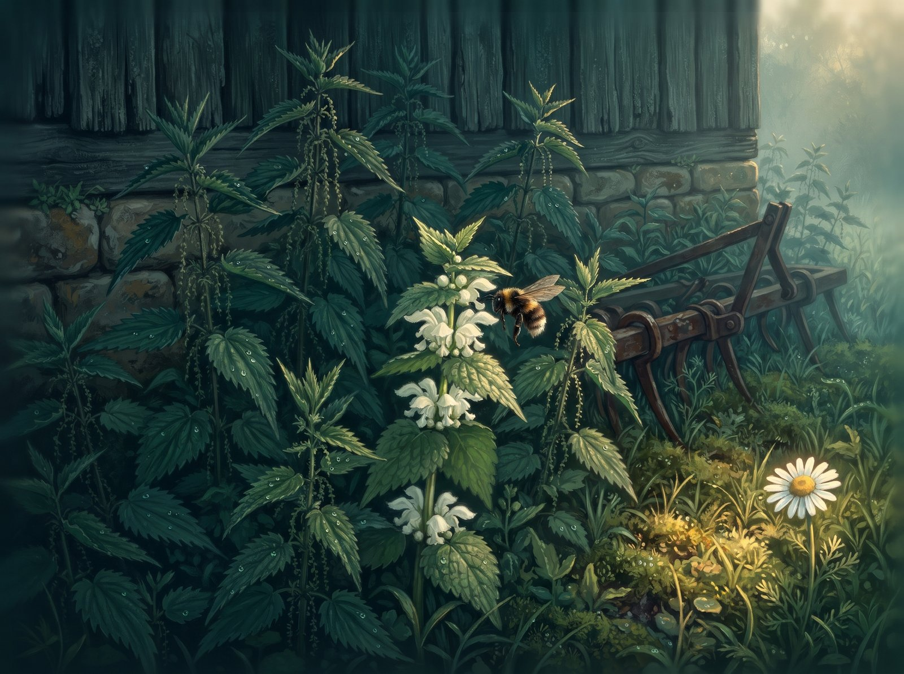
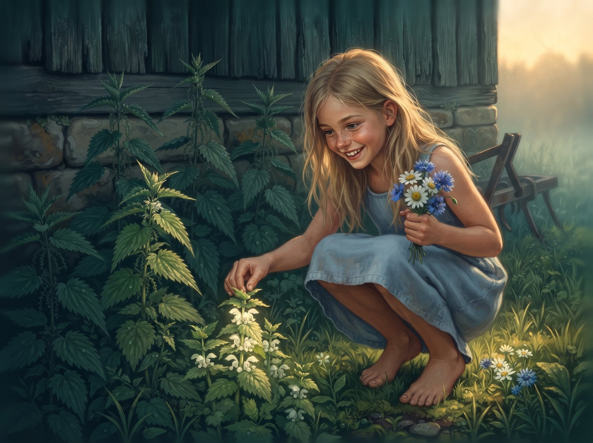
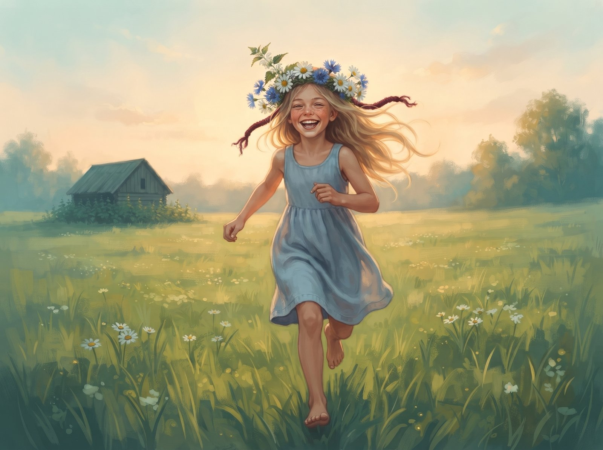

Nettles grow by the old barn. Prickle, prickle! Everybody's scared of them.

In between them grows a little white archangel. Her leaves look just like a nettle's. But the archangel doesn't sting.

"I'm prickly too!" hisses the archangel. "Ssssss!"

And she hides her little white flowers under her leaves.

Along comes a bumblebee. Bzzzz.

"Archangel, where are your flowers? I want some honey."

"I haven't got any flowers. I'm prickly! Ssssss!"

The bumblebee flies away. Bzzzz.

The little daisy calls out:

"Archangel, let's talk!"

"No. I'm prickly! Ssssss!"

The archangel feels sad. Everybody runs away from her.

Then a girl comes running. Barefoot. She's not scared of nettles. She touches the archangel.

"You don't sting!" laughs the girl. She opens up the leaves. "Oh, what pretty white flowers! You're an archangel!"

The girl tastes one little flower.

"It's sweet!"

She picks the archangel and weaves it into her flower crown. Right in between the white daisies.

The girl puts on her crown and runs across the meadow. Hop, hop, hop!

The archangel has never been up so high. The breeze is so fresh! It tickles her little white flowers.

