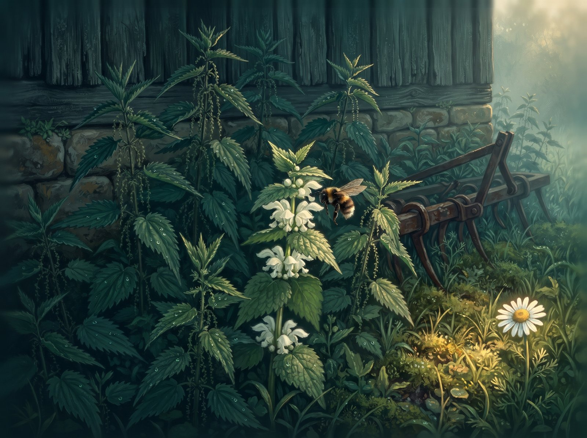
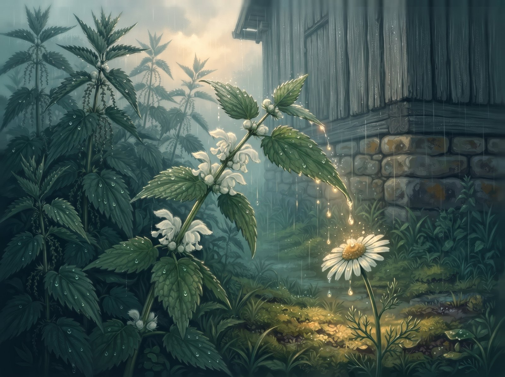
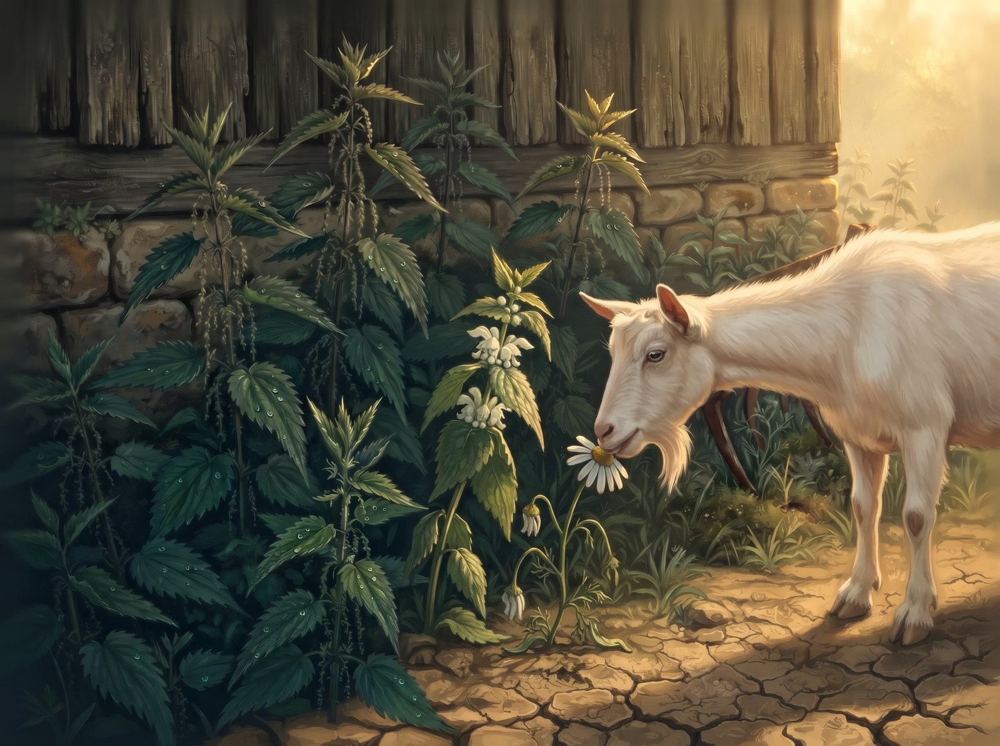
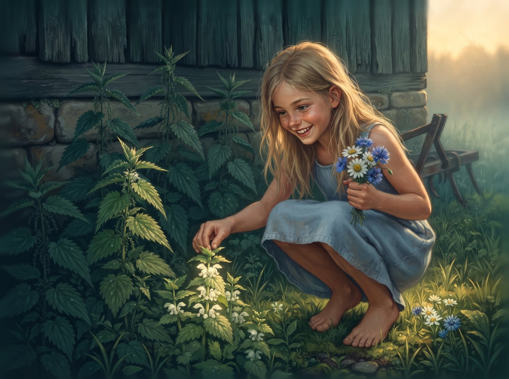
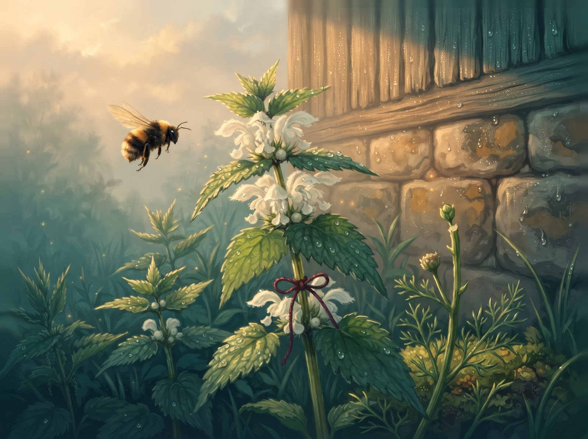

By the old barn grew nettles. Tall, dark and prickly. Every one of them stung, and everybody was scared of them: the goat, the cat and the kids.

In among them a white archangel sprouted up. Her leaves looked exactly like nettle leaves, only she didn't sting. Not one bit. Under her leaves she had white flowers with a drop of honey inside, and every morning a bumblebee flew over to taste them. Bzzzz.

At the edge of the nettle patch grew a little daisy. She and the archangel chatted all day long, and when it rained, the archangel would bend down a leaf so the drops rolled right onto the daisy's head.

"More!" the daisy would laugh.

But the nettles made fun of the daisy:

"Softie! And you, archangel, you're one of us, aren't you?"

The archangel liked being "one of them". It was safe among the nettles. So she started pretending: she bristled her leaves, hissed like the nettles did, and hid her white flowers under her leaves so nobody would find out how soft she really was.

One hot day the goat came over from the farm.

"Cover me up," the daisy begged. "The goat will think I'm a nettle."

The archangel wanted to. But the nettles hissed:

"Let's see whose side you're on."

And the archangel pulled her leaves away.

The goat bit off the daisy's flower. All that was left at the edge was a bare little stalk.

Next morning the bumblebee asked:

"Where's the daisy's flower?"

"None of my business," said the archangel, in a nettle voice. And it scared her how mean that sounded.

The bumblebee couldn't find any flowers, so it flew away. Now the archangel only had the nettles. She'd hidden her flowers for so long, she'd forgotten she even had them.

One evening a barefoot girl from the farm came walking through the nettles. She wasn't scared of them. She stopped by the archangel and took hold of one of her leaves.

"You don't sting!" the girl said, surprised. She opened up the leaves and found the white flowers. "So you're an archangel! Why are you hiding?"

The girl pulled out one little flower and sucked it.

"Sweet!" she laughed.

The archangel trembled all over. Sweet. She'd forgotten that herself.

The girl tied a red thread around her stem.

"So I can find you tomorrow," she said, and ran off.

The next morning the archangel didn't hide her flowers anymore. She held them up high, and soon there was a familiar bzzzz. And over at the edge, on the daisy's bare stalk, a tiny new bud was trembling.

"I'm sorry," the archangel said quietly, in her own voice.

The daisy didn't answer straight away. But she did answer.
