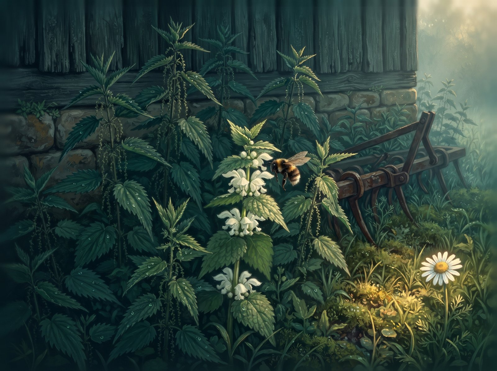
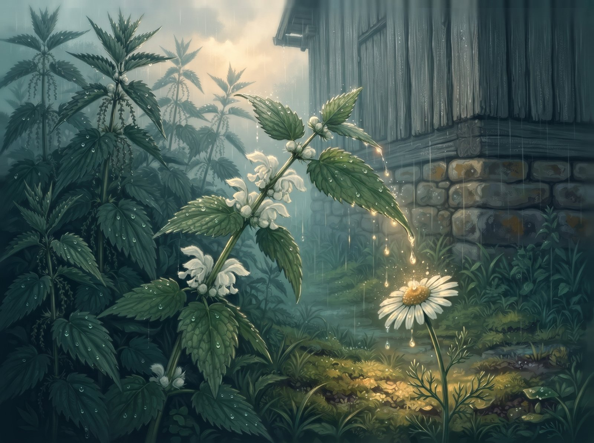
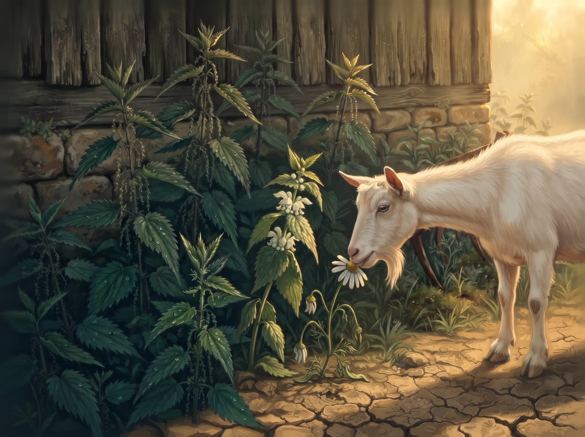
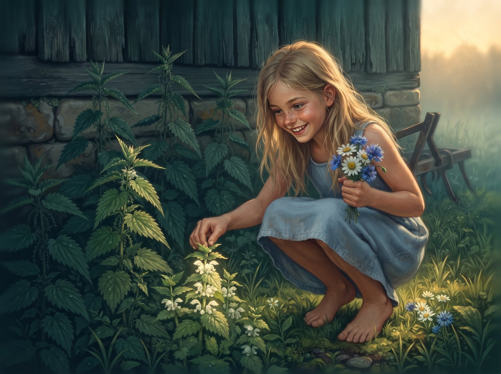
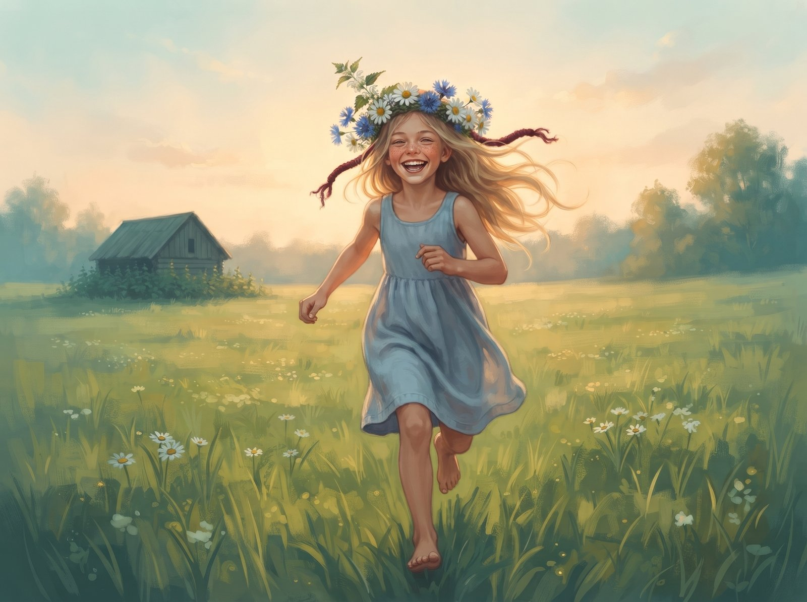

The white archangel sprouted where nobody plants anything: by the old barn, between the stone foundation and a rusty old harrow. All around her towered the nettles. Tall, dark, with hairy stems, they smelled of damp earth and something sharp, and when the wind swayed them, it sounded like they were hissing.

"Look, a new one," one of them whispered. "Leaves just like ours."

And her leaves really were like nettle leaves: toothed, wrinkly, dark green. Only the archangel didn't sting. Not at all. But the nettles didn't know that, and she didn't tell them.

Every morning, before the dew had dried, a bumblebee came to visit her. Fat and brown-striped, it buzzed so hard the whole stem shook, and it stuck its head into the white flowers bunched up where her leaves met the stem. That's where a drop of honey was hiding. The archangel looked forward to those mornings more than to rain. Even though she looked forward to rain too.

At the edge of the nettle patch, out in the sun, grew a little daisy. When it got really hot she'd snuggle into the archangel's shade, and the two of them talked about everything: ants, clouds, the girl from the farm who walked barefoot straight through the nettles and didn't even wince. "Nettles make your legs strong!" her granny used to shout from the yard.

When the rain finally came, the archangel would bend down her widest leaf, and the drops rolled off it right onto the daisy's head.

"More!" the daisy giggled, and the archangel bent down another one.

The nettles didn't like the daisy.

"Softie," they sneered. "Anyone could snap her off. Why are you even talking to her? You're one of us."

The archangel looked up at the tall nettle stems above her, and she liked that word. Us. Among the nettles, nobody would touch her: not the goat, not the kids, not granny's scythe.

So the archangel started trying to be one of them. She bristled her leaves whenever the cat came sneaking past. She laughed along when the nettles talked about "softies". And she started bending her flowers down, under her leaves, so nobody could see how white and soft they were. The bumblebee still came, but it buzzed around longer and longer each time, looking for somewhere to land.

In July the drought came. The ground cracked, and dust settled on everything like grey flour. The nettles didn't complain, their roots went deep. But the daisy hung her head and leaned against the archangel's leaves, like always.

That afternoon the goat came ambling over from the farm. Bearded and nosy, she nibbled anything that didn't sting, and always gave the nettle patch a wide berth.

"Cover me," the daisy whispered. "She'll think I'm a nettle too."

The archangel was just about to spread her leaves when the nettles rustled above her:

"Well. Let's see whose side you're on."

The archangel pulled her leaves away.

The goat didn't even stop. One bite, and all that was left at the edge was a chewed-off stalk and a slightly bitter smell of sap. The nettles rustled their approval. The archangel stood up straighter than ever. Only that night, for a long time, she didn't know what to do with her leaves.

The next morning the bumblebee came.

"Where's the daisy?" it asked.

"None of my business," said the archangel. "Goats eat whatever they find."

The words came out dry and prickly, exactly the kind of thing the nettles would say. The archangel was surprised herself at how easily they slipped out. The bumblebee hovered, looked around for flowers, didn't find any, and flew away. It never came back.

August was quiet. The archangel stood in the nettle patch, all scrunched up and bent over, and slowly forgot she had flowers at all. If anyone had asked, she'd have said she never had any. Sometimes, early in the morning, a buzz drifted over from far away, and something inside her stirred. But the bumblebee always flew past, off to the clover field.

One evening the girl came wading through the nettles. Barefoot, holding a big handful of daisies and cornflowers, she was picking flowers for a crown. The nettles bristled and hissed and whipped at her shins, but she just snorted and kept going. She stopped by the archangel, reached out and took a leaf between her fingers. Her palm was warm and a bit rough, and it smelled of wild strawberries and dust.

Nothing. No sting.

The girl raised her eyebrows, parted the leaves, and saw what the archangel had been hiding for so long: white, slightly crumpled flowers.

"So you're an archangel," she laughed. "And you've been pretending to be a nettle."

She pulled out one little flower and sucked it. The archangel was stunned. She'd forgotten herself that she was sweet.

The girl carefully snapped off the stem, wove the archangel into her crown between the daisies, and wound the ends with a red thread. The nettles were still hissing something after her, but nobody was listening anymore. The daisy petals brushed against the archangel's leaves, and it seemed to her that one of them smelled exactly like the one from the edge.

The girl put on her crown and ran home across the meadow. The archangel lifted her white flowers to the evening sun. She'd never been up so high before.

