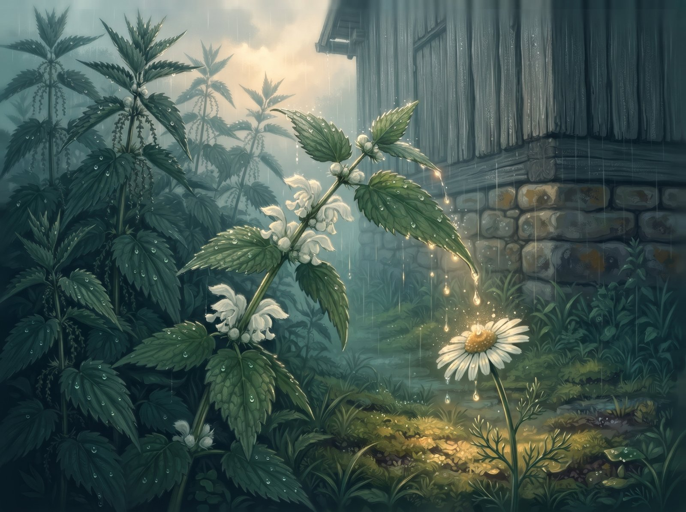
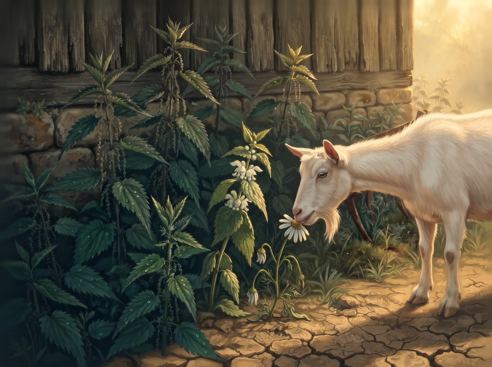
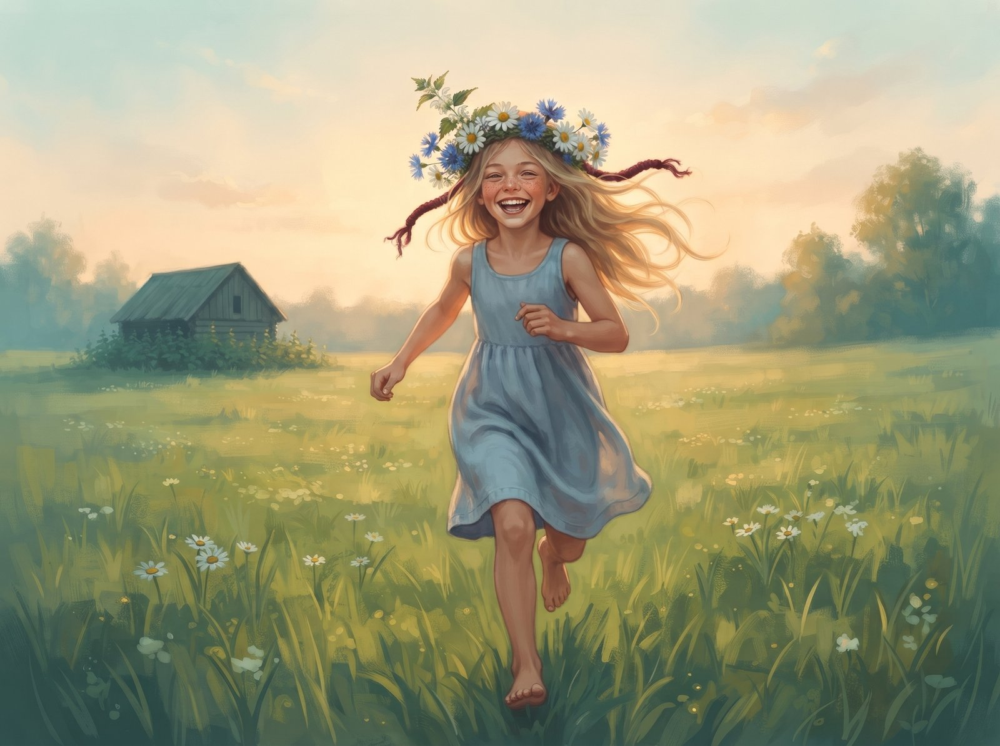

The white archangel sprouted where nobody plants anything: by the old barn, between the stone foundation and a rusty harrow. All around her towered the nettles, tall and dark, with hairy stems. They smelled of damp earth and something sharp, and the whole yard knew it was best not to touch them.

"Look, a new one," one of them whispered. "Leaves just like ours."

The archangel looked at her leaves. Toothed, wrinkly, dark green. Just like theirs, really. That she didn't sting, not one bit, the nettles didn't know. She didn't tell them. Not because she wanted to lie. It's just that nobody asked, and keeping quiet was easier.

Her mornings belonged to the bumblebee. It came before the dew had dried, fat and brown-striped, buzzing so hard the whole stem shook, and pushed its head into the white flowers tucked where her leaves met the stem, where a drop of honey was hiding. For the archangel this was something close to happiness: being the thing someone comes looking for.

Her days belonged to the daisy. The daisy grew at the edge of the nettle patch, out in the sun, and when it got hot she'd snuggle into the archangel's shade. They talked about ants, about clouds, about the barefoot girl from the farm who waded through the nettles without even wincing, because her granny said nettles make your legs strong. And when the rain came, the archangel would bend down her widest leaf, and the drops rolled off right onto the daisy's head.

"More!" the daisy giggled.

The nettles didn't like that.

"Softie," they sneered. "Anyone could snap her off. Why are you even talking to her? You're one of us."

Us. The archangel looked up at the stems rising over her like a wall, and felt that word wrap itself around her. Among the nettles nobody would touch her: not the goat, not the kids, not granny's scythe. All she had to do was not stand out.

And she didn't. She bristled her leaves whenever the cat came sneaking past. She laughed along when the nettles talked about "softies", and every time, her laugh sounded a little more prickly. She started bending her flowers down, under her leaves. At first only when the nettles were looking. Then all the time, because you never know when they're looking. The bumblebee still came, but it buzzed around longer and longer, looking for somewhere to land.

In July the drought came. Dust settled on everything like grey flour. The nettles didn't complain, their roots went deep. The daisy hung her head and leaned against the archangel's leaves, like always.

That afternoon the goat came ambling over from the farm. She nibbled anything that didn't sting, and always gave the nettle patch a wide berth.

"Cover me," the daisy whispered. "She'll think I'm a nettle too."

The archangel was just about to spread her leaves when something rustled above her:

"Well. Let's see whose side you're on."

It wasn't a question. The archangel understood that straight away, and she understood just as quickly that she had to answer now. She pulled her leaves away.

One bite. All that was left at the edge was a chewed-off stalk and a slightly bitter smell of sap. The nettles rustled their approval, and the archangel stood up straighter than ever. That night, for a long time, she didn't know what to do with her leaves.

"Where's the daisy?" the bumblebee asked the next morning.

"None of my business. Goats eat whatever they find."

Dry, prickly words, nettle words. What scared the archangel wasn't that she'd said them. It was how easily they came out, as if they'd always been hers. The bumblebee hovered, looked for flowers, didn't find any, and flew away.

August was quiet. The archangel stood bent over and slowly stopped thinking about her flowers. She didn't decide to forget them. There was just nobody left to show them to, and they turned into something from a long time ago. Sometimes, early in the morning, a buzz drifted over from far away, and something inside her stirred. But the bumblebee flew past, off to the clover field.

One evening the girl came wading through the nettles. Barefoot, with a big handful of daisies and cornflowers. The nettles bristled and whipped at her shins, and she just snorted. She stopped by the archangel and took a leaf between her fingers. Her palm was warm and a bit rough, and smelled of wild strawberries.

Nothing.

The girl parted the leaves and saw what the archangel had hidden for so long she couldn't remember it herself: white, slightly crumpled flowers.

"So you're an archangel," she laughed. "And you've been pretending to be a nettle."

She pulled out a little flower and sucked it, and through her, as if from the outside, the archangel found out that she was sweet.

The girl snapped off the stem, wove the archangel into her crown between the daisies, and wound the ends with a red thread. The nettles hissed after her, but nobody was listening anymore. The daisy petals brushed against the archangel's leaves, and one of them smelled exactly like the one from the edge. Or maybe it only seemed that way.

The girl put on her crown and ran home across the meadow. The archangel lifted her white flowers to the evening sun, hiding nothing anymore. She'd never been up so high before. Or so far from her roots.

