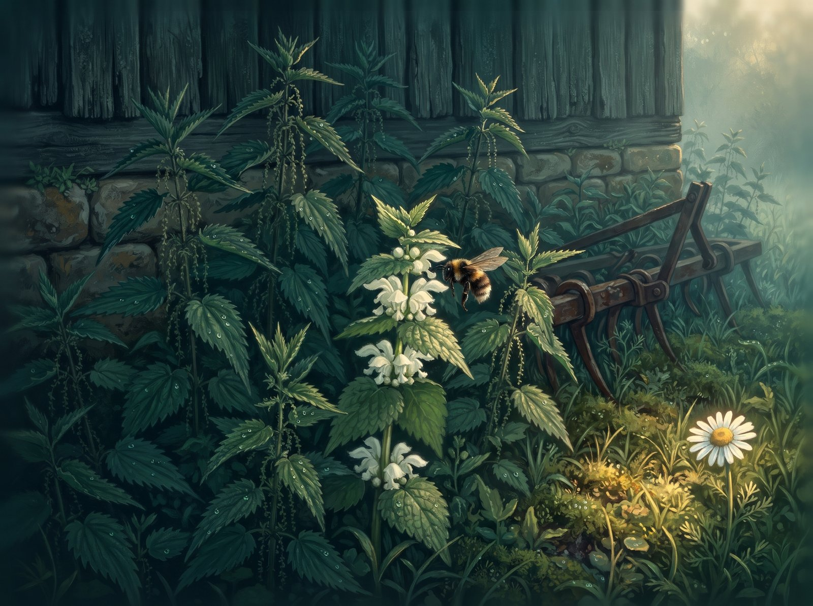

Prie senos daržinės augo dilgėlės. Aukštos, tamsios ir dygios. Dilgėlių visi bijojo: ir ožka, ir katinas, ir vaikai.

Tarp dilgėlių augo notrelė. Jos lapai buvo lygiai kaip dilgėlių, tik notrelė visai nedilgino. O po lapais notrelė turėjo baltus žiedelius, saldžius kaip medus.

Notrelė norėjo, kad ir jos visi bijotų. Todėl ji paslėpė žiedelius po lapais.

Rytą atskrido kamanė. Bzzz.

– Notrele, gal turi žiedelių?

Notrelė pasišiaušė.

– Šalin! Aš dygi!

Kamanė apsuko ratą ir nuskrido.

Kitą rytą kamanė atskrido vėl. Bzzz.

– Notrele, gal šiandien turi žiedelių?

Notrelė dar giliau paslėpė žiedelius.

– Šalin... aš dygi.

Kamanė nuskrido į dobilų lauką. Notrelei pasidarė liūdna. Tarp tamsių dilgėlių ji buvo visai viena.

Vieną vakarą per dilgyną atbėgo basa mergaitė. Dilgėlė kirto jai per kojytę. Mergaitė sušuko „ai!“, pasitrynė kojytę ir nusijuokė. Paskui pritūpė ir paglostė notrelės lapą.

Notrelė norėjo sušnypšti: „Šalin! Aš dygi!“ Bet šį kartą nieko nesakė. Tik sudrebėjo.

– Nedilgina! – nustebo mergaitė ir praskleidė lapus. – Kokie balti žiedeliai! Tu gi notrelė!

Mergaitė paragavo žiedelio.

– Saldu!

Ji įpynė notrelę į vainikėlį tarp ramunių ir rugiagėlių ir perrišo raudonu siūlu. Užsidėjo vainikėlį ir nubėgo per pievą namo, op, op, op.

Notrelė dar niekada nebuvo taip aukštai. Vėjelis kuteno jos baltus žiedelius, ir notrelė jų daugiau nebeslėpė.

