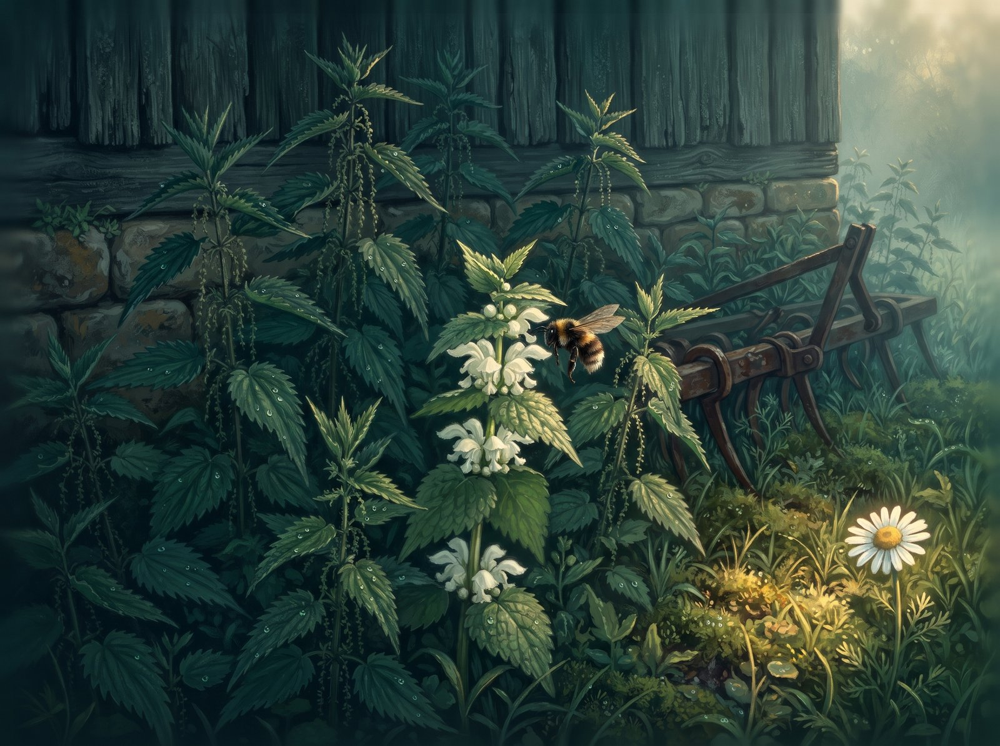
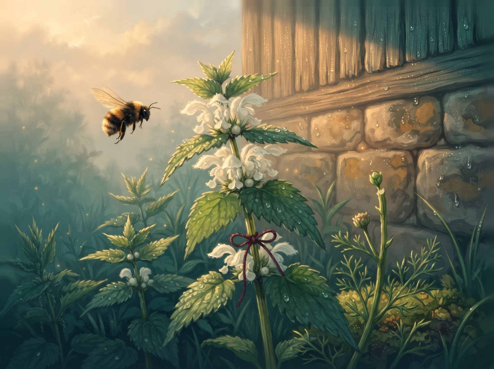

Prie senos daržinės augo dilgėlės. Aukštos, tamsios, dygios. Jos visos dilgino, ir visi jų bijojo: ir ožka, ir katinas, ir vaikai.

Tarp jų išdygo notrelė. Jos lapai buvo lygiai kaip dilgėlių, tik ji nedilgino. Nė kiek. Po lapais ji turėjo baltus žiedus su lašeliu medaus, ir kiekvieną rytą jų paragauti atskrisdavo kamanė. Bzzz.

Dilgyno pakraštyje augo ramunėlė. Ji su notrele kalbėdavosi visą dieną, o per lietų notrelė palenkdavo lapą, ir lašai nuriedėdavo ramunėlei ant galvos.

– Dar! – juokdavosi ramunėlė.

Bet dilgėlės iš ramunėlės šaipėsi:

– Minkštoji! O tu, notrele, juk viena iš mūsų, tiesa?

Notrelei patiko būti „viena iš jų“. Tarp dilgėlių saugu. Todėl ji ėmė apsimetinėti: šiaušė lapus, šnypštė kaip dilgėlės, o savo baltus žiedus paslėpė po lapais, kad niekas nesužinotų, kokia ji švelni.

Vieną karštą dieną nuo sodybos atėjo ožka.

– Pridenk mane, – paprašė ramunėlė. – Ožka pagalvos, kad aš dilgėlė.

Notrelė norėjo. Bet dilgėlės sušnypštė:

– Pažiūrėsim, kas tu.

Ir notrelė patraukė lapus.

Ožka nukando ramunėlei žiedą. Pakraštyje liko tik plikas stiebelis.

Kitą rytą kamanė paklausė:

– Kur ramunėlės žiedas?

– Ne mano reikalas, – atsakė notrelė dilgėlės balsu. Ir pati išsigando, kaip piktai tai nuskambėjo.

Kamanė neberado žiedų ir nuskrido. Notrelei liko tik dilgėlės. Ji taip ilgai slėpė žiedus, kad pati pamiršo, jog juos turi.

Vieną vakarą per dilgyną basa atėjo mergaitė iš sodybos. Ji dilgėlių nebijojo. Prie notrelės ji sustojo ir paėmė jos lapą.

– Nedilgina! – nustebo mergaitė. Ji praskleidė lapus ir rado baltus žiedus. – Tai tu notrelė! Ko slepiesi?

Mergaitė ištraukė vieną žiedelį ir pačiulpė.

– Saldi! – nusijuokė ji.

Notrelė net sudrebėjo. Saldi. Ji ir pati buvo pamiršusi.

Mergaitė pririšo prie jos stiebo raudoną siūlą.

– Kad rytoj tave rasčiau, – pasakė ir nubėgo.

Kitą rytą notrelė nebeslėpė žiedų. Ji iškėlė juos aukštai, ir netrukus pasigirdo pažįstamas bzzz. O pakraštyje, ant ramunėlės stiebelio, krūpčiojo naujas mažas pumpuras.

– Atleisk, – tyliai pasakė notrelė savo balsu.

Ramunėlė atsakė ne iš karto. Bet atsakė.
