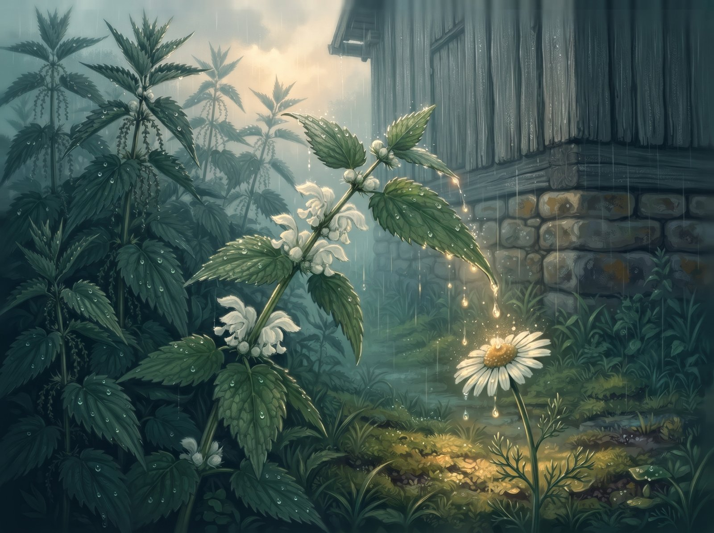
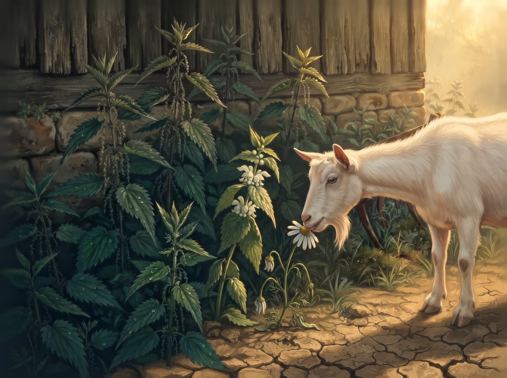
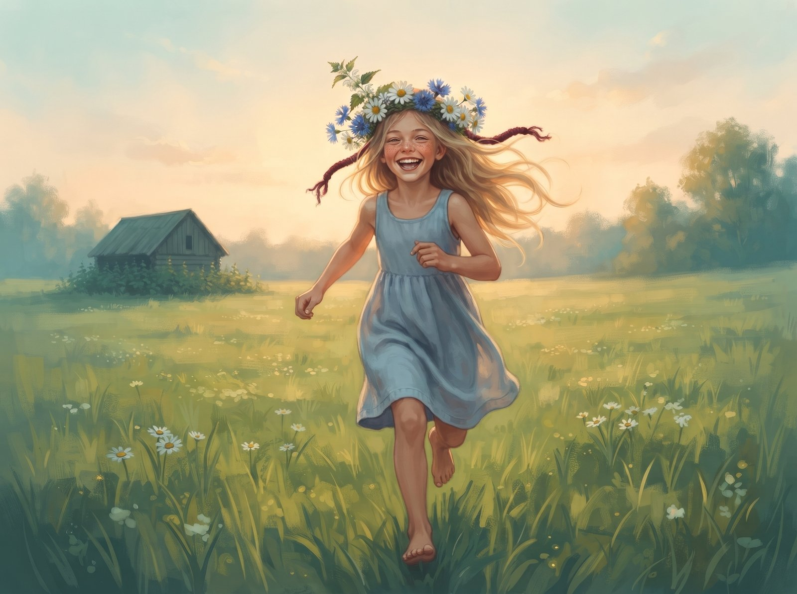

Notrelė išdygo ten, kur niekas nieko nesėja: prie senos daržinės, tarp akmeninio pamato ir surūdijusių akėčių. Aplink stūksojo dilgėlės, aukštos ir tamsios, plaukuotais stiebais. Jos kvepėjo drėgna žeme ir kažkuo aštriu, ir visas kiemas žinojo, kad jų geriau neliesti.

– Žiūrėk, nauja, – sušnibždėjo viena. – Lapai kaip mūsų.

Notrelė pažiūrėjo į savo lapus. Dantyti, raukšlėti, tamsiai žali. Iš tiesų kaip jų. Kad ji nedilgina, nė kiek, dilgėlės nežinojo. Ji nesakė. Ne todėl, kad norėjo meluoti. Tiesiog niekas nepaklausė, o tylėti buvo lengviau.

Jos rytai priklausė kamanei. Ši atskrisdavo, kol rasa dar nebuvo nudžiūvusi, stora, rudai dryžuota, burzgianti taip, kad drebėdavo visas stiebas, ir kišdavo galvą į baltus žiedus lapų pažastyse, kur slėpėsi lašelis medaus. Notrelei tai buvo kažkas panašaus į laimę: būti tuo, ko kažkas atskrenda ieškoti.

Jos dienos priklausė ramunėlei. Ši augo dilgyno pakraštyje, saulėkaitoje, ir per karščius prisiglausdavo notrelės pavėsyje. Jos kalbėdavosi apie skruzdes, apie debesis, apie basą mergaitę iš sodybos, kuri brisdavo per dilgynus nesusiraukdama, nes močiutė sakė, kad nuo dilgėlių kojos stipresnės. O kai užeidavo lietus, notrelė palenkdavo plačiausią lapą, ir lašai nuriedėdavo ramunėlei tiesiai ant galvos.

– Dar! – kikendavo ramunėlė.

Dilgėlės to nemėgo.

– Minkštoji, – šaipėsi jos. – Ją bet kas nuskabys. Ko tu su ja kalbiesi? Tu juk viena iš mūsų.

Mūsų. Notrelė pažvelgė į stiebus, kylančius virš jos kaip siena, ir pajuto, kaip tas žodis ją apgaubia. Tarp dilgėlių jos nepalies nei ožka, nei vaikas, nei močiutės dalgis. Reikia tik nesiskirti.

Ir ji nesiskyrė. Šiaušė lapus, kai pro šalį sėlindavo katinas. Juokėsi kartu, kai dilgėlės kalbėjo apie „minkštąsias“, ir juokas kas kartą skambėjo truputį dygiau. Žiedus ėmė lenkti žemyn, po lapais. Iš pradžių tik tada, kai dilgėlės žiūrėjo. Paskui visada, nes niekada nežinai, kada jos žiūri. Kamanė vis dar atskrisdavo, bet vis ilgiau zvimbdavo aplink, ieškodama, kur nutūpti.

Liepą užėjo sausra. Dulkės nusėdo ant visko pilku miltu. Dilgėlės nesiskundė, jų šaknys siekė giliai. Ramunėlė nusvarino galvą ir prigludo prie notrelės lapų, kaip visada.

Tą popietę nuo sodybos atsliūkino ožka. Ji skabė viską, kas tik nedilgino, o dilgyną aplenkdavo plačiu lanku.

– Pridenk mane, – sušnibždėjo ramunėlė. – Ji pagalvos, kad aš irgi dilgėlė.

Notrelė jau buvo beišskleidžianti lapus, kai virš jos sušnarėjo:

– Na, pažiūrėsim, kas tu.

Tai buvo ne klausimas. Notrelė suprato tai iš karto, ir taip pat iš karto suprato, kad atsakyti reikia dabar. Ji patraukė lapus.

Vienas kąsnis. Pakraštyje liko nukąstas stiebelis ir kartokas sulčių kvapas. Dilgėlės pritariamai sušiureno, ir notrelė stovėjo tiesi kaip niekada. Tą naktį ji ilgai nežinojo, kur dėti lapus.

– Kur ramunė? – paklausė kamanė kitą rytą.

– Ne mano reikalas. Ožkos ėda, ką randa.

Sausi, dygūs žodžiai, dilgėlių žodžiai. Notrelę išgąsdino ne tai, kad juos pasakė, o tai, kaip lengvai jie išėjo, lyg visada būtų buvę jos. Kamanė pakybojo, paieškojo žiedų, nerado ir nuskrido.

Rugpjūtis buvo tylus. Notrelė stovėjo susilenkusi ir pamažu liovėsi galvojusi apie žiedus. Ji nenusprendė jų pamiršti. Tiesiog nebeliko, kam juos rodyti, ir jie tapo kažkuo, kas buvo kadaise. Kartais ankstų rytą iš tolo atsklisdavo burzgimas, ir kažkas joje krustelėdavo. Bet kamanė praskrisdavo pro šalį, į dobilų lauką.

Vieną vakarą per dilgyną atbrido mergaitė. Basa, su pilna sauja ramunių ir rugiagėlių. Dilgėlės sukilo, kirto jai per blauzdas, o ji tik prunkštelėjo. Prie notrelės ji sustojo ir suėmė lapą tarp pirštų. Delnas buvo šiltas, šiurkštokas, kvepėjo žemuogėmis.

Nieko.

Mergaitė praskleidė lapus ir pamatė tai, ką notrelė slėpė taip ilgai, kad pati nebeprisiminė: baltus, šiek tiek suglamžytus žiedus.

– Tai tu notrelė, – nusijuokė ji. – O apsimetinėji dilgėle.

Ji ištraukė žiedelį ir pačiulpė, ir notrelė per ją, tarsi iš šalies, sužinojo, kad yra saldi.

Mergaitė nulaužė stiebą, įpynė notrelę į vainikėlį tarp ramunių ir apvyniojo galus raudonu siūlu. Dilgėlės šnypštė iš paskos, bet niekas jų nebeklausė. Ramunių žiedlapiai lietė notrelės lapus, ir viena jų kvepėjo lygiai taip, kaip ta, iš pakraščio. Gal tik pasirodė.

Mergaitė užsidėjo vainikėlį ir nubėgo per pievą namo. Notrelė iškėlė baltus žiedus į vakaro saulę, nieko nebeslėpdama. Taip aukštai ji dar niekada nebuvo buvusi. Ir taip toli nuo savo šaknų.

