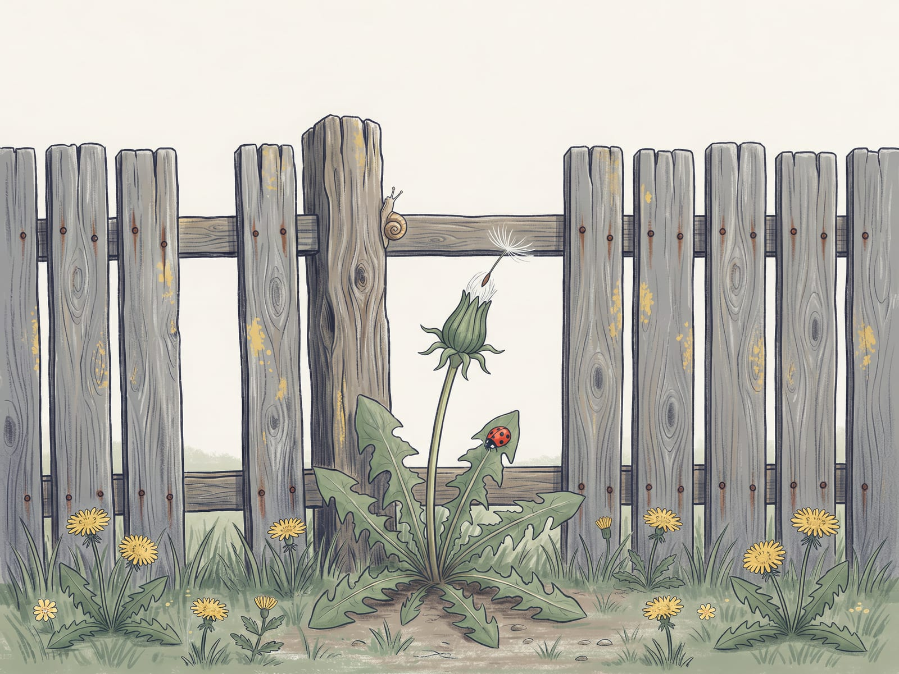
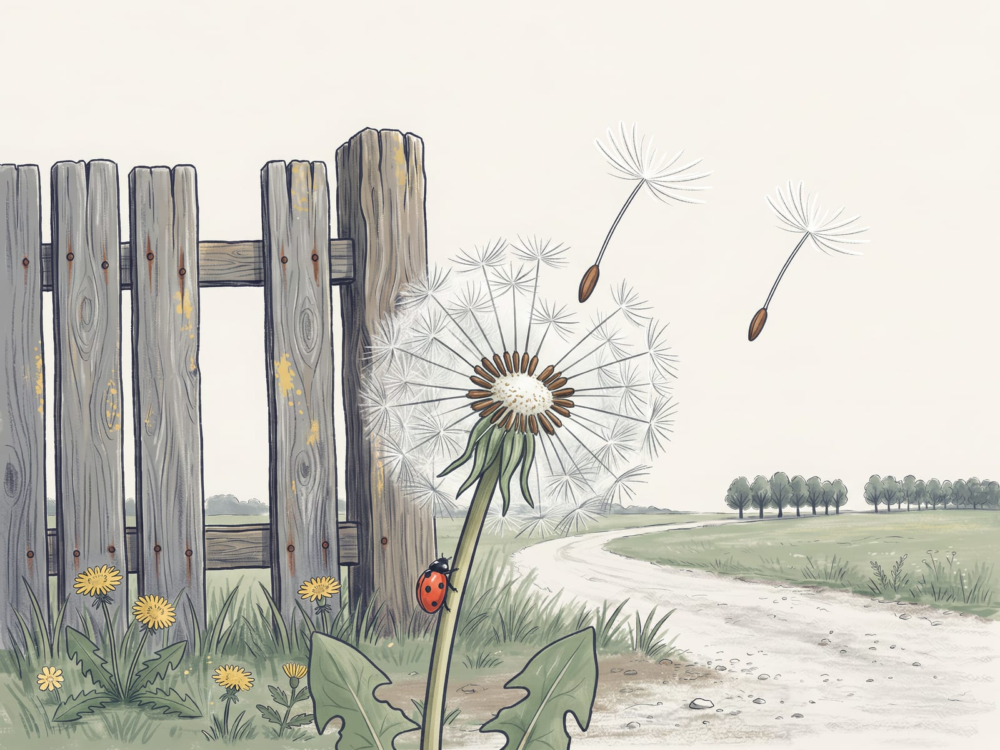
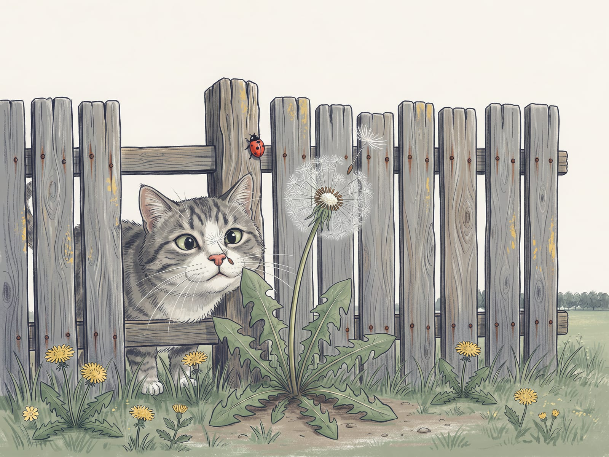
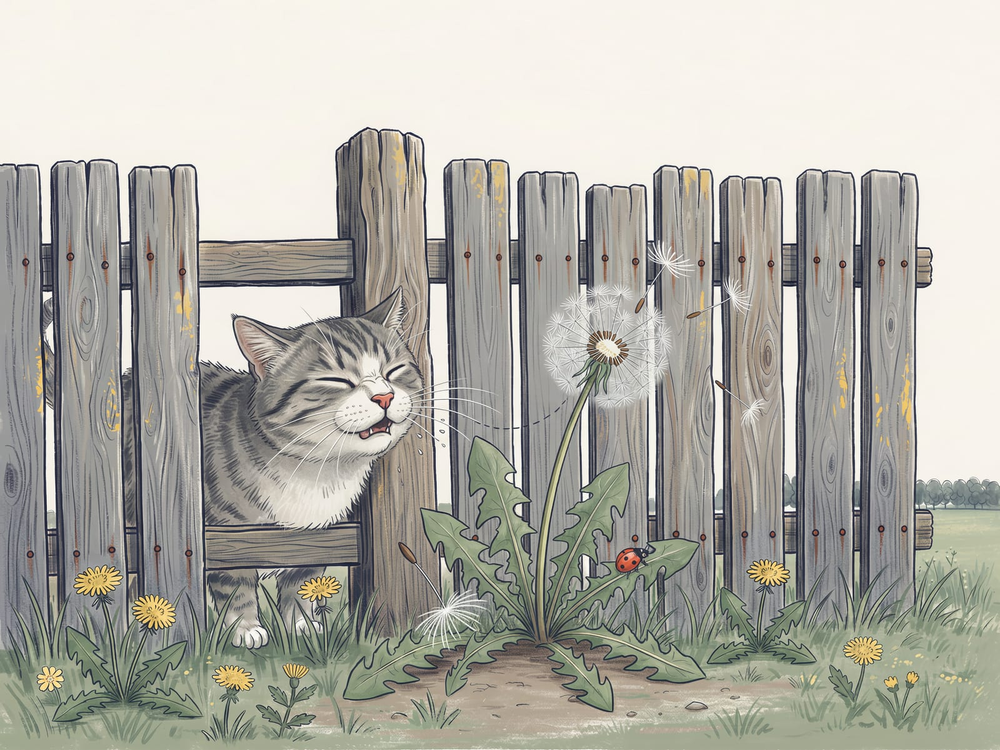
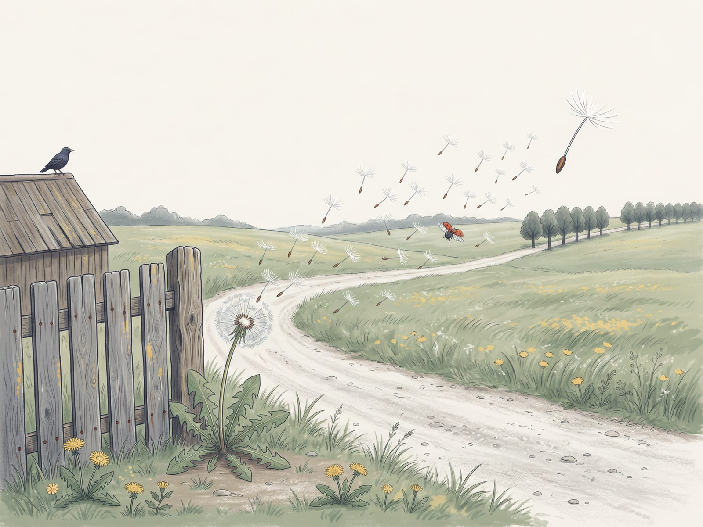
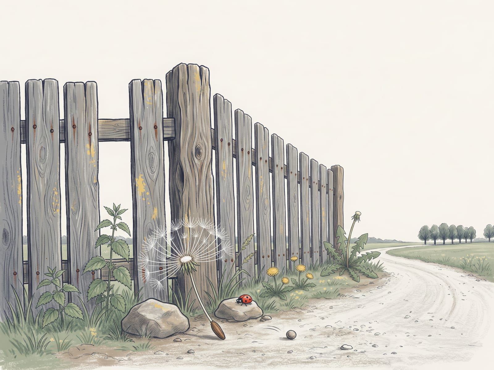
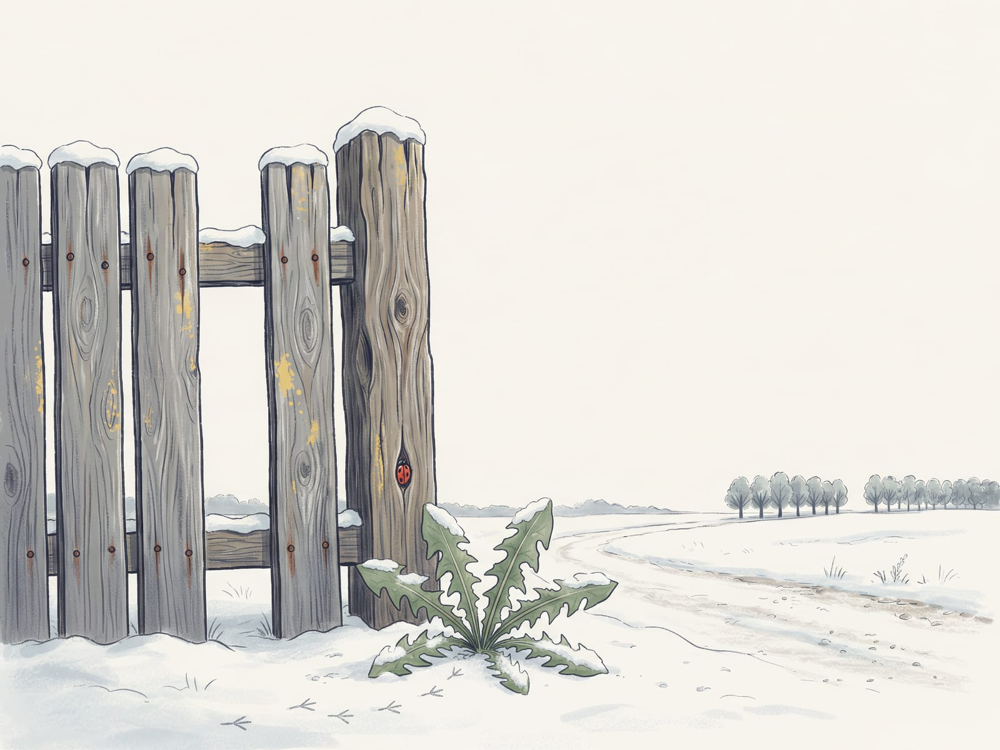
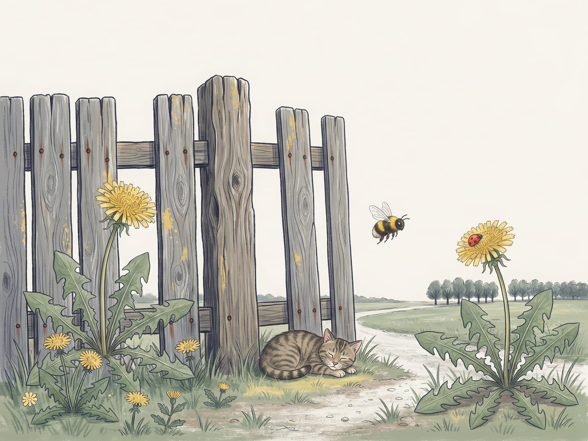

Prie senos tvoros kampo augo pienė. Gegužę ji žydėjo geltona kaip saulutė, o paskui užsimerkė ir paslėpė galvelėje savo vaikus, mažas sėklytes.

Vieną rytą pienės galva atsivėrė, ir ji tapo balta ir pūkuota kaip debesėlis. Kiekviena sėklytė išskleidė mažą skėtį, o pati smalsiausia, Pūkė, užsiropštė į patį viršų.

– Aš skrisiu toli toli! – sušuko Pūkė ir pamojavo skėtuku.

Pienė šypsojosi, bet tyliai palinko arčiau, nes jai buvo truputį liūdna paleisti savo mažylę.

Tuo metu pro tarpą tvoroje atslinko katė. Ji pauostė pienę, o Pūkė – pakšt! – ir prilipo jai prie pat nosies.

– Aš skrisiu toli toli... – sumurmėjo Pūkė ir apsidairė, nes iš ten pasaulis atrodė labai didelis.

Katė raukė nosį, raukė, kol nusičiaudėjo: apči! Pūkė nuskriejo atgal ir įstrigo pienės lapuose, galva žemyn. Pienė tyliai nusijuokė ir apglėbė ją lapais.

Kitą rytą papūtė didelis vėjas. Jis pakėlė visas sėklytes, ir Pūkė nuskrido aukštai aukštai, virš tvoros, virš kelio, virš žalios pievos.

Bet vėjelis greitai pavargo ir nurimo, ir Pūkė leidosi vis žemiau ir žemiau, kol nusileido prie tos pačios tvoros, tik kitame gale. Iš ten ji matė savo mamą.

Rudenį iš Pūkės išdygo mažas daigelis, o žiemą jį švelniai apklojo sniegas.

Pavasarį Pūkė pražydo ryškiu geltonu žiedu, tokiu pat kaip mamos. Ji pažiūrėjo per kiemą, o mama jai linktelėjo.

– Aš čia, mamyte! – sušuko Pūkė.

Ir abi geltonos pienės visą dieną šypsojosi saulutei.

## Pokalbiui

### Apie ką ši pasaka

Pienė saugo savo sėklytes, kol jos užauga, ir sunkiai jas paleidžia. Pūkė veržiasi kuo toliau ir nori būti kitokia, geresnė, „ne kaip mama“. Bet vėjas ją nuneša visai netoli, ir pavasarį ji pražysta tokiu pat geltonu žiedu kaip mama. Tai pasaka apie tai, kad obuolys nuo obels netoli rieda, kad ir kaip norėtume kitaip. Apie mamą, kuri myli ir saugo, bet turi paleisti. Ir apie vaiką, kuris auga, stiprėja ir pamažu tampa panašus į savo tėvus, nors to nenori ir nepripažįsta.

Temos: auginimas ir paleidimas, noras būti kitokiam, panašumas į tėvus, kartų ratas.

Pabaigos skiriasi. Mažyliams Pūkė nusileidžia netoli ir džiugiai šaukia mamai „Aš čia!“. Vaikams skirtoje versijoje mama prisipažįsta, kad savo mamai sakė lygiai tą patį. Vyresniems skirtoje abi tyliai pripažįsta, kad čia „tik laikinai“, o mama prisimena, kaip kadaise pati nesugebėjo nuskristi toliau nei penkis žingsnius nuo savo mamos.

### Kaip kalbėtis

Tema: augti ir likti arti.

Mažam vaikui kartais būna baisu nutolti nuo mamos, nors kartu labai norisi pačiam pažinti pasaulį. Pasaka tai švelniai parodo: Pūkė drąsiai išskrenda, bet nusileidžia ten, iš kur mato mamą, ir abi žydi toliau. Vaikui nereikia aiškinti, ką tai reiškia. Užtenka, kad jis pajustų, jog galima išskristi ir vis tiek likti arti.

### Klausimai

- Kur norėjo nuskristi Pūkė? O kur nuskristum tu, jei būtum pūkelis?
- Pūkė nusileido visai netoli ir matė savo mamą. Kaip manai, ar jai buvo gera?
- Kokios spalvos pražydo Pūkė? O kuo tu panašus į mamą ar tėtį?

Pavasarį suraskit tikrą pienės pūką ir papūskit kartu. Paskui pažiūrėkit, kur nuskris pūkeliai: gal kuris nors nusileis visai šalia. O namuose galima pažaisti: vaikas yra pūkelis, kurį jūs nupučiat, o jis „nusileidžia“ ir pribėga jus apkabinti.
