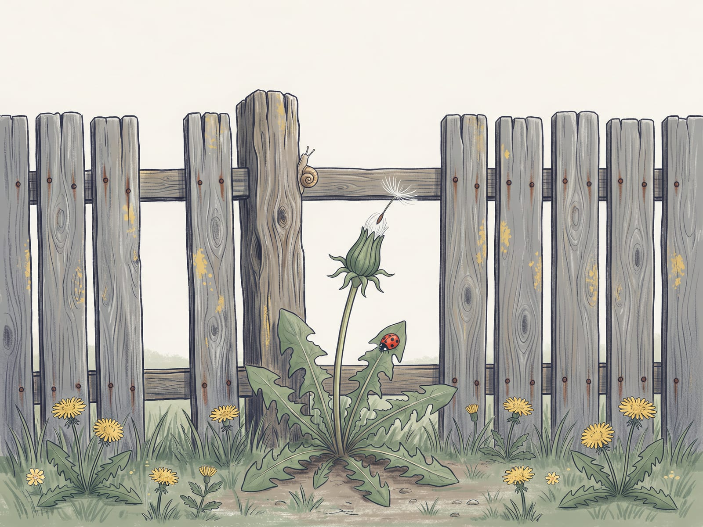
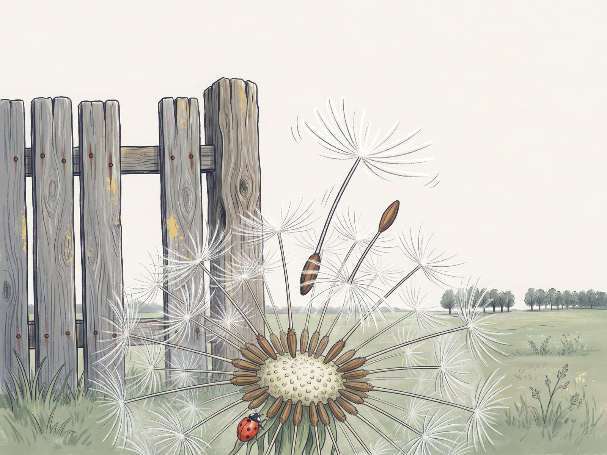
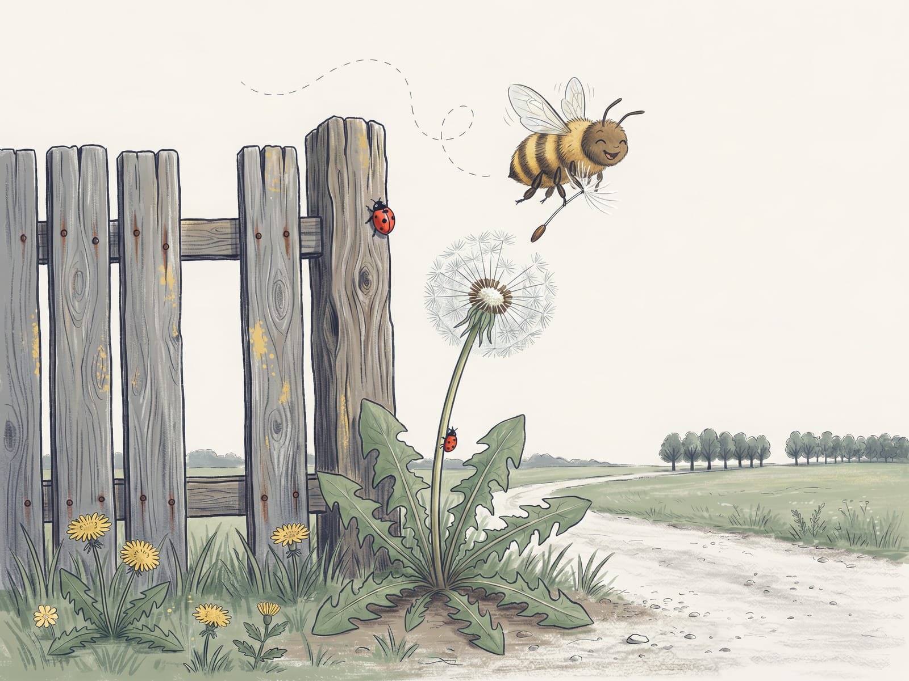
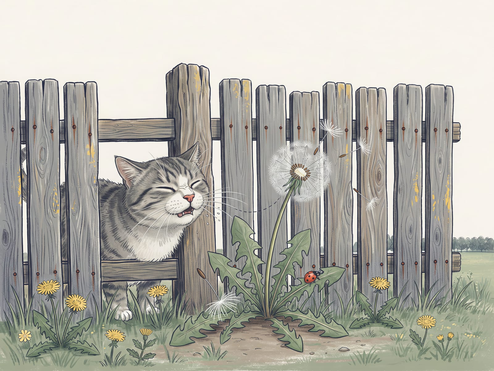
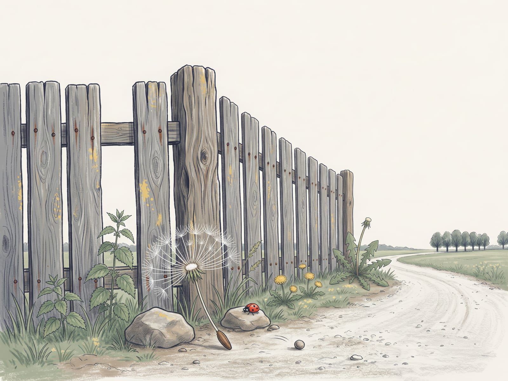
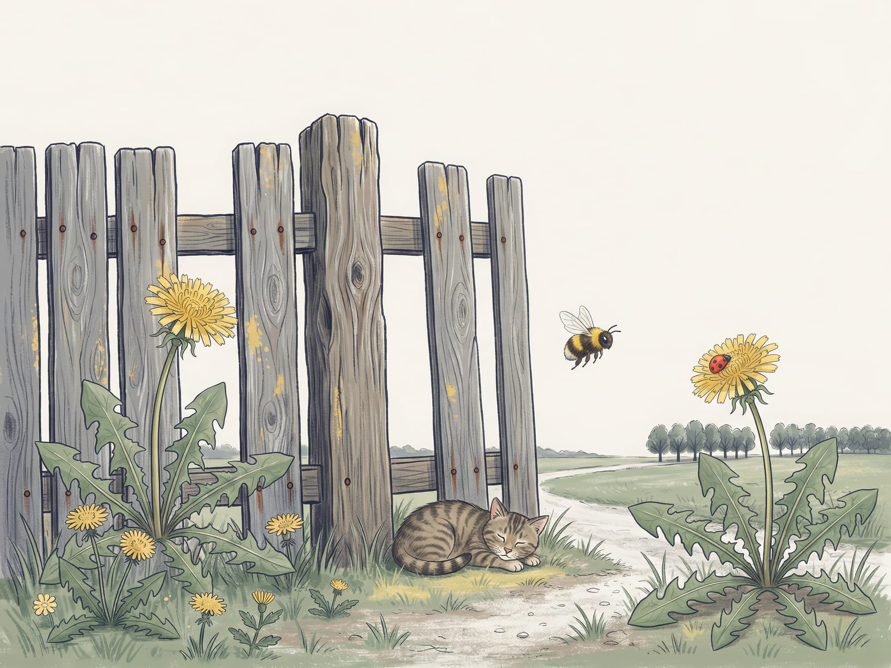

Prie senos sodybos tvoros, pačiame jos kampe, augo pienė. Gegužę ji buvo geltona kaip saulė, o paskui užsimerkė, suspaudė žaliais lapeliais galvą ir ėmė saugoti tai, kas viduje. O viduje augo jos vaikai, sėklytės, gal du šimtai. Ir viena iš jų, Pūkė, niekaip negalėjo nusėdėti ramiai.

– Kada jau? Kada? – vis stūmėsi ji prie plyšelio tarp lapelių.

– Dar ne, – sakydavo pienė. – Dar užaugk.

Vieną rytą galva atsivėrė, ir pienė tapo balta ir apvali kaip pūko kamuolys. Kiekviena sėklytė išskleidė savo mažą skėtį. Pūkė iškart užsiropštė į patį viršų ir apsidairė.

Už kelio žaliavo pieva, o pievos gale stovėjo senos, didelės liepos. Už jų kažkas baltai spindėjo.

– Kas ten?

– Dvaro parkas, – pasakė pienė. – Ten auga rožės ir lelijos.

– Ten aš ir nuskrisiu! – nusprendė Pūkė. – Aš nebūsiu paprasta pienė kaip tu. Aš būsiu rožė!

Pienė nieko neatsakė. Ji tik truputį palinko, lyg norėtų Pūkę paslėpti, nes visai nenorėjo, kad ji skristų taip toli.

Bet Pūkė jau turėjo planą.

Pirmiausia ji nusprendė pasimokyti skraidyti pati. Ji įsitempė, pašoko ir mosavo skėčiu iš visų jėgų. Plast, plast, plast! Nepakilo nė per milimetrą, tik apsvaigo galva ir susipainiojo su sesutėmis.

– Ai! Tu man ant skėčio! – suspiegė kaimynė.

Tada atskrido bitė Zyzė. Ji lankydavo pienę kiekvieną pavasarį.

– Zyze, gal nuneštum mane į dvaro parką? Tu juk ten skraidai!

– Galiu pabandyti, – sudūzgė Zyzė. Ji įsikabino Pūkę kojelėmis ir pakilo. Bet Pūkės skėtis kuteno Zyzei pilvą. Zyzė kikeno, kikeno, kol neištvėrė, ir paleido ją tiesiai atgal ant pienės galvos.

– Atsiprašau! – sušuko ji, jau skrisdama tolyn. – Labai kutena!

Pūkė susiraukė. Tada ji pamatė katę, kuri kiekvieną dieną eidavo pro tarpą tvoroje. Katė sustojo ir pauostė pienę, o Pūkė tuoj pat prilipo jai prie pat nosies.

– Neškis mane prie liepų! – paprašė Pūkė.

Katė primerkė akis, raukė nosį, raukė, kol garsiai nusičiaudėjo: apči! Pūkė nuskriejo atgal ir įstrigo pienės lapuose, galva žemyn.

Pienė tyliai nusijuokė ir slapta apsidžiaugė. Dar vieną naktį Pūkė bus šalia.

Bet kitą rytą papūtė tikras vėjas. Stiprus, rytinis, nuo pievos pusės. Jis pakėlė visas sėklytes iš karto.

– Sudie, mama! Aš nebūsiu tokia kaip tu! – šaukė Pūkė, kildama aukštyn.

Ji skrido virš tvoros, virš kelio, virš pievos. Liepos vis artėjo. Dar truputėlį!

Bet pačiame pievos viduryje vėjas nutilo. Valandėlę palaukė, o paskui, lyg persigalvojęs, dvelktelėjo atgal. Pūkė leidosi vis žemiau ir žemiau, kol nusileido prie tos pačios tvoros, tik kitame jos gale. Iš ten buvo matyti mama.

– Nieko, – sumurmėjo Pūkė. – Čia tik laikinai.

Rudenį Pūkė sudygo. Jos lapeliai augo dantyti, lygiai kaip mamos. Žiemą abi apklojo sniegas.

O pavasarį Pūkė pražydo. Ji taip norėjo būti rože! Bet žiedas atsivėrė ryškiai geltonas, toks pat kaip mamos.

Pūkė iš pradžių susiraukė. Paskui pažiūrėjo, kaip prie jos dūzgia Zyzė, kaip saulė šildo jos lapus, ir pasidarė visai gera.

– Mama! – sušuko ji per kiemą. – Aš visai ne tokia kaip tu!

– Žinau, – nusišypsojo pienė. – Aš savo mamai sakiau lygiai tą patį.

## Pokalbiui

### Apie ką ši pasaka

Pienė saugo savo sėklytes, kol jos užauga, ir sunkiai jas paleidžia. Pūkė veržiasi kuo toliau ir nori būti kitokia, geresnė, „ne kaip mama“. Bet vėjas ją nuneša visai netoli, ir pavasarį ji pražysta tokiu pat geltonu žiedu kaip mama. Tai pasaka apie tai, kad obuolys nuo obels netoli rieda, kad ir kaip norėtume kitaip. Apie mamą, kuri myli ir saugo, bet turi paleisti. Ir apie vaiką, kuris auga, stiprėja ir pamažu tampa panašus į savo tėvus, nors to nenori ir nepripažįsta.

Temos: auginimas ir paleidimas, noras būti kitokiam, panašumas į tėvus, kartų ratas.

Pabaigos skiriasi. Mažyliams Pūkė nusileidžia netoli ir džiugiai šaukia mamai „Aš čia!“. Vaikams skirtoje versijoje mama prisipažįsta, kad savo mamai sakė lygiai tą patį. Vyresniems skirtoje abi tyliai pripažįsta, kad čia „tik laikinai“, o mama prisimena, kaip kadaise pati nesugebėjo nuskristi toliau nei penkis žingsnius nuo savo mamos.

### Kaip kalbėtis

Tema: noriu būti kitoks, o išaugu panašus.

Šio amžiaus vaikai pradeda lyginti save su kitais ir dažnai svajoja būti kažkuo ypatingu: ne tokiu, kaip visi, ne tokiu, kaip tėvai. Tai natūralu ir gražu. Pasaka švelniai parodo kitą pusę: Pūkė pražysta geltona kaip mama, ir tai visai nėra blogai. Jai gera ten, kur ji yra. Pats juokingiausias atradimas vaikui būna tas, kad ir mama kažkada buvo maža Pūkė ir sakė savo mamai tuos pačius žodžius.

### Klausimai

- Kuo norėjo būti Pūkė? O kuo tu norėtum būti, kai užaugsi?
- Pūkė bandė nuskristi tris kartus. Kuris bandymas tau juokingiausias? Ar tau yra tekę kažko labai norėti, bet nepavyko?
- Kodėl mama nusišypsojo, kai Pūkė sušuko „Aš visai ne tokia kaip tu!“? Kuo tu panašus į mamą ar tėtį? O kuo visai kitoks?

Papasakokit vaikui, kuo norėjot būti, kai buvot jo amžiaus, ir ką tada sakydavot savo tėvams. Vaikai labai mėgsta sužinoti, kad ir tėvai kažkada buvo vaikai.
