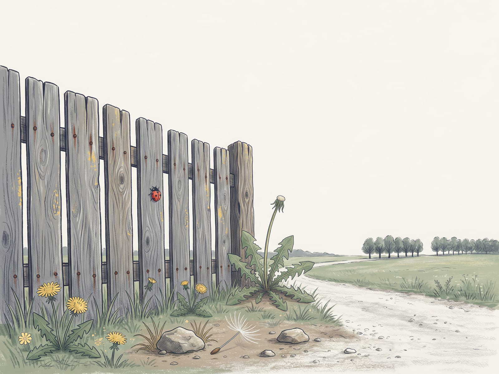
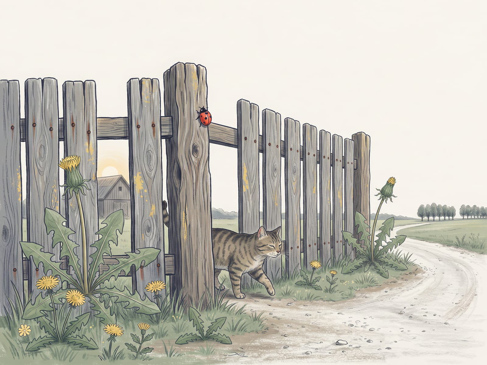

Jau antrą dieną pienė nesiskleidė.

Ji augo prie senos sodybos tvoros, prie paties kampinio stulpo, kur tvora pasuka nuo kelio į pievą. Tvora buvo iš medinių lentų, kadaise dažytų žaliai, bet dažų seniai nebeliko, ir lentos pasidarė sidabriškai pilkos, šiurkščios kaip senos rankos, su geltonomis kerpių dėmėmis ir surūdijusiomis vinimis, nuo kurių žemyn per medį driekėsi rudi dryžiai. Viena lenta buvo iškritusi, ir pro tarpą į kiemą ir atgal kasdien vaikščiojo katė. Prie stulpo žolė visada augo vešliau: čia vasarą gulėdavo šuo, čia lietus nuo stogo varvėdavo į tą pačią vietą, ir žemė buvo juoda, minkšta, kvepianti.

Gegužę visas patvorys buvo geltonas. Pienės žydėjo griovio krašte, palei žvyrkelį, tarp bulvių vagų, net ant tvarto stogo, kur vėjas kadaise užnešė saują žemių. Rytais, kai saulė pakildavo virš stogų, jos visos atsiverdavo beveik vienu metu, ir pieva per kelias minutes iš žalios tapdavo geltona, lyg kas būtų išliejęs ant jos kibirą dažų.

O ji stovėjo užsimerkusi, žaliais lapeliais suspaudusi galvą, ir laikė.

Viduje buvo ankšta ir šilta. Ten glaudėsi ir augo sėklos, apie du šimtus, viena prie kitos, kiekviena su plonu stiebeliu ir dar suglaustu skėčiu viršuje. Pienė jautė kiekvieną. Jos krutėjo, o viena, pati viršutinė, vis spaudėsi aukštyn, prie plyšelio tarp lapelių, kur jau prasisunkdavo šviesa.

– Pūke, dar ne, – tyliai pasakė pienė ir suspaudė lapelius stipriau.

* * *

Prie šio stulpo pienė gyveno jau ketvirti metai. Jos šaknis buvo ilga ir stora, nusileidusi giliai po velėna. Ji jau išgyveno tris šienapjūtes, vieną sausą vasarą, kai lapai suglebo iki žemės, ir vieną pavasarį, kai šeimininkų vaikas su peiliuku iškrapštė pusę jos rozetės, nes mama liepė išravėti kiemą. Ji vėl išaugo. Pienės visada išauga.

Ji mėgo bites. Pavasarį skaičiuodavo, kiek jų atskrenda per dieną. Kartais priskaičiuodavo iki šimto, kol saulė nusileisdavo už tvarto. Mėgo ir tai, kad močiutė iš sodybos kiekvieną gegužę pririnkdavo jos žiedų pilną krepšelį, ir paskui pro virtuvės langą visą dieną sklisdavo pienių medaus kvapas, saldus, bet ir truputį karstelėjęs. Pienė tada stovėdavo be žiedų, bet keistai patenkinta, lyg būtų kažką padovanojusi.

Nuo stulpo buvo matyti visas jos pasaulis. Žvyrkelis, baltas nuo dulkių, su dviem provėžomis, tarp kurių augo smilgos ir gysločiai. Pakelėje kmynai ir pelynai, kurie karštą dieną kvepėdavo taip, kad skaudėdavo galvą. Kartą per dieną keliu pravažiuodavo traktorius, kartais dviratis, ir tada dulkės ilgai supdavosi ore, kol nusėsdavo ant pienių žiedų pilku miltu. Už kelio prasidėjo pieva, žema ir drėgna, su dobilais ir vingiorykštėmis, o pievos gale, kur žemė vėl kilo, stovėjo liepų alėja.

Liepos buvo senos, gal dviejų šimtų metų, tamsiais, raukšlėtais kamienais, tokiais storais, kad jų neapkabintų nė du vyrai. Jos stovėjo dviem eilėmis, lygiai, kaip kažkada pasodintos, ir jų viršūnės susiglaudusios virš kelio darė žalią tunelį. Vasaros viduryje, kai liepos žydėdavo, jų kvapas atsklisdavo per visą pievą iki pat tvoros, ir visos bitės iš apylinkių pamiršdavo pienes ir dobilus ir skrisdavo ten, ir alėja dūzgė nuo ryto iki vakaro, lyg pats medis būtų dainavęs.

Už liepų buvo dvaro parkas. Iš čia jo beveik nesimatė, tik tarp kamienų kartais kas nors sužibėdavo baltai, gal tvenkinio vanduo, gal balta suolelio lenta, gal kažkieno suknelė.

Apie vieną dalyką pienė niekam nepasakojo.

Kai ji pati buvo sėkla, irgi stūmėsi prie viršaus. Iš savo mamos galvos ji matė tas pačias liepas ir tą patį baltumą už jų. Iš bičių ji buvo girdėjusi, kad ten auga rožės ir lelijos ir kad niekas jų nepjauna. Ji norėjo ten. Norėjo būti ne pienė, ne geltona kaip visos, ne ta, kurią rauna iš kiemo. Kai pagaliau atsiskyrė nuo mamos, ją pakėlė vėjas, ir ji skrido, ir jau matė liepų viršūnes iš arti, ir tada vėjas nurimo.

Ji nusileido prie šio stulpo. Penki žingsniai nuo mamos.

Ilgai galvojo, kad tai laikinai.

* * *

Trečią rytą lapeliai atsilenkė patys. Pienė nieko negalėjo padaryti: atėjo laikas, ir galva atsivėrė, ir sėklos išsiskleidė į visas puses, ir kiekvienos skėtis išsitiesė. Ji tapo balta ir apvali, permatoma prieš saulę, ir pirmą kartą per tris dienas pamatė savo vaikus.

Pūkė buvo pačiame viršuje. Jos skėtis buvo didesnis už kitų, plunksniškas, ir ji tuoj pat ėmė juo mosuoti, lyg tikrintų, ar veikia. Ji apsidairė į visas puses: į tvarto stogą, į žvyrkelį, į pievą. Ir ilgiausiai žiūrėjo ten, kur buvo liepos ir tas baltumas tarp kamienų.

– Kas ten?

Pienė patylėjo.

– Dvaro parkas.

– Ten aš ir nuskrisiu. Aš būsiu kitokia. Ne kaip tu.

Pienė sudrebėjo nuo tų žodžių, nuo galvos iki pat šaknies, ir viena sėkla apačioje atsiskyrė ir nukrito tiesiai į žolę. Ji nieko neatsakė.

* * *

Po pietų atbėgo mergaitė iš sodybos. Ji buvo basa, saulės nudegintais pečiais, su pienių vainiku, kuris jau vyto ant jos šviesių plaukų. Pamačiusi baltą galvą prie stulpo, ji šūktelėjo ir pritūpė, suėmė stiebelį dviem pirštais ir palenkė prie savo veido. Pienė pajuto jos kvapą: duonos ir medaus. Mergaitė užsimerkė, kažko užsinorėjo ir pūtė, ilgai, iš visų jėgų.

Pusė sėklų pakilo kartu su jos kvėpavimu. Pienė jautė, kaip jos atplyšta: viena, dvi, dvidešimt, šimtas, lengvai, beveik nejaučiamai, lyg kas trauktų siūlus iš megztinio. Jos sukosi ore aplink mergaitės galvą, mergaitė juokėsi ir gaudė jas delnais, o paskui jos išsisklaidė virš kelio ir nuplaukė per pievą, kur vėjas nešė, mažos baltos žvaigždutės prieš tamsią liepų alėją.

Pūkė liko. Ji įsikibo į galvą iš visų jėgų ir susigūžė. Ne taip, ne nuo mergaitės, ne dabar. Ji norėjo tikro vėjo.

Mergaitė apžiūrėjo, kas liko, gūžtelėjo pečiais, paleido stiebelį ir nubėgo per kiemą, pro tą tarpą tvoroje, kur vaikščiodavo katė. Pienė atsitiesė, tik dabar jos galva buvo pusplikė, kaip nuskusta iš vienos pusės.

Ji ilgai stovėjo tyliai. Jai buvo gėda, kad džiaugiasi. Kad Pūkė liko. Kad dar vieną naktį ji turės ją šalia.

* * *

Naktį buvo šalta ir drėgna. Nuo pievos pakilo rūkas, toks tirštas, kad liepų alėja dingo, o paskui ir pats žvyrkelis, ir liko tik tvoros stulpas, rasoti gysločiai ir tyla. Ant skėčių susirinko rasa, ir sėklos pasidarė sunkios, sulipusios. Pienė norėjo užsiverti, kaip verdavosi kiekvieną vakarą, kai dar buvo geltona, bet nebegalėjo. Kartą atsivėrusi galva nebesusiglaudžia. Ji tik stovėjo, palinkusi nuo rasos svorio, ir jautė, kaip Pūkė viršuje dreba. Ji niekuo negalėjo jos sušildyti. Galėjo tik būti šalia.

Rytas atėjo pilkas, paskui rausvas, paskui auksinis. Rūkas pakilo nuo pievos lėtai, kaip kas keltų marlę nuo pieno puodo, ir vėl atsirado liepos, iš pradžių kaip šešėliai, paskui tamsios ir tikros. Saulė pasiekė tvorą, ir pilkos lentos ėmė garuoti. Rasa ant skėčių pradėjo džiūti.

Ir tada papūtė vėjas.

Tikras, rytinis, nuo pievos pusės, vėsus ir stiprus, toks, kuris lenkia žolę bangomis ir švilpia pro tarpą tvoroje. Jis pakėlė sėklas nuo pienės galvos kaip pūkus nuo išpurtytos pagalvės, visas iš karto.

Pūkė irgi pakilo.

– Aš nebūsiu tokia kaip tu! – suklykė ji, jau ore.

Pienė nespėjo atsakyti. Pūkė jau buvo virš tvoros, paskui virš kelio, paskui pienė jos nebematė.

* * *

Skristi buvo lengva ir baisu. Pūkė sukosi, kilo, leidosi, ir po ja slinko pasaulis, kurį ji iki šiol matė tik iš vienos vietos. Tvarto stogas su samanų lopais ir varnėnu ant kraigo. Sodybos kiemas, šulinys su gervėle, skalbiniai ant virvės. Žvyrkelis, kuris iš aukštai atrodė kaip ilgas baltas kaspinas, numestas per žalią pievą. Pieva su tamsiomis drėgnų vietų dėmėmis ir sidabrine vandens linija ten, kur tekėjo griovys. Ji matė, kaip vėjas eina per žolę bangomis, ir kaip kiekviena banga nurieda iki pat liepų ir sudūžta į jų kamienus.

Liepos artėjo. Jau matėsi atskiri lapai, jauni, šviesiai žali, ir tamsios šakos, ir paukščiai tarp jų. Pūkė pasuko skėtį į tą pusę, kaip mokėjo, ir laukė, kol vėjas nuneš ją per alėją ir dar toliau, kur tas baltumas.

Vėjas nurimo pačiame pievos viduryje. Valandėlę jis visai nutilo, o paskui, lyg persigalvojęs, dvelktelėjo atgal, nuo liepų pusės.

Pūkė dar ilgai sklandė, vis žemiau ir žemiau, atgal per pievą ir per kelią, kol skėtis užkliuvo už smilgos, ir ji nusileido. Ant žvyrkelio krašto, tarp dviejų akmenų, prie tos pačios tvoros, tik kitame jos gale, ten, kur tvora pasibaigia ir prasideda dilgėlės.

Iš ten buvo matyti tvoros kampas, o prie jo, tarp žolės, tuščias pienės stiebas su plika galva.

Dvidešimt žingsnių.

Pūkė ilgai žiūrėjo į liepas. Jos buvo ten pat, kur buvo, ne arčiau ir ne toliau.

– Tai laikinai, – pasakė ji sau.

* * *

Rudenį Pūkė sudygo. Iš pradžių tik vienas mažas daigelis, du lapeliai, apvalūs ir lygūs, ir ji labai jais džiaugėsi. Lygūs, ne kaip mamos. Paskui išaugo trečias lapas, ir jis buvo dantytas. Ir ketvirtas. Ir penktas. Visi dantyti, gilūs, nelygiais kraštais, kaip liūto dantys.

Pūkė stengėsi juos auginti kitaip. Siauresnius. Aukštesnius. Ištiestus į viršų, ne į šonus. Lapai augo taip, kaip augo, ir gulėsi aplink ją ratu prie pat žemės, ir iš viršaus ji atrodė lygiai taip pat kaip visos pienės aplinkui.

Tvoros kampe pienė irgi išleido naujų lapų. Ji matė Pūkę iš savo vietos kiekvieną rytą, kai nuo žvyrkelio nuslinkdavo rūkas. Nieko nesakydavo.

Liepos nubarstė lapus. Iš pradžių geltonus, paskui rudus, paskui jau tik juodas šakas prieš žemą pilką dangų, ir alėja iš toli atrodė kaip dvi eilės senų žmonių, sustojusių prie kelio. Kelias pažliugo, provėžose stovėjo vanduo, ir ryte jame plaukiojo ledo plutelės. Tvora pajuodo nuo lietaus. Lapkritį pro tarpą tvoroje katė nebevaikščiojo, tik retkarčiais praošdavo vėjas.

Žiemą jas abi užklojo sniegas. Jis gulė ant tvoros lentų aukštomis baltomis kepurėmis, užpustė žvyrkelį taip, kad jo nebeliko, ir visa pieva iki pat liepų tapo lygi ir tyli, ir nebuvo matyti, kur saldžiai miega pienės.

* * *

Pavasarį Pūkė pražydo.

Ji labai tikėjosi, kad bus kitaip. Kad iš to pumpuro, kurį ji augino visą balandį, išsiskleis kažkas kitokio: baltas, mėlynas, nors ir raudonas, nors koks. Bet vieną gegužės rytą, kai saulė pakilo virš tvarto, pumpuras atsivėrė, ir jis buvo geltonas. Ryškiai, nepakeliamai geltonas, toks pat kaip visos pienės patvoryje, toks pat kaip mamos.

Atskrido bitė, apsuko ratą ir nutūpė jai ant žiedo. Ji ilgai rausėsi, prisirinko žiedadulkių ant kojelių ir nuskrido tiesiai prie stulpo, lyg nebūtų jokio skirtumo, kur skristi.

Popiet atėjo močiutė iš sodybos su krepšeliu. Ji pririnko žiedų tvoros kampe, pririnko prie tvoros galo, nuskynė ir kelis Pūkės. Krepšelyje jie gulėjo vieni šalia kitų, ir Pūkė, žiūrėdama iš paskos, negalėjo atskirti, kurie žiedai jos, o kurie mamos.

Vakare, kai saulė nusileido už tvarto, Pūkė jautė, kaip jos likęs žiedas pats ima vertis, lapeliai po vieną lenkiasi į vidų. Ji nenorėjo. Bet tamsa ir vėsa darė savo, ir ji užsivėrė, ir tik pačioje paskutinėje akimirkoje, pro plyšelį tarp lapelių, pamatė, kad ten, prie stulpo, pienė užsivėrė lygiai tuo pačiu metu.

* * *

Kitą rytą, kai abi atsivėrė, Pūkė pirmą kartą per visą šį laiką sušuko per dvidešimt žingsnių:

– Mama! Aš čia tik laikinai!

Pienė atsisuko į ją, kiek pienė gali atsisukti, visa geltona prieš saulę.

– Žinau, – pasakė ji. – Aš irgi.

## Pokalbiui

### Apie ką ši pasaka

Pienė saugo savo sėklytes, kol jos užauga, ir sunkiai jas paleidžia. Pūkė veržiasi kuo toliau ir nori būti kitokia, geresnė, „ne kaip mama“. Bet vėjas ją nuneša visai netoli, ir pavasarį ji pražysta tokiu pat geltonu žiedu kaip mama. Tai pasaka apie tai, kad obuolys nuo obels netoli rieda, kad ir kaip norėtume kitaip. Apie mamą, kuri myli ir saugo, bet turi paleisti. Ir apie vaiką, kuris auga, stiprėja ir pamažu tampa panašus į savo tėvus, nors to nenori ir nepripažįsta.

Temos: auginimas ir paleidimas, noras būti kitokiam, panašumas į tėvus, kartų ratas.

### Kaip kalbėtis

Pienė laiko galvą užvertą, kiek tik gali, bet paleidimas nėra jos sprendimas: vieną rytą galva atsiveria pati, nes atėjo laikas. Kai mergaitės kvėpavimas Pūkės nepaima, pienei gėda, kad ji džiaugiasi. Naktį ji negali Pūkės sušildyti, gali tik būti šalia. Daug tėvų atpažins šį jausmą: vaikas auga, ir vis mažiau tavo rankose, o meilė lieka tokia pati, tik nebeturi kur dėtis.

Pūkė iš visų jėgų stengiasi būti kitokia. Ji augina lapus siauresnius ir aukštesnius, bet jie išauga dantyti, kaip mamos. Ji nenori užsiverti vakare, bet užsiveria tą pačią akimirką kaip mama. Taip dažnai būna ir su mumis: tėvų žodžiai, įpročiai, net balso tonas išnyra tada, kai mažiausiai to tikimės, ir dažniausiai tada, kai labiausiai žadėjome būti kitokie.

Didžiausia pasakos paslaptis yra ta, kad pienė irgi kadaise norėjo į dvaro parką ir nusileido penki žingsniai nuo savo mamos, bet niekada to nepasakojo. Jos „Aš irgi“ pabaigoje yra pirmas prisipažinimas. Tėvai retai pasakoja vaikams apie savo neišsipildžiusias svajones, nors gal būtent tai padėtų vaikui nesijausti vienam. Ar ta pabaiga yra susitaikymas, ar artumas, ar abu kartu, pasaka neatsako.

### Pamąstymui

- Kokius savo tėvų žodžius ar įpročius pastebiu savyje, nors žadėjau niekada jų nekartoti?
- Ko, greičiausiai, nepasakosiu savo vaikui? Apie kokias vietas, kur pats noriu (norėjau) „nuskristi“, nutylėsiu?
- Kada paskutinį kartą slapta apsidžiaugiau, kad vaikas dar liko šalia? Ir ką tas džiaugsmas sako apie mane?
