Prie miško, tarp aukštų liepų, stovėjo senas medinis namelis mėlynomis langinėmis. Kai papūsdavo vėjelis, namelis mėgdavo dūduoti kaminu: ū-ū-ū!

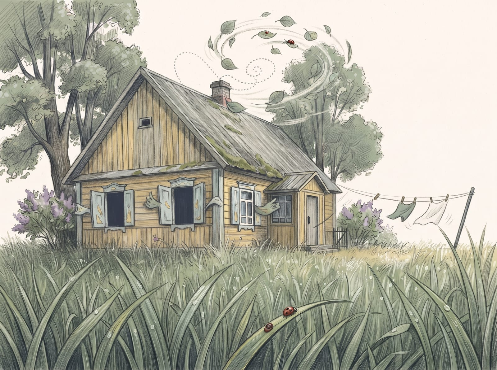

Bet jo žmonės išvažiavo į miestą, kieme pasidarė tylu tylu, ir namelis liūdėjo vienas, net nebedūdavo. Kas vakarą jis tik žiūrėjo į vartelius ir laukė, kad jį kas aplankytų.

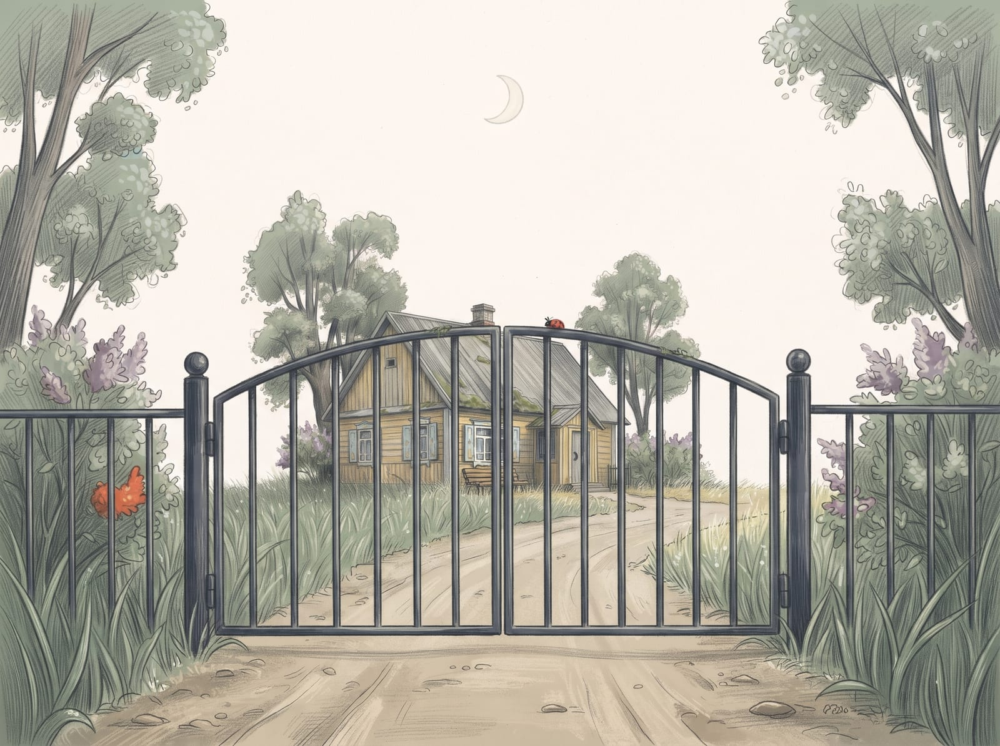

Vieną pavasario rytą atskrido kregždutė ilga įkirpta uodega.

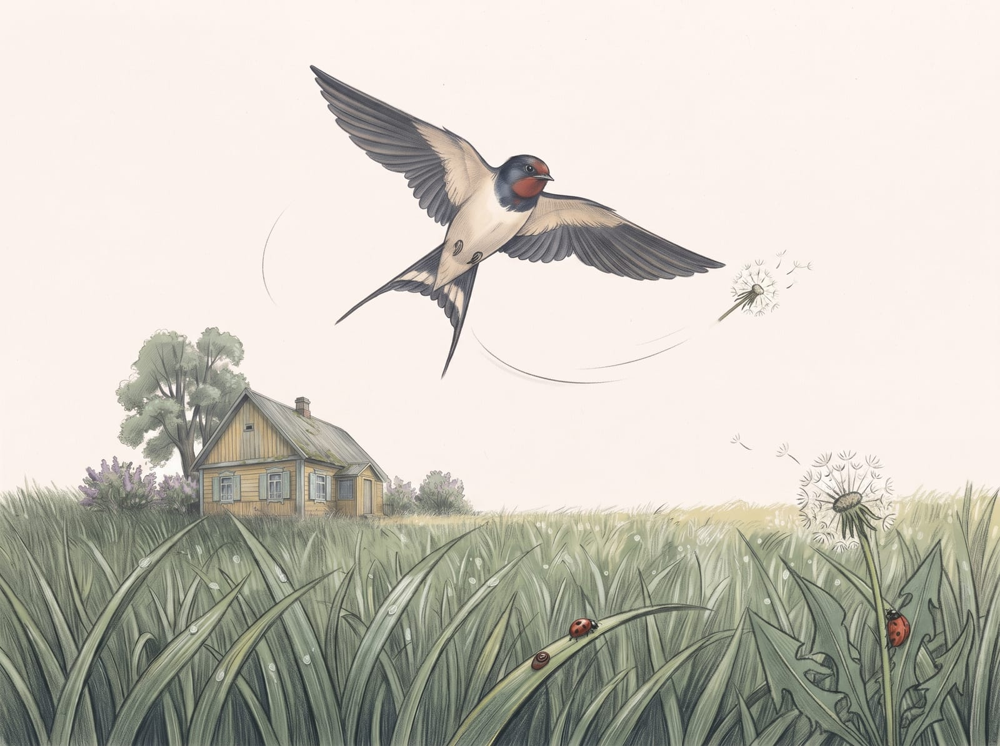

Ji nutūpė ant durų rankenos ir mandagiai pabarbeno snapeliu.

– Nameli, įleisk mane, aš noriu susilipdyti lizdelį.

– Durys uždarytos! – sugirgždėjo namelis. – Prinešiosi purvo.

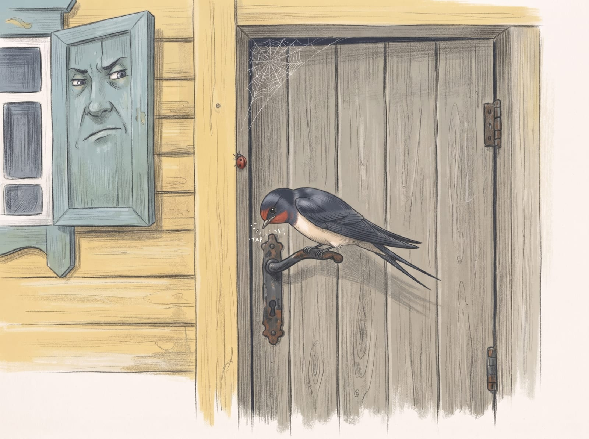

Kregždutė apsuko ratą aplink stogą, pamatė kaminą ir smukt į jį žemyn.

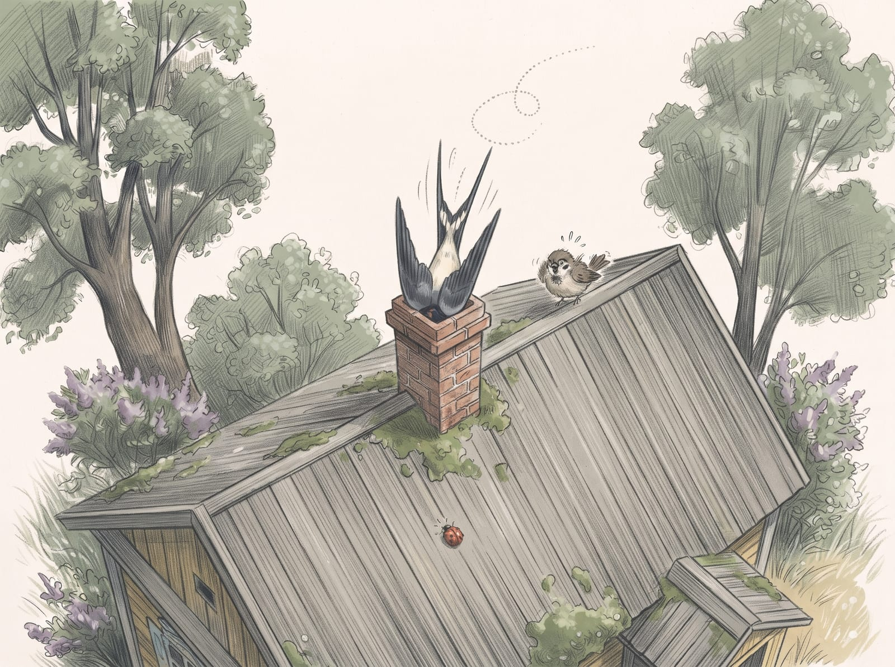

Bet kamine buvo pilna suodžių, ir nameliui taip sukuteno nosį, kad jis nusičiaudėjo: apčiū! Kregždutė išlėkė atgal į dangų juoda kaip anglis, tik akutės blizgėjo.

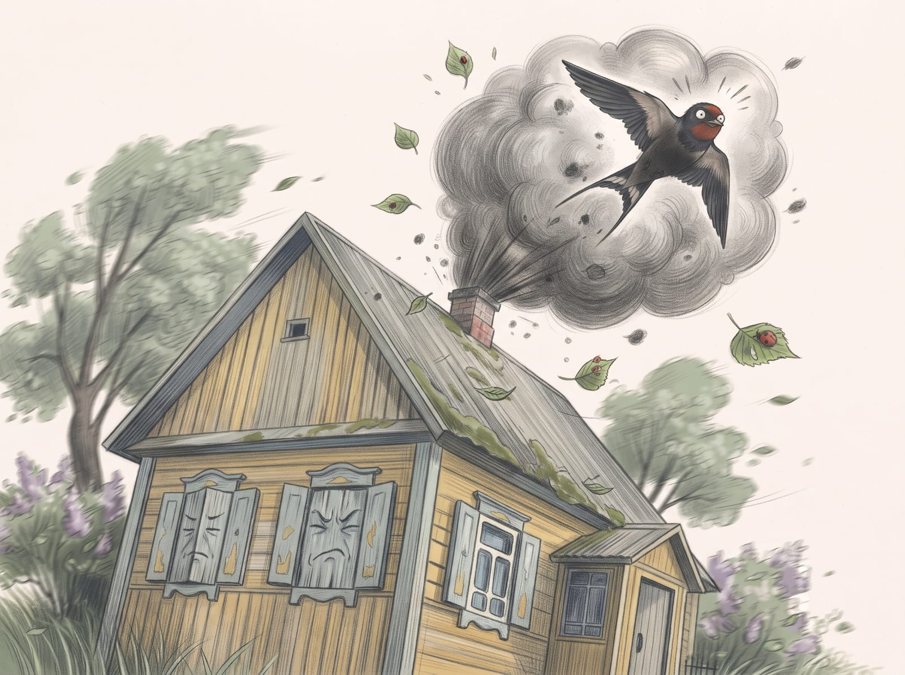

– Durys uždarytos... – sumurmėjo namelis, bet jau tyliau, nes jam buvo truputį gėda.

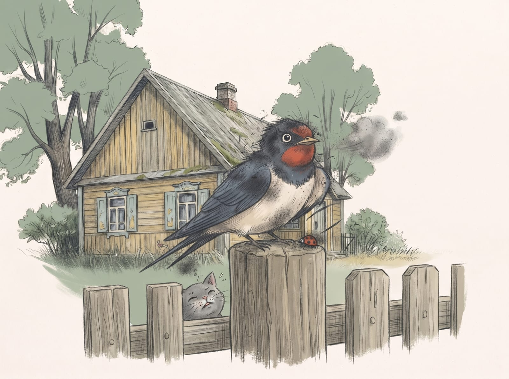

Tuo metu ėmė lynoti. Kregždutė sušlapo, susigūžė ant rankenos ir atrodė tokia maža ir vieniša, kad nameliui suspaudė širdelę. Juk ir jam pačiam buvo vieniša ir tylu.

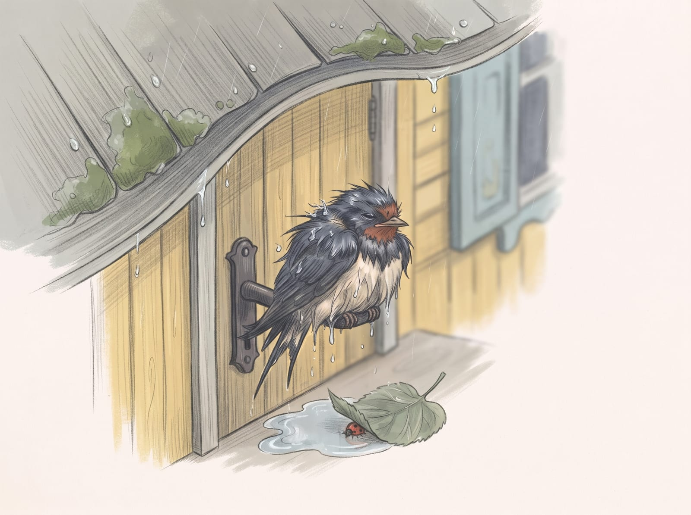

Namelis nieko nesakė, tyliai girgžtelėjo, ir durys prasivėrė.

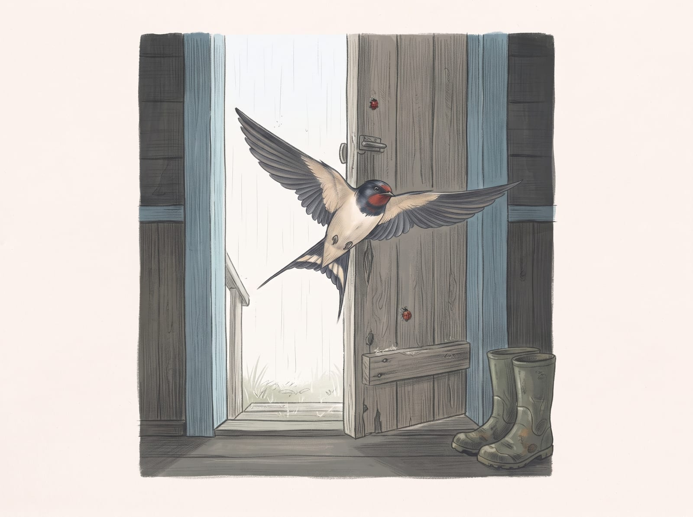

Kregždutė įskrido vidun, nusipurtė lietaus lašus su suodžiais ir ant storiausios sijos sulipdė lizdą. Lietus greitai praėjo, pro duris įspindo saulutė, o vasarą lizde čirškė penki kregždžiukai geltonais snapais.

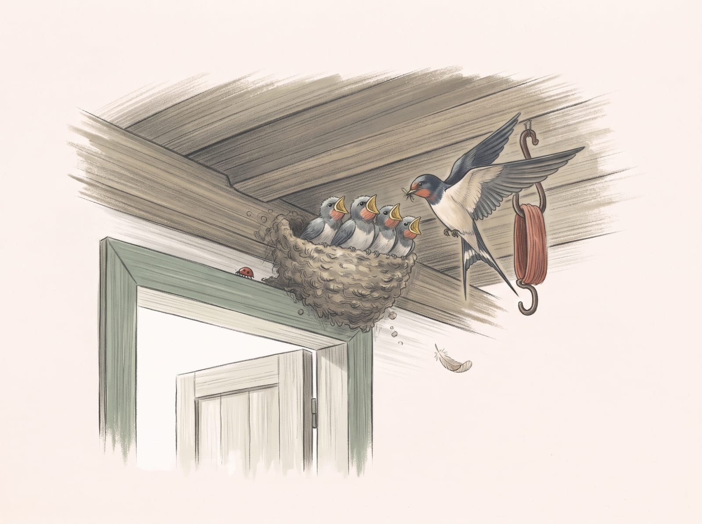

Ir vakare, kai vėl papūtė šiltas vėjelis, namelis dūdavo kaminu: ū-ū-ū! O kregždžiukai jam pritarė, kiek tik turėjo balselio.

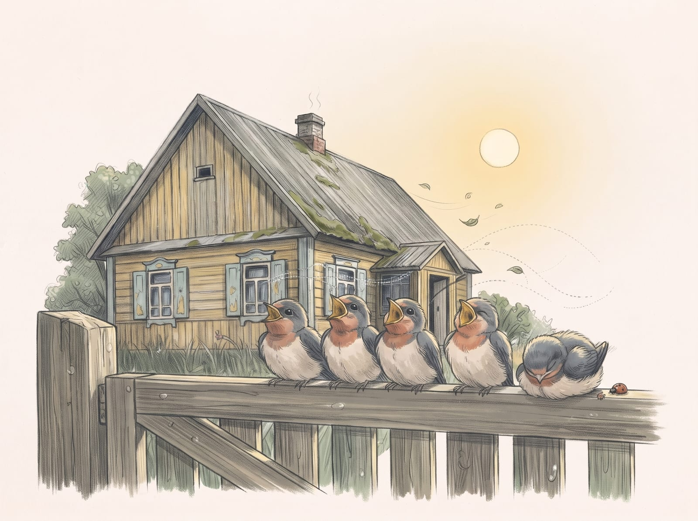

## Pokalbiui

### Apie ką ši pasaka

Iš pirmo žvilgsnio tai istorija apie seną namelį, kuris neįsileidžia kregždutės. Tačiau iš tiesų ji apie vienatvę. Kai jo žmonės išvažiavo į miestą, namelis liko vienas, liūdėjo ir saugojo tvarką, todėl iš pradžių bijojo ir purvo, ir svečių. Bet kai pamatė, kad kregždutei taip pat šalta ir vieniša, atvėrė duris ir vėl ėmė dūduoti.

Tai ir švelni pradžia pokalbiui apie senelius, kurie gyvena toli, apie tuščius kaimo namus ir apie tai, kad draugų atsiranda tada, kai atveriame jiems duris.

Mažylių ir vaikų versijose vienišas namas susiranda draugų, ir pabaiga šilta. Versija Vyresniems liūdnesnė, todėl prieš skaitydami ją vaikui, perskaitykite patys.

### Kaip kalbėtis

Tema: vienatvė ir draugystė, kai įsileidi kitą.

Mažyliui svarbiausia pajausti, kad būti vienam liūdna, o įsileisti draugą gera. Jam nereikia suprasti, kodėl namelis laukia. Užtenka pastebėti, kaip namelis iš pradžių pyksta, paskui jam gėda, o galiausiai jis atveria duris ir vėl dūduoja.

### Klausimai

- Kodėl namelis nebedūdavo kaminu?
- Kaip jautėsi kregždutė, kai sušlapo ant rankenos? Parodyk, kaip ji susigūžė.
- Kas buvo juokingiausia? Kaip namelis nusičiaudėjo?

Paskaitę paieškokite boružėlės kiekviename paveikslėlyje, o paskui kartu padūduokite kaip namelis: ū-ū-ū! Mažyliui patinka kartoti priedainį „Durys uždarytos!“, ir iš to, kaip jis jį taria, girdisi, ar jis jaučia namelio pyktį, gėdą ir švelnumą.
