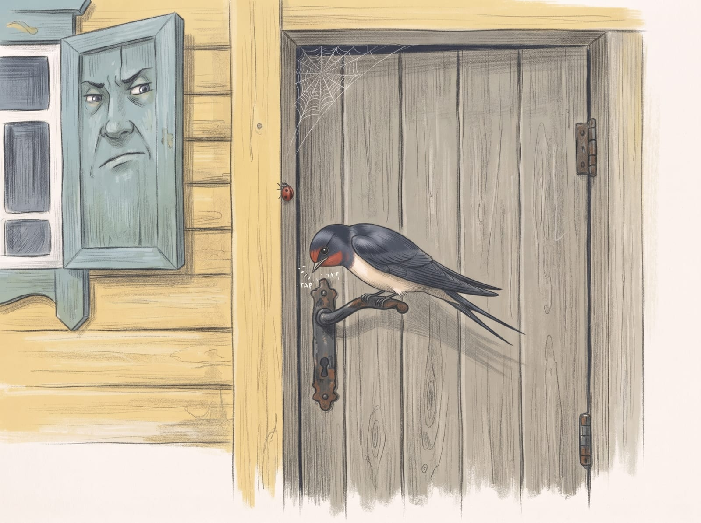
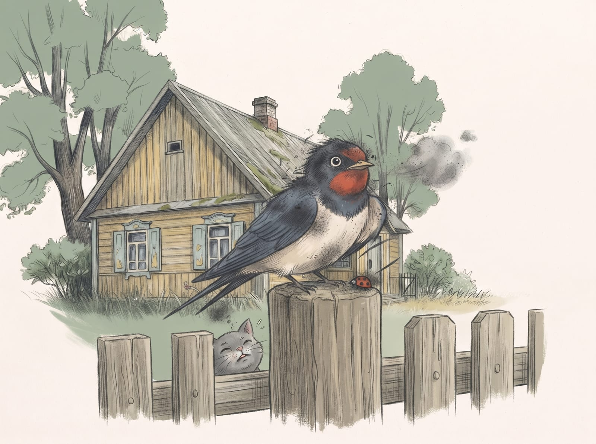
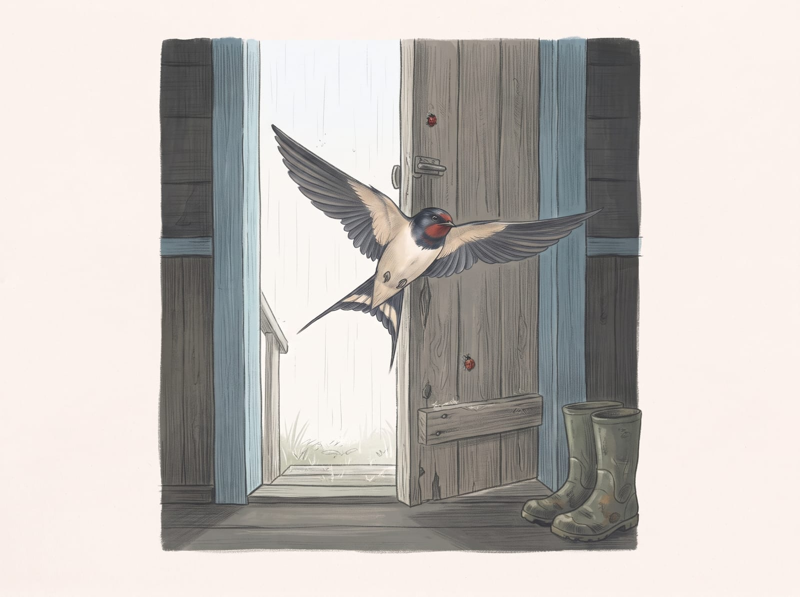
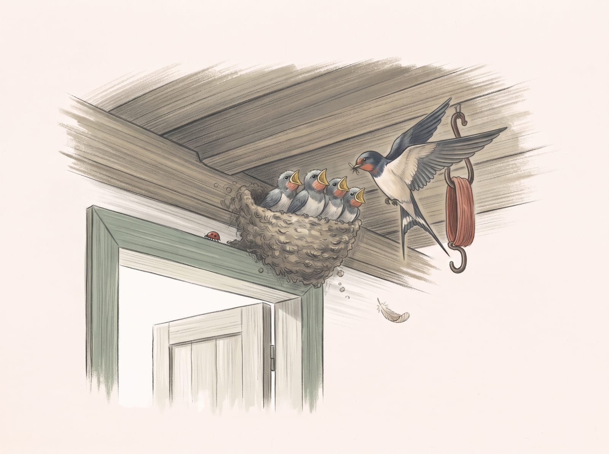
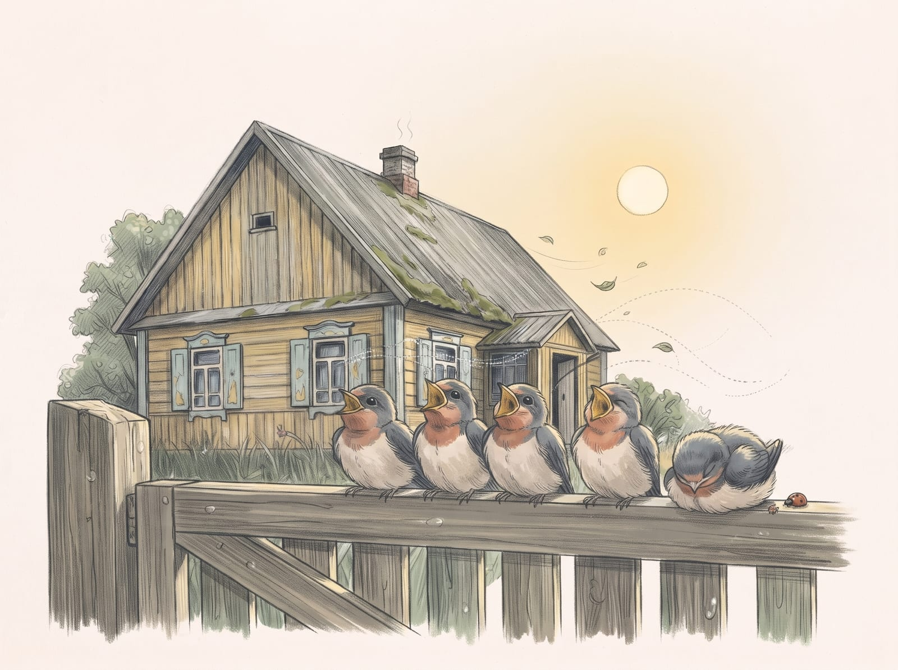

Kregždė Žvitra grįžo iš Afrikos pirmą gegužės rytą ir iškart nuskrido ten, kur gimė: į seną vienkiemį už trijų kalvų. Ten tarp aukštų liepų stovėjo medinis namas mėlynomis langinėmis, o jo priemenėje, ant storiausios sijos, kadaise kabėjo Žvitros mamos lizdas.

Bet priemenės durys šį kartą buvo uždarytos.

Žvitra nutūpė ant rankenos ir mandagiai pabarbeno snapu.

– Labas rytas! Ar galėčiau įskristi? Noriu susilipdyti lizdą.

Namas sugirgždėjo taip, kad nuo stogo nubyrėjo samanų gabalėlis.

– Negali. Mano žmonės išvažiavo, bet jie grįš. O jei grįš ir ras ant grindų molio ir plunksnų? Ne, ne. Viskas turi būti taip, kaip jie paliko.

– O kada jie grįš? – paklausė Žvitra.

Namas nieko neatsakė ir tik dar stipriau užspaudė duris.

Žvitra buvo ne iš tų, kurie pasiduoda. Ji apskrido namą ir pamatė kaminą. Iš kamino nerūko, vadinasi, krosnis šalta, o kaminas veda tiesiai vidun. Ji susiglaudė sparnus ir šmurkštelėjo žemyn.

Viduje buvo tamsu ir pilna suodžių. Namas nusičiaudėjo visu kaminu: apčiū! Ir Žvitra kaip kamštis išlėkė atgal į dangų, juoda nuo snapo iki uodegos galiuko. Ji nusileido ant tvoros, nusipurtė, o aplink ją pakilo toks suodžių debesis, kad net žvirblis ant gretimo stulpo sukosėjo.

– Atsiprašau, – sumurmėjo namas. – Netyčia.

Bet Žvitra jau galvojo apie naują planą. Jei nėra vietos viduje, lizdą galima priklijuoti ir lauke. Ji ėmė nešioti molį nuo balos prie vartelių ir lipdyti lizdą tiesiai ant durų, po stogo kraštu. Gniužulėlis po gniužulėlio, visą dieną.

Dirbdama ji dainavo: greitai, čirškiančiai, kaip tik kregždės moka. Ir staiga kaminas užūkė: ū-ū-ū!

– Tu dūduoji! – nustebo Žvitra.

– Nieko panašaus, – sugirgždėjo namas. – Čia vėjas.

Bet vėjo tą dieną nebuvo nė trupučio.

Vakare atslinko debesys. Pirmiausia sužaibavo už miško, paskui griaustinis sudundėjo virš kalvų, ir pliaupė lietus. Vanduo bėgo nuo stogo krašto tiesiai ant naujojo lizdo, ir šis pamažu tirpo, kol – pliumpt! – nukrito ant slenksčio rudu gumulu.

Žvitra prisiglaudė prie durų. Plunksnos sušlapo ir sulipo, ji drebėjo ir nebečirškė.

Namas žiūrėjo į ją. Jis prisiminė, kaip jo šeimininkas kiekvieną pavasarį atremdavo duris akmeniu ir sakydavo: „Kregždėms. Kur kregždės, ten ir laimė.“ Jis prisiminė, kaip vasarą priemenėje čirškė jaunikliai, o šeimininkas, užsidėjęs akinius, stovėdavo po sija ir skaičiuodavo geltonus snapus: vienas, du, trys... ir kiekvieną kartą susipainiodavo. O pats namas dūdavo kaminu kas vakarą. Ir kaip tylu buvo dabar.

– Nagi, – sugirgždėjo namas. – Lįsk vidun, kol visai neperšlapai.

Ir durys prasivėrė per delną.

Audra praūžė iki ryto. Žvitra miegojo ant sijos, šalia senojo mamos lizdo vietos, o namas visą naktį klausėsi, kaip ji kvėpuoja.

Ryte ji vėl ėmė nešioti molį, tik dabar pro duris, o namas pats patarė, kur sija sausiausia. Netrukus atskrido ir Žvitros draugas, o po kelių savaičių lizde jau rėkė penki geltonsnapiai jaunikliai.

Grindys buvo nusėtos pūkais ir baltomis dėmėmis, bet namas apsimetė, kad nemato.

– O kas bus, kai grįš tavo žmonės? – kartą paklausė Žvitra.

Namas pažiūrėjo į vartelius.

– Tada parodysiu jiems jauniklius, – tarė jis. – Šeimininkas visada mėgo juos skaičiuoti.

Ir vakare kaminas vėl užūkė: ū-ū-ū! Šįkart namas nė nesiteisino, kad čia vėjas.

## Pokalbiui

### Apie ką ši pasaka

Iš pirmo žvilgsnio tai istorija apie seną namą, kuris neįsileidžia kregždės. Tačiau iš tiesų ji apie laukimą ir praeities ilgesį. Namas laukia savo žmonių ir, kad viskas liktų taip, kaip jie paliko, užsidaro: saugo tvarką ir tylą. Bet kartu užveria duris ir tiems, kurie galėtų tapti jo draugais.

Tai ir pasaka apie Lietuvos vienkiemius, kurių senoliai lieka vieni, o vaikai išvažiuoja į miestus ir užsienį. Apie tėvus, kurie sako „viskas gerai, nevažiuok“, ir apie vaikus, kurie nebeturi laiko aplankyti senstančių tėvų. Namas nusprendžia, kad šeimininkas „išvažiavo, bet grįš“, nes taip lengviau. Durys, kurias jis galiausiai praveria naujam gyvenimo etapui, nereiškia, kad jis pamiršo ar nustojo laukti. Jos reiškia, kad namas leidžia sau gyventi toliau ir priima pokyčius, o ne vengia jų.

Mažylių ir vaikų versijose vienišas namas susiranda draugų, ir pabaiga šilta. Versija Vyresniems liūdnesnė, todėl prieš skaitydami ją vaikui, perskaitykite patys.

### Kaip kalbėtis

Tema: kai pernelyg saugome prisiminimus apie tai, kas buvo, ir nenorime pripažinti tiesos, užveriame duris tam, kas yra dabar.

Šio amžiaus vaikas jau supranta, kad namas ne piktas, o ilgisi savo žmonių ir bijo, kad jie grįžę ras netvarką ar kitus pokyčius. Verta pakalbėti, kaip ilgesys gali padaryti mus nesvetingus ir kaip drąsu yra persigalvoti bei priimti galimybę gyventi toliau.

### Klausimai

- Kodėl namas nenorėjo įleisti Žvitros? Ar jis buvo blogas?
- Kas nutiko, kad namas persigalvojo?
- Ar tau yra tekę ko nors labai laukti? Ką tada darei?

Paklauskite, kaip vaikas mano, ar namo žmonės grįš. Neskubėkite atsakyti už jį. Jei jis paklaus, kur jie išvažiavo, galite papasakoti apie senelius ar kaimo sodybas, kurias pažįstate. Tai gera proga pakalbėti apie savo šeimos šaknis.
