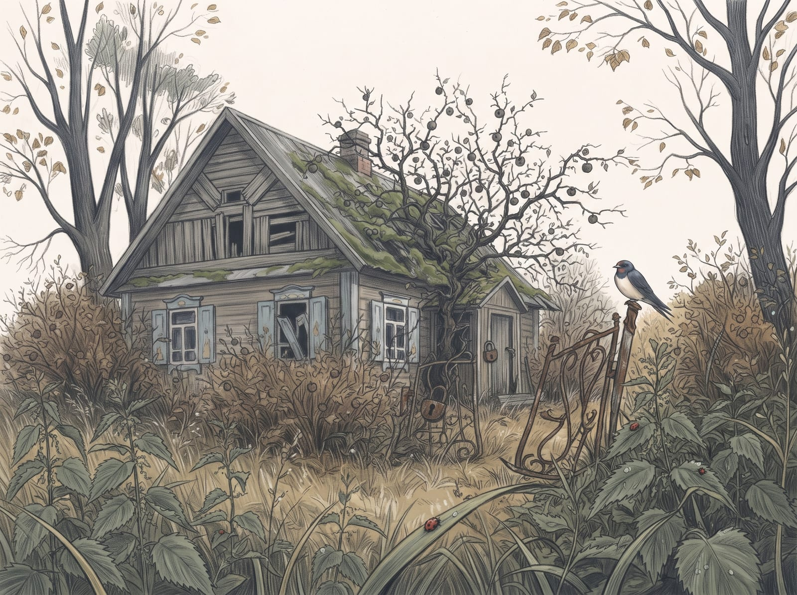

Pavasarį, kai nuo stogo su dusliu šnaresiu nučiuožė paskutinis sniego luitas ir sudrebino langines, senasis namas vėl ėmė klausytis vartelių.

Jie buvo už kokių trisdešimties žingsnių, tarp dviejų alyvų krūmų, kurie per tuos metus taip sužėlė, kad vartelius beveik paslėpė. Metaliniai, kalvio kalti, su lankeliu viršuje. Atsidarydami jie cypdavo, ir namas tą cyptelėjimą pažinojo geriau nei savo paties girgždesį: trumpas, kai varteliai atidaromi skubant, ištęstas, kai juos stumia kas nors pavargęs. Kai pūsdavo vėjas, jie tik barškėdavo į stulpą, ir tada namas nusivildavo.

Namas stovėjo vienkiemyje už trijų kalvų nuo vieškelio. Kadaise čia vedė keliukas, dabar jį žymėjo tik dvi pažemėjusios vėžės, užžėlusios varnalėšomis ir dilgėlėmis. Kiemą juosė liepos, sodintos dar šeimininko senelio. Jos seniai pralenkė kaminą ir vasarą taip užstodavo saulę, kad troboje net vidurdienį tvyrojo žalsva prieblanda. Už jų stovėjo kluonas, toliau tvartas be durų, o pakalnėje sodas, kurio obelų niekas nebegenėjo.

Pats namas buvo rąstinis, apkaltas lentomis, kadaise dažytas geltonai, su mėlynomis langinėmis. Dažai nuo langinių luposi plačiais lopais, kaip lupasi beržo tošis, ir po jais matėsi pilka, sutrūkinėjusi mediena. Už durų buvo priemenė, nedidelė, su moliniu, kojų nutrintu slenksčiu ir siauru langeliu į kiemą.

Namas turėjo vieną silpnybę: mėgo dūduoti. Kai papūsdavo pietvakarių vėjas, ypač rudenį, kai jis būna drėgnas ir sunkus, kaminas užūkdavo žemu, storu balsu, panašiu į tolimą karvės mūkimą. Šeimininkas tada, sėdėdamas ant slenksčio su papiroso nuoruka tarp pirštų, kraipydavo galvą:

– Va, ir vėl mūsų trobą giedot paėmė.

Kartais dar pridurdavo: „Gieda gieda, o malkų pati neprisiskaldo.“ Ir eidavo skaldyti.

* * *

Šeimininko nebuvo jau trečias pavasaris.

Namas atsiminė tą rudenį iki smulkmenų, nors stengėsi jo dažnai neprisiminti. Pirmiausia kelias dienas niekas nekūreno krosnies. Paskui kieme sustojo kelios mašinos, iš jų išlipo tamsiai apsirengę žmonės. Moterys su skarelėmis, vyrai be kepurių. Jie kalbėjo pusbalsiu, kaip kalbama bažnyčioje, rūkė už kluono ir gėrė kavą iš termosų. Troboje degė žvakės, vaškas varvėjo ant staltiesės. O paskui keturi vyrai pro priemenės duris išnešė kažką ilgo ir sunkaus, ir vienam iš jų, praeinant pro staktą, paslydo koja, ir jis atsirėmė į ją delnu.

Durys liko praviros. Pro jas daugiau niekas negrįžo.

Namas buvo senas ir matęs tokių dienų. Pro tas pačias duris kadaise išnešė šeimininko tėvą, o dar anksčiau senelį, tą, kuris sodino liepas. Ir šeimininko žmoną Oną, prieš daugelį metų, žiemą, kai sniegas siekė langus ir vyrams teko kasti taką iki vartelių. Namas žinojo, ką reiškia tamsūs drabužiai ir pusbalsiai. Tačiau šįkart jis nenorėjo to pripažinti. Jis sau pasakė – išvažiavo. Šeimininkas išvažiavo, gal pas sūnų į Vilnių, gal kur toliau. Tas žodis buvo lengvesnis, teikiantis vilties. Tai buvo pirmas kartas, kai namas sau pamelavo, ir jį nustebino, kaip lengvai tai pavyko.

Kai visi išsiskirstė, kažkas iš giminių užrakino trobos duris spyna, o priemenės duris tik privėrė ir užkabino ant kabliuko. Naktį pakilo vėjas, kabliukas iššoko, ir durys ėmė trankytis: atsilapodavo, sugirgždėdavo ir vėl trenkdavosi į staktą. Kiekvieną kartą pro tarpą įsiverždavo šaltas, šlapių lapų pritvinkęs oras ir nešdavo lauk tai, kas dar buvo likę viduje.

O viduje buvo likęs šeimininko kvapas. Naminis tabakas, kurį jis augindavo už tvarto ir džiovindavo palėpėje ant virvės. Ruginė duona, kurią pirkdavo iš autoparduotuvės kas antradienį ir laikydavo drobiniame maišelyje. Vilnonės kojinės, megztos dar Onos, sulopytos jau jo paties stambiais dygsniais, padžiautos ant krosnies atbrailos. Truputis prakaito, žemės ir pigaus muilo.

Namas sutraukė staktą. Namai tai moka, tik žmonės mano, kad durys pačios išbrinksta nuo rudens drėgmės. Mediena prisigėrė vandens, išsipūtė, ir durys įstrigo taip tvirtai, kad nebebūtų atsidariusios nė per audrą. Vėjas atsitrenkė į jas, pabarbeno ir nuėjo ieškoti kitų plyšių.

Tą žiemą namas kvėpavo atsargiai, mažais gurkšneliais, kaip gurkšnoja paskutinę arbatą iš termoso tas, kuris dar ilgai neras šilto vandens. Kai vėjas pasukdavo iš pietvakarių, namas užspausdavo kamino sklendę ir nedūduodavo. Jis bijojo, kad su balsu pro kaminą išeis ir tai, ką saugo. Dūduoti jis mėgo labiau už viską, bet atsisakė ir to. Juk tik iki pavasario. Gal iki vasaros.

* * *

Laukti namas mokėjo. Jis laukė visą gyvenimą, tik anksčiau to nevadino laukimu.

Laukė, kai vaikai išvažiavo mokytis į Kauną, pirma duktė Danutė, paskui Vytukas. Laukė jų per Kalėdas, ir jie atvažiuodavo, sugriūdavo prie stalo, šildydavo rankas prie krosnies ir skųsdavosi, kad autobusas iki vieškelio eina tik kartą per dieną. Paskui Danutė ištekėjo ir išvažiavo į Airiją, ir nuo jos ateidavo tik atvirukai su žaliomis kalvomis, kuriuos Ona statydavo spintelėje už stiklo. Vytukas liko Vilniuje. Jis atvažiuodavo per Velykas, per Vėlines, per tėvo gimtadienį. Paskui tik per Vėlines. Paskui skambindavo.

Šeimininkas telefoną laikydavo ant palangės, nes tik ten pagaudavo ryšį, ir kalbėdavo stovėdamas, garsiai, lyg šauktų per lauką.

– Taip, taip. Viskas gerai. Ko čia man trūks. Malkų yra, bulvių yra. Nevažiuok, kelias dabar kaip kisielius, įklimpsi. Kada nors vasarą. Taip. Nu, žiūrėk ten.

Padėjęs telefoną, jis dar ilgai stovėdavo prie lango ir žiūrėdavo į vartelius. Paskui atsisėsdavo ant suolo ir sakydavo, nežinia kam, gal namui:

– Ką jis čia veiks. Žmogus dirba.

Vieną kartą Vytukas atvažiavo su kažkokiais popieriais ir ilgai kalbėjo apie butą Vilniuje: kad yra atskiras kambarys, kad šalia poliklinika ir parduotuvė, kad nebereikės malkų. Šeimininkas klausėsi, gniaužė rankose kepurę, o paskui atsistojo, priėjo prie krosnies ir uždėjo ant jos delną, kaip uždedama ant arklio kaklo.

– O kam aš ją paliksiu?

Vytukas nieko neatsakė. Popierius išsivežė atgal.

* * *

Gegužę atskrido kregždės.

Pirmiausia namas jas išgirdo: aukštą, skubų, burbuliuojantį čiulbesį virš kiemo, lyg kas būtų pažėręs saują stiklo karoliukų. Paskui pamatė. Dvi kaimo kregždės, juodai mėlynomis nugarėlėmis, rūdžių spalvos pagurkliais, ilgomis, giliai įkirptomis uodegomis. Viena, ta, kurios kairioji uodegos plunksna buvo trumpesnė, iškart nusileido ant priemenės durų rankenos.

Kiek namas save atsiminė, kregždės kiekvieną pavasarį lipdė lizdą priemenėje, ant storiausios sijos, šalia geležinio kablio, ant kurio kadaise kabėjo lopšys. Jame supo Danutę, paskui Vytuką. Lopšio seniai nebebuvo, bet ant kablio dar karojo apsivijęs raudonas vilnonis siūlas, kurį Ona buvo užrišusi nuo akių, kad niekas vaikų nenužiūrėtų. Siūlas išbluko iki rusvos džiovintos šermukšnio uogos spalvos, bet laikėsi.

Visą vasarą šeimininkas priemenės durų neuždarydavo. Atremdavo jas akmeniu, o kai kaimynai klausdavo, ar nebijo, kad įlįs kiaunė, jis numodavo ranka:

– Kregždėms. Kur kregždės, ten ir laimė.

Ir jau tyliau pridurdavo, kad ir musių troboje mažiau.

Dabar kregždė tupėjo ant rankenos ir žiūrėjo į užvertas duris. Paskui pakilo, apskrido namą, nutūpė ant palangės ir pabarbeno snapu į priemenės langelį, apdulkėjusį ir apraizgytą voratinkliais. Vėl ant rankenos. Ir vėl. Jos draugas sukinėjosi apie kaminą ir čirškė taip piktai ir nekantriai, kad namui pasidarė nejauku.

– Neįleisiu, – sugirgždėjo namas. – Prinešit molio, priteršit aslą. Šeimininkas grįš, o čia mėšlas ant grindų.

Kregždė pakreipė galvą.

– Jis visada mus įleisdavo.

– Jo nėra. Kai grįš, tada ir įleis.

– O kada grįš?

Namas neatsakė. Tik dar stipriau suspaudė staktą.

Kitą dieną kregždės ėmė lipdyti lizdą kluone, po įlūžusiu stogu. Namas matė, kaip jos nuo balos prie vartelių neša molio gniužulėlius ir skuba atgal. Po savaitės praūžė liūtis, ir pro kluono skylę vanduo pliaupė tiesiai ant sijos. Rytą pusė lizdo gulėjo apačioje, šlapias rudas gumulas šiauduose. Kregždė vėl tupėjo ant rankenos.

* * *

Birželį prie vartelių sustojo automobilis. Iš jo išlipo žilas vyras su akiniais ir ilgai stovėjo, nesiryždamas bristi į žolę, kuri siekė jam iki juosmens. Paskui jis pastūmė vartelius. Šie sucypė tuo pačiu plonu balsu kaip tada, kai ant jų supdavosi basas berniukas, o šeimininkas šaukdavo iš daržo:

– Vytuk, nulipk, nusuksi vyrius!

Vyras kažkodėl nusišypsojo ir paglostė vartelių viršų. Pakėlė telefoną, nufotografavo namą. Ir išvažiavo.

Namas jo neatpažino. Jis laukė šeimininko, o ne svetimo, žilo, pavargusio žmogaus, kuris stovi už vartelių ir neina vidun. Šeimininkas visada eidavo vidun. Vėliau namas ne kartą bandė prisiminti to vyro veidą ir negalėjo, nes tada žiūrėjo į kelią už jo nugaros.

Po to vakaro namas ilgai nesuprato, kas pasikeitė. Jis įkvėpė, kaip kasdien, ir užuodė pelėsį. Pelių išmatas. Šlapią tinką. Tabako ieškojo kampuose, palėpėje ant virvės, kur kabojo tik keli sudžiūvę, į dulkes byrantys lapai, ir nerado. Kojinių ant krosnies nebebuvo, jas pelės išsitampė į lizdus dar pirmą žiemą, o namas apsimetė, kad nepastebėjo. Palubėje žaliavo pelėsio dėmės, tapetai atšoko nuo sienos ir kabojo kaip nulupta žievė. Kai lijo, namas pirmą kartą pajuto, kad šąla iš vidaus.

Kregždė vis dar tupėjo ant rankenos. Nebečirškė, tik žiūrėjo.

Tą naktį papūtė pietvakarių vėjas. Jis buvo šiltas, kvepėjo nupjauta žole iš kažkieno tolimos pievos ir žydinčiomis liepomis. Namas ilgai jo klausėsi, o paskui, pirmą kartą per tris metus, atleido kamino sklendę. Kaminas užūkė žemai ir storai, iš pradžių užkimęs, su kosuliu, paskui vis tvirčiau. Namas dūdavo beveik iki aušros. Ir kažkur tarp vieno ūkimo ir kito, pats nežinodamas kada, atleido staktą.

Durys girgžtelėjo ir prasivėrė per delną.

Ryte priemenėje kvepėjo šlapiu moliu.

* * *

Liepą ant sijos tupėjo penki geltonsnapiai. Jie rėkė nuo aušros iki sutemų, barstė pūkus ant aslos, o tėvai skraidė pro duris pirmyn atgal tiek kartų, kad namas pametė skaičių. Mėšlas ant grindų kaupėsi baltomis dėmėmis, ir namui tai visai nerūpėjo. Vakarais vėl dūdavo kaminas.

Kartą vienas jauniklis, jau beveik išmokęs skraidyti, nutūpė ant vartelių ir paklausė:

– Ko tu vis žiūri į kelią?

– Laukiu šeimininko, – atsakė namas.

– O koks jis?

Namas pagalvojo apie tabaką, apie slenkstį ir apie tai, kaip šeimininkas, grįžęs iš lauko, visada pirmiausia paglostydavo durų staktą. Paskui dar apie basą berniuką ant vartelių.

– Pamatysi, – tarė jis. – Kai grįš.

Rugsėjo pabaigoje kregždės susirinko ant elektros laidų, kurie dar driekėsi nuo vieškelio iki namo, nors srovės juose seniai nebebuvo. Jų buvo daug, iš visų apylinkių, ir jos čirškė visos kartu, kaip kadaise žmonės kieme per atlaidus. Vieną rytą laidai buvo tušti. Atsisveikinti nė viena neatskrido.

Durų namas nebeuždarė. Gal todėl, kad pavasarį kregždės grįš. Gal todėl, kad pro tokį tarpą įeitų ir žmogus, jei tik labai norėtų.

Gruodį pro tarpą ėmė pustyti sniegas. Jis gulė ant molinio slenksčio, per šimtą metų išminto ir įdubusio viduryje, lygiu baltu sluoksniu, ir niekas jo nesujaukė iki pat pavasario.

## Pokalbiui

### Apie ką ši pasaka

Iš pirmo žvilgsnio tai istorija apie seną namą, kuris neįsileidžia kregždės. Tačiau iš tiesų ji apie laukimą, susvetimėjimą ir praeities ilgesį. Namas laukia šeimininko, kuris nebegrįš, ir tam, kad lauktų toliau, užsidaro: saugo kvapą, tvarką, viską taip, kaip buvo. Iš pradžių tai padeda išlaikyti viltį. Paskui ima jį pūdyti iš vidaus.

Tai ir pasaka apie Lietuvos vienkiemius, kurių senoliai lieka vieni, o vaikai išvažiuoja į miestus ir užsienį. Apie tėvus, kurie sako „viskas gerai, nevažiuok“, ir apie vaikus, kurie atvažiuoja, pastovi prie vartelių ir neužeina. Namas įtiki, kad šeimininkas „išvažiavo“, nes taip lengviau. Durys, kurias jis galiausiai praveria, nereiškia, kad jis pamiršo ar nustojo laukti. Jos reiškia, kad jis pagaliau leidžia gyvenimui tekėti toliau.

Mažylių ir vaikų versijose vienišas namas susiranda draugų, ir pabaiga šilta. Versijoje Vyresniems namas taip pat atveria duris, bet šeimininko jis nesulauks, o atvažiavusio sūnaus jau nebeatpažino.

### Kaip kalbėtis

Pasakos temos: beviltiškas laukimas to, kas jau nebegrįš, susvetimėjimas, netektis ir nenoras paleisti, net kai nebėra vilties.

Namas pasako sau „išvažiavo“, nes tiesa per sunki, ir šitas mažas melas leidžia jam toliau stovėti. Kaina yra užvertos durys, pelėsis ir tyla. Sūnus atvažiuoja, bet stovi už vartelių, o namas žiūri pro jį į kelią, laukdamas to, kurio nebebus. Abu išsiilgę, bet nė vienas neužeina pas kitą. Šeimininko telefono pokalbiai („viskas gerai, nevažiuok“) yra tos pačios užsklęstos durys, tik žmogaus lūpose.

Pabaigoje durys prasiveria, bet sniegas ant slenksčio taip ir lieka nepaliestas. Novelė nesako, ar tai susitaikymas, pasidavimas, ar tik kitas laukimo būdas. Šiuos klausimus galima užduoti ir sau, ir paaugliui.

### Pamąstymui

- Kokią skaudžią tiesą esu pakeitęs „lengvesniu“ žodžiu?
- Ar yra kas nors, kas laukia manęs, o aš vis atidedu kelionę?
- Ką saugau užvėręs duris ir kas dėl to negali įeiti į mano gyvenimą?
