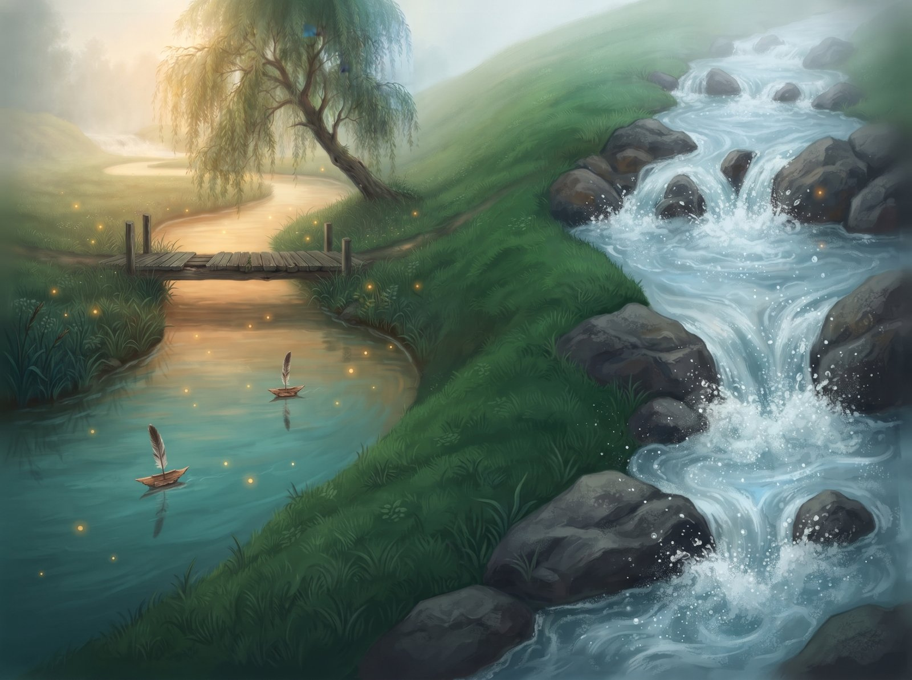
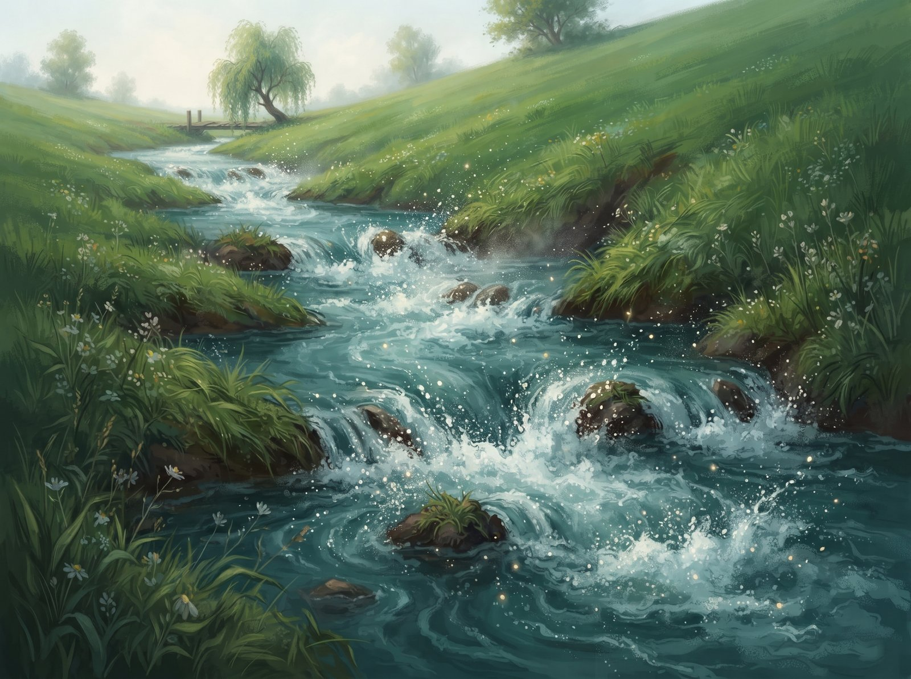
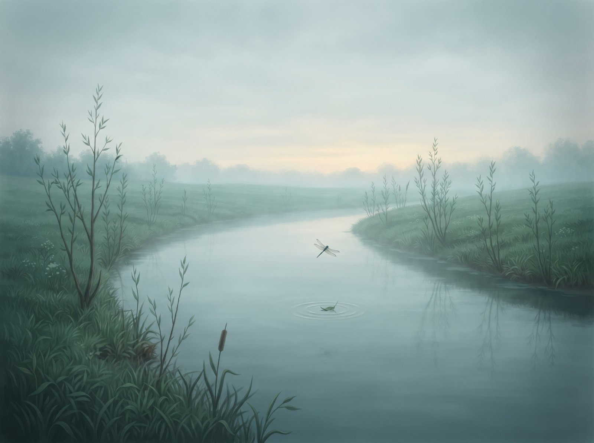
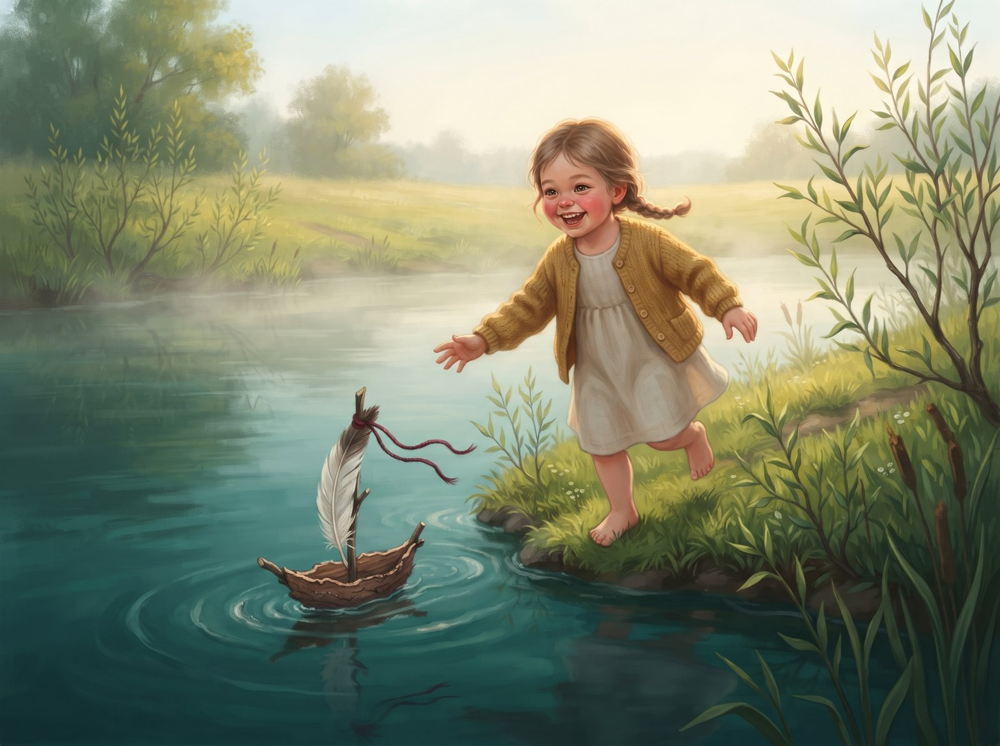

In a meadow, by an old wooden footbridge, wound a river called Alanta (ah-LAHN-ta). Children floated little pine-bark boats with feather sails on her, and Alanta rocked them gently and sang:

"Slowly, slowly, I carry your boat."

Over the hill ran another river, Zvelsa (ZHVEL-sa). She jumped over the rocks and roared so loudly that the whole village could hear her.

One day two travellers stopped at the footbridge. They rinsed their hands, but they weren't looking at Alanta.

"Can you hear Zvelsa? Now that's a river!"

Alanta frowned with every little ripple. She wanted to be loud too. So off she ran down the hill, as fast as she could go:

"Quickly, quickly, I carry nothing!"

Splashes flew everywhere.

But when Alanta stopped, everything was quiet. No footbridge, no children, no boats. Just one little leaf floating along, and a dragonfly circling above it.

One morning a little girl in a yellow cardigan came running to the bank. Her boat was a bit wonky, and a red thread fluttered on its mast. Plop! And in went the boat.

Alanta didn't hurry. She caught the little boat, turned it round in a circle and carried it so slowly that the girl could run along the bank beside it. The girl laughed, and Alanta murmured softly:

"Slowly, slowly, I carry your boat."

