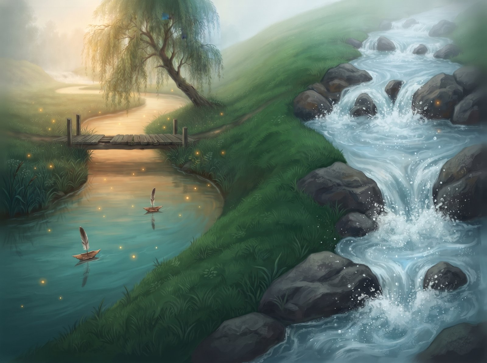
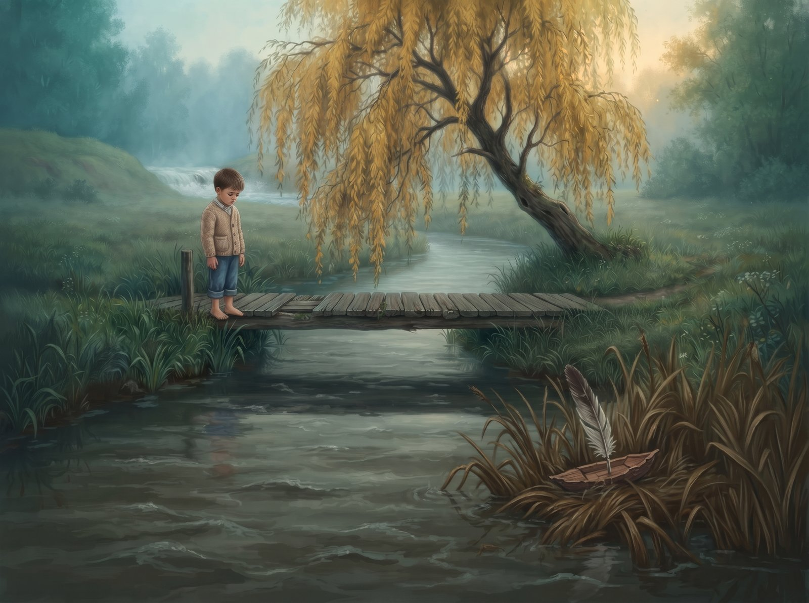
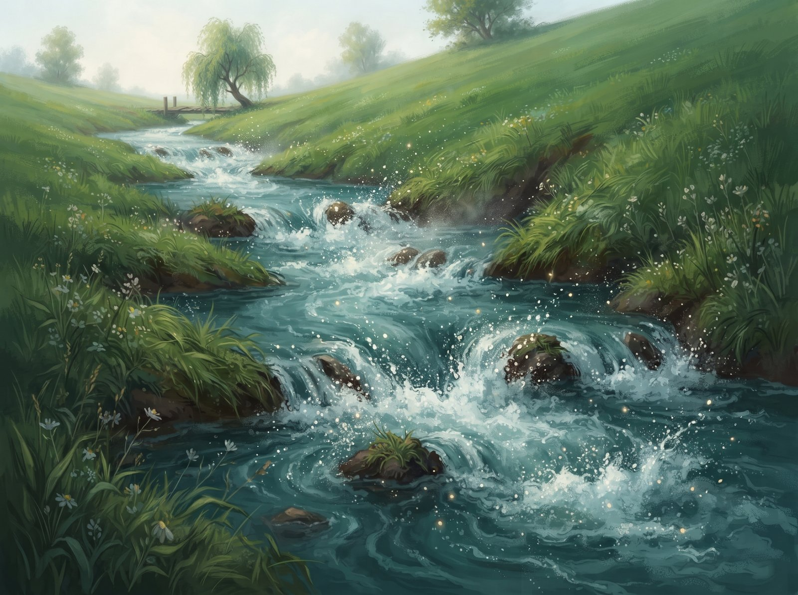
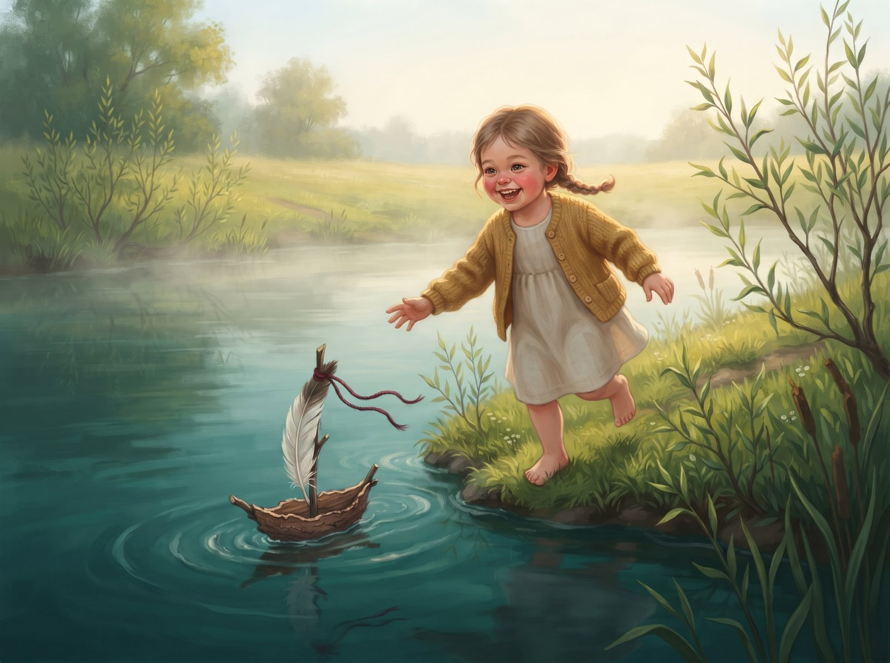
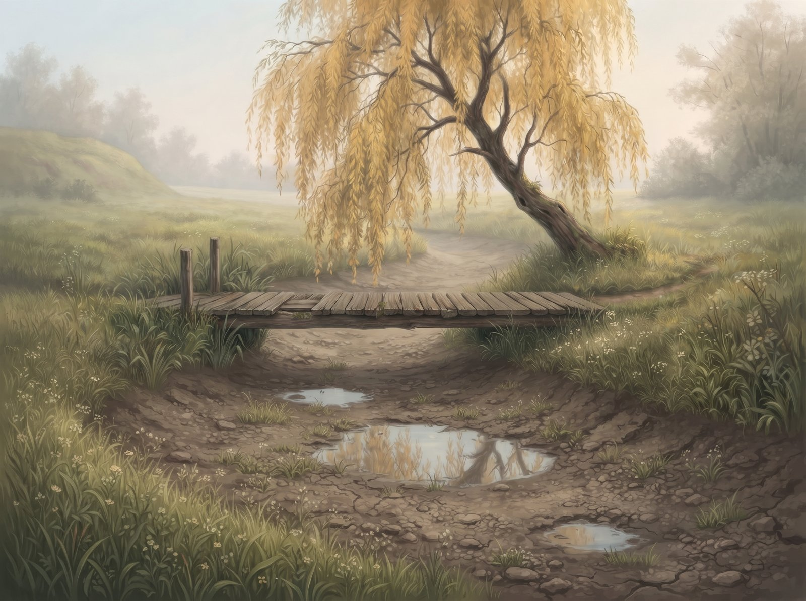

Alanta the river flowed slowly and calmly. She wound through the meadow in a big loop, just so she could stay a little longer by the old wooden footbridge. That's where the village kids floated their pine bark boats with feather sails. Alanta carried them very carefully, so that not a single one tipped over, and at the bend she'd wait for the kids to come running along the bank.

Over the hill flowed another river, Zvelsa (ZHVEL-sa). She jumped over rocks, splashed spray everywhere and roared so loud you could hear her miles away.

One day two travellers stopped at the footbridge. They washed their hands, but they hardly even looked at Alanta.

"Hear that? Zvelsa?" one of them said. "Now that's a river! You could watch her all day."

The travellers walked off, and Alanta took a look at herself. Slow. Quiet. Carp dozing on the bottom. "I'm boring," she thought.

From then on, Alanta was cross with herself. She tried to roar, she threw herself against a rock, but all she got was a few muddy drops. And when a boy put his boat in the water, she didn't even look. She gave it a grumpy shove, and the boat got stuck in the reeds. The boy went home sad.

In spring, Alanta flooded, and she came up with a plan. Next to her loop there was an old ditch that ran straight down the slope. Alanta pushed into it with all her might, gnawing at the earth, rolling clods of mud, until at last she shot off down a brand new, straight path.

Whoosh! Splash! Foam! Alanta raced along, fast and loud, just like Zvelsa.

"Finally!" she cheered.

But the slope ended pretty quickly. The water slowed down again. Alanta looked around: no willow, no footbridge, no kids. Just empty bushes and quiet.

A few weeks went by. One morning a little girl came down to the new bank with a wonky bark boat with a red thread tied to it. Over the hill Zvelsa roared again, and Alanta's heart squeezed tight. But she looked at the girl, at her little boat, and she decided: today, she wasn't going to rush.

Alanta gently caught the boat, spun it round in a little whirl, and carried it slowly, so the girl could keep up running along the bank. The girl laughed, and her laugh rang out like a little bell.

Alanta had something to carry again. And she understood that being slow had never been boring. It was how she took care of things.

And up above, where the old loop used to wind, only a few puddles are left. The old footbridge stands there, quiet and dry. Maybe one day flowers will grow all around it.

