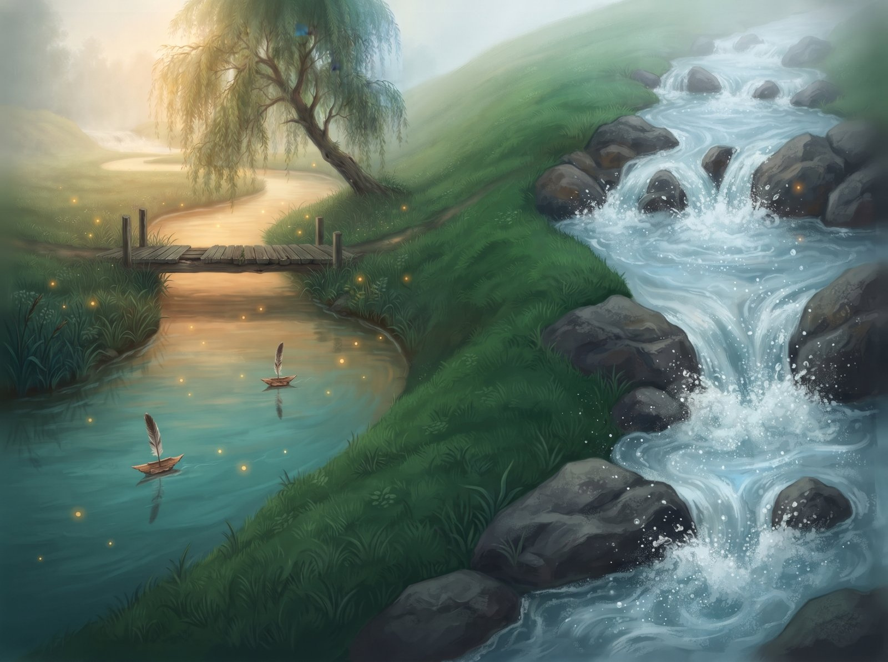
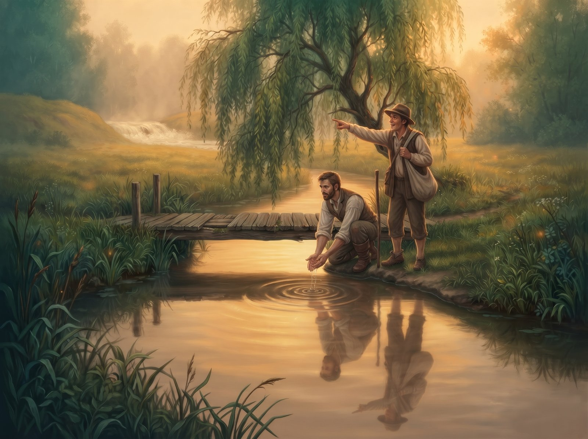
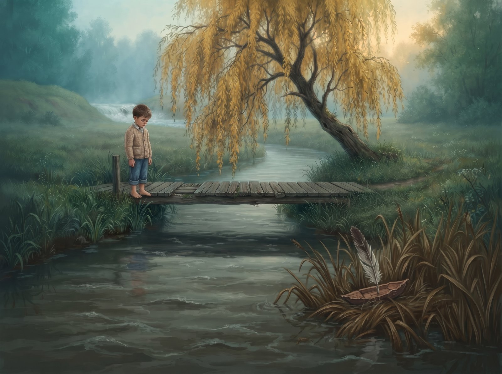
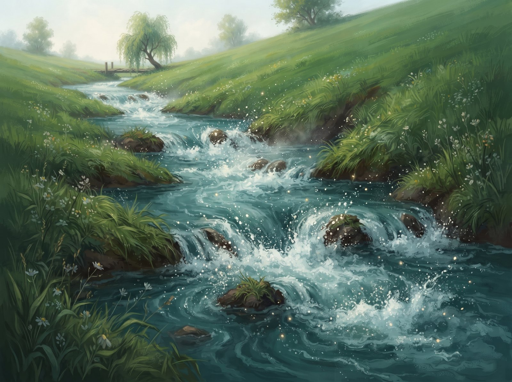
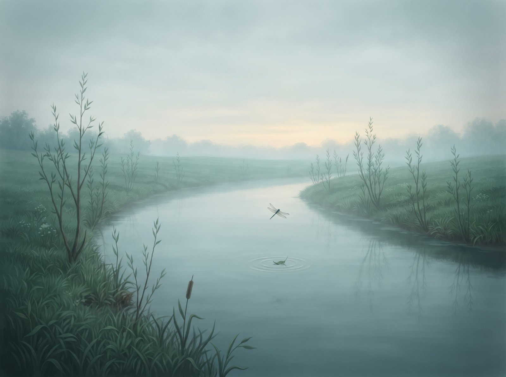
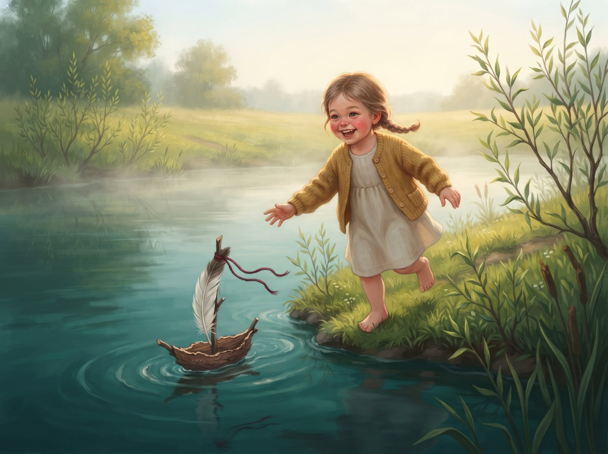
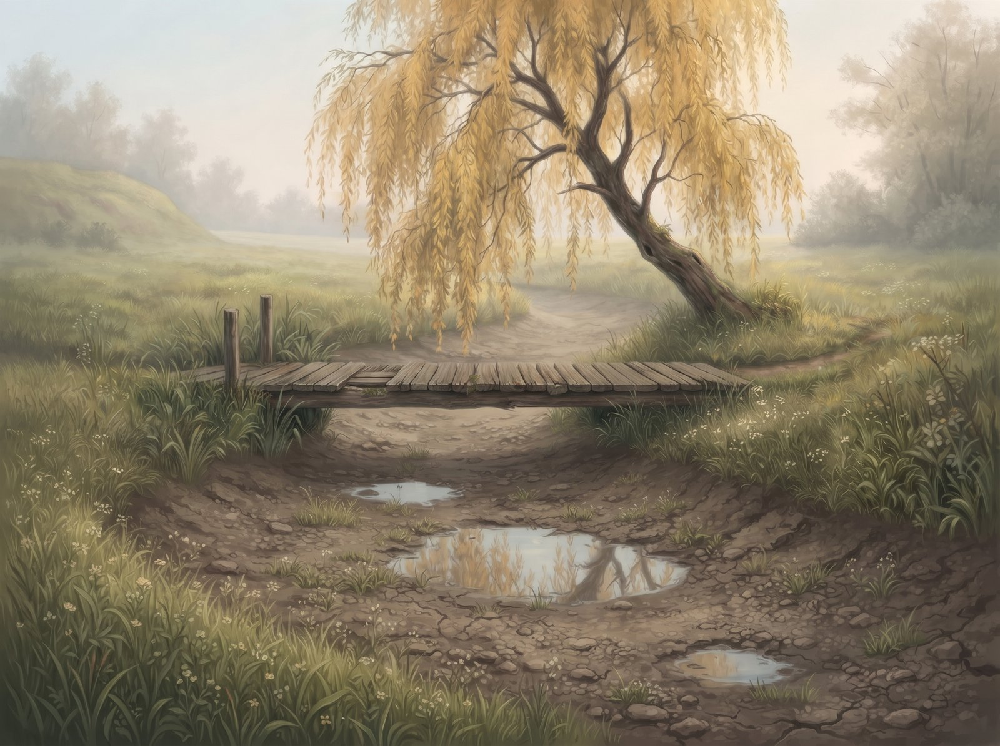

Alanta loved tickling the willow branches that dipped into her water and throwing little flecks of sunlight onto the undersides of their leaves. She took her time, curling in a wide loop around the damp meadow, just so she could stay a bit longer by the old wooden footbridge. Its sun-warmed planks smelled of resin and summer dust. When the village kids crouched there and set their pine bark boats with feather sails on the water, Alanta held her breath. She carried them so carefully that not one ever tipped over, and at the bend she'd wait until bare feet came running along the bank.

On the other side of the hill, down a rocky gorge, Zvelsa (ZHVEL-sa) went racing past. She crashed cheerfully into the boulders, flinging cold silver spray, and sometimes, when the wind was right, she'd shout a "hi!" over to her neighbour.

One afternoon two travellers stopped on Alanta's footbridge. They rinsed their hands in the calm water, but barely glanced at the river itself.

"Can you hear Zvelsa roaring over the hill?" one of them said, all excited. "Now that's power! The water's practically boiling. You could watch it for hours."

The travellers left, and suddenly Alanta's depths felt heavy and murky. She looked down at her own bottom: lazy weeds swaying, carp dozing in the mud. No roar at all. Just a slow, boring bend.

From that day on, Alanta's sides ached every time the wind carried Zvelsa's distant rumble over. She was angry at her slow bends, and at the willow roots that kept catching at her current. Hoping to make even one white splash, she flung herself with all her strength at the only rock on her bank, but all she got was a few muddy drops. And when a boy launched his bark boat from the footbridge that autumn, Alanta didn't even look at it. She shoved it with her current, and the boat got stuck straight away in the wet reeds.

Just before Alanta's long loop, an old dry ditch ran across the meadow. It cut straight down the slope and met up with the riverbed again further down, skipping the willow and the footbridge altogether.

In spring, when the snow melted and Alanta flooded, she made up her mind. Instead of flowing calmly into her old loop, the river threw her whole weight against the steep side of the ditch. She gnawed at the turf, tore up grass roots and rolled over clumps of clay. The narrow ditch got wider and deeper, until finally the whole current went crashing down the new, straight path.

Alanta was thrilled. Tumbling down the steep slope, she was finally roaring! Her back was all foam, her water smashed into freshly uncovered rocks and threw up clouds of cold spray. She was fast. She felt powerful and alive.

But the slope ended quickly, and the current spilled out onto a wide, flat lowland. Here the water lost its speed, spread out and slowed down again. Alanta looked around. All that rustled around her were empty willow thickets. No old willow tree, no warm footbridge planks for barefoot kids to run along.

A few weeks went by. One morning a girl came shyly down to the new clay bank. Sinking into the soft mud, she carefully set a wonky bark boat on the water, with a thick red thread tied to it. Over the hill the wind carried Zvelsa's roar again, and for a moment Alanta's chest tightened. But she looked at the girl's worried little face, at that tiny piece of bark she'd picked out so carefully, and she made up her mind one more time. The river gently caught the boat, let it spin round happily in a little whirl, and carried it slowly along the bank, keeping pace with the small feet running through the grass. She had something to carry again. And next to her, kids' laughter rang out again, bright as a little bell.

Only higher up the valley, where the old loop used to wind, a few drying puddles were left. The old wooden footbridge under the willow stood quiet and dry, hanging over a riverbed that was slowly growing over with grass.

