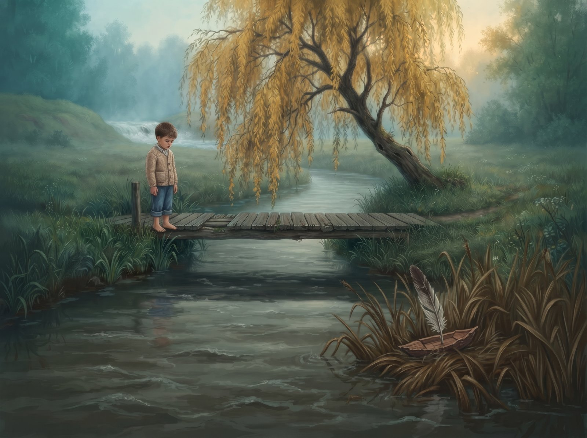
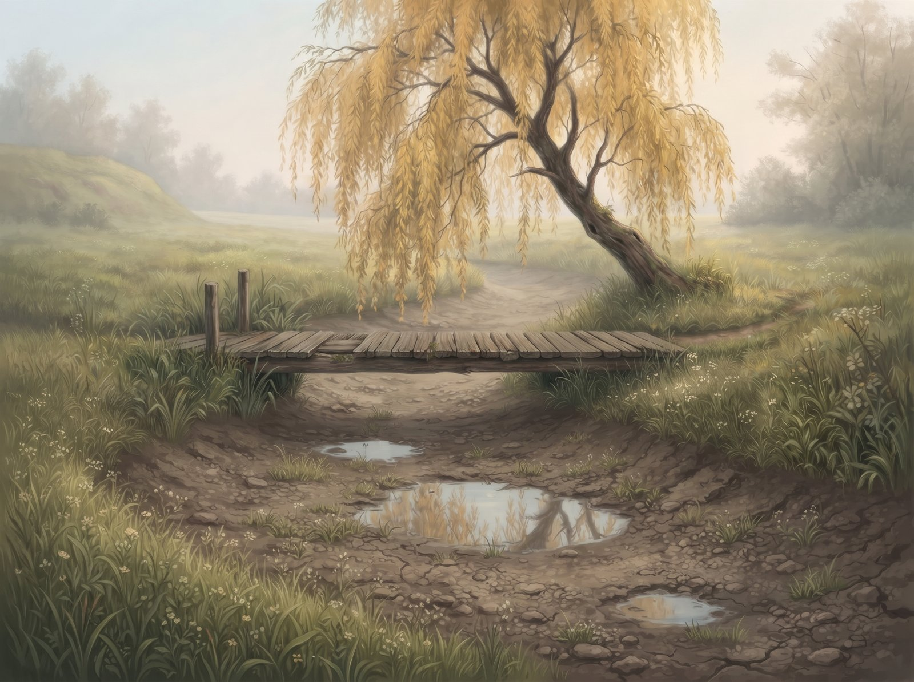

Alanta never hurried. She liked tickling the willow branches that drooped into her water and tossing flecks of sunlight onto the undersides of the leaves. She liked curling in a wide loop around the damp meadow, just to stay a little longer by the old wooden footbridge. Its warm planks smelled of resin and dust, and in summer the village kids would crouch on them and set their pine bark boats with feather sails on the water. That's when Alanta held her breath. She knew every one of her eddies and every stone, knew where to turn a boat and where to let it rest, and at the bend she always waited until bare feet had time to come running along the bank. Nobody taught her that. It was just who she was.

Over the hill, down a rocky gorge, ran Zvelsa (ZHVEL-sa): cold, silver, noisy. Sometimes she'd shout a "hi" over the wind to her neighbour, and Alanta would answer with a calm little splash. They never compared themselves. Why would they? They were different rivers.

Until one afternoon two travellers stopped at the footbridge. They washed their hands, shook the water off their fingers, and looked past Alanta the way you look past a window.

"Hear Zvelsa?" one of them said. "Now that's power. The water's practically boiling. You could watch it for hours."

They left, and an hour later they probably didn't remember what they'd said, or the river they'd washed their hands in. But Alanta remembered.

For the first time, she looked at herself through someone else's eyes. Weeds swaying slowly, like tired hands. Carp dozing in the mud. A bend that wasn't in a hurry to get anywhere. Everything that had been her yesterday looked like a list of flaws today.

From that day on, Zvelsa's rumble, which used to be just her neighbour's voice, turned into a reproach. Every time the wind brought it over, Alanta's sides ached. She was angry at her bends, at the willow roots that seemed to catch at her current on purpose and slow her down. Once she threw herself with all her strength at the only rock on her bank, hoping for even one white splash, and all she raised was a few muddy drops. That was worse than nothing. And in autumn, when a boy launched a boat from the footbridge, she didn't even look at it. She shoved it, the way you shove something that's in your way, and the boat got stuck in the reeds. The boy stood on the footbridge for a long time. Then he left.

Just before the long loop, an old dry ditch ran across the meadow. Alanta had known it her whole life and never given it a thought. Now she thought about it every day. The ditch cut straight down the slope, no bends at all, and further down it met up with her bed again. A shorter way. A steeper one. The kind of way Zvelsa would take.

In spring, when the snow melted and there was more water than ever, Alanta made up her mind. She didn't turn into her loop. She leaned on the side of the ditch with her whole weight, gnawed at the turf, tore at the roots, rolled the clay clods over, and the ditch, which for years had been nothing but a dip in the grass, gave way. The whole current went crashing down the new path.

And it was wonderful. Falling down the steep slope, Alanta roared. Her back foamed, her water smashed into freshly uncovered rocks and threw up clouds of cold spray. She was fast. She was loud. She was finally what she'd heard in the travellers' voices.

The slope ended sooner than she'd expected. At the bottom lay a flat lowland, and there the water spread out, lost its speed and turned slow again, only now it was slow for nothing. Alanta looked around. Empty willow scrub rustling. No willow tree, no footbridge, no bare feet. She was a slow river again, she just didn't have a reason to be slow anymore.

A few weeks went by. One morning a girl came shyly down to the new clay bank. She sank into the soft mud, but crouched down anyway and carefully set a wonky bark boat on the water, with a thick red thread tied to it. You could tell she'd made the boat herself, and that it had taken her a long time. Over the hill the wind brought Zvelsa's roar again, and Alanta's chest tightened with that old, familiar ache. But she looked at the girl's face, focused and a little bit scared, at that tiny piece of bark picked out so carefully, and she realised she was choosing again. Quietly, this time.

She gently caught the boat. Let it spin round in a little whirl so the girl would laugh, and carried it slowly along the bank, keeping pace with the feet running through the grass. The laughter rang out bright, like a little bell. And Alanta felt something she hadn't felt since that afternoon by the footbridge: that someone needed her exactly the way she was.

Only higher up the valley, where the old loop used to wind, a few drying puddles were left now. The old footbridge under the willow stood quiet and dry, hanging over a riverbed slowly growing over with grass. Some paths, once you've carved them, never grow back over. And some grow over for good.

