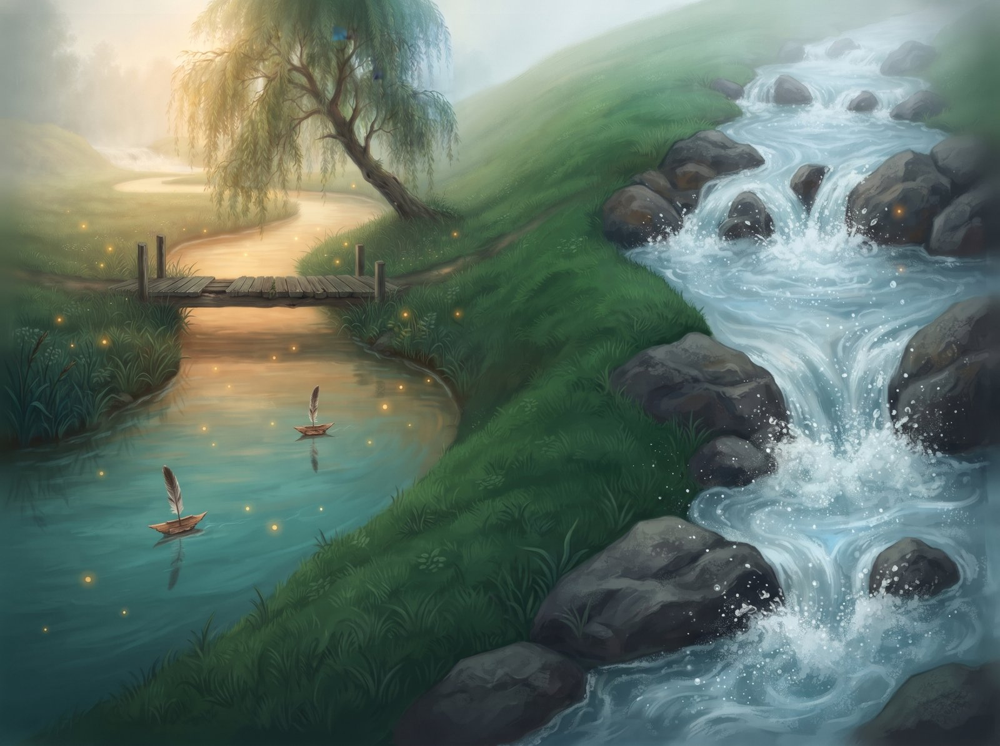
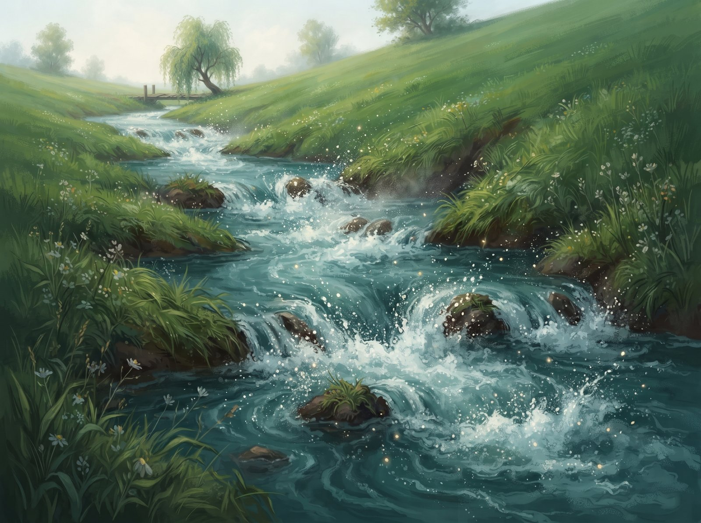
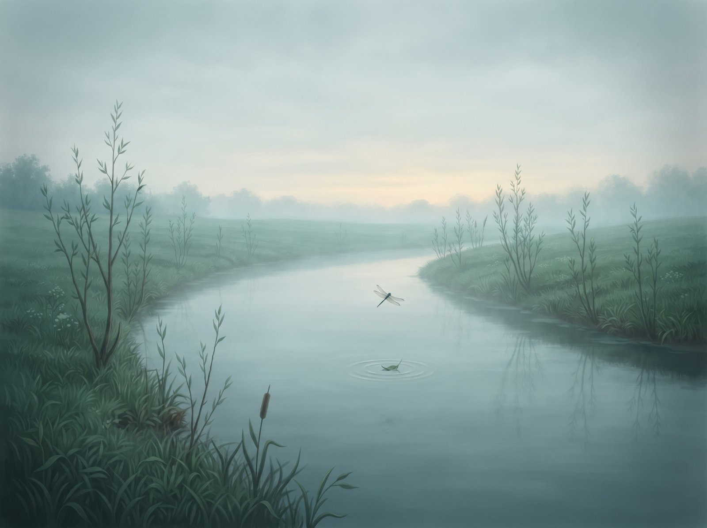
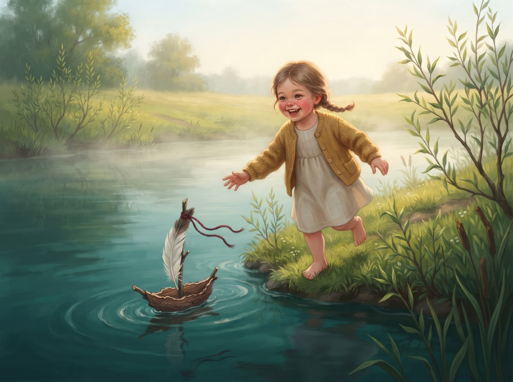

Pievoje, prie seno lieptelio, vingiavo upė Alanta. Vaikai leisdavo į ją pušies žievės laivelius su plunksnų burėmis, o Alanta juos supdavo ir dainuodavo:

– Lėtai, lėtai, laivelį nešu.

Už kalvos tekėjo kita upė, Žvelsa. Ji šokinėjo per akmenis ir šniokštė taip garsiai, kad girdėjo visas kaimas.

Vieną dieną prie lieptelio sustojo du keliautojai. Jie nusiplovė rankas, bet žiūrėjo ne į Alantą.

– Girdi Žvelsą? Va ten tai upė!

Alanta susiraukė visomis bangelėmis. Ji irgi norėjo būti garsi. Ir pasileido nuo kalno, kiek tik galėjo:

– Greitai, greitai, nieko nenešu!

Purslai skraidė į visas puses.

Bet kai Alanta sustojo, aplink buvo tylu. Nei lieptelio, nei vaikų, nei laivelių. Tik vienas lapelis plaukė, o virš jo sukosi laumžirgis.

Vieną rytą prie kranto atbėgo maža mergaitė geltonu megztuku. Jos laivelis buvo kreivas, o ant stiebo plazdėjo raudonas siūlas. Pliumpt, ir laivelis jau vandenyje.

Alanta neskubėjo. Ji pagavo laivelį, pasuko jį ratu ir nešė taip lėtai, kad mergaitė spėtų bėgti pakrante. Mergaitė juokėsi, o Alanta tyliai čiurleno:

– Lėtai, lėtai, laivelį nešu.

