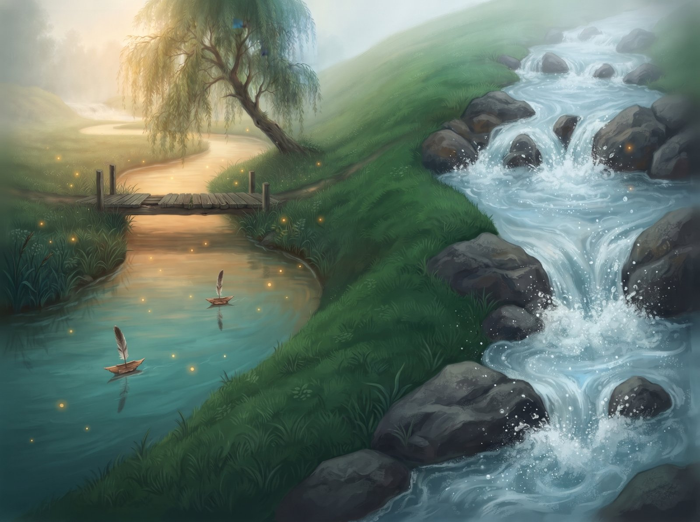
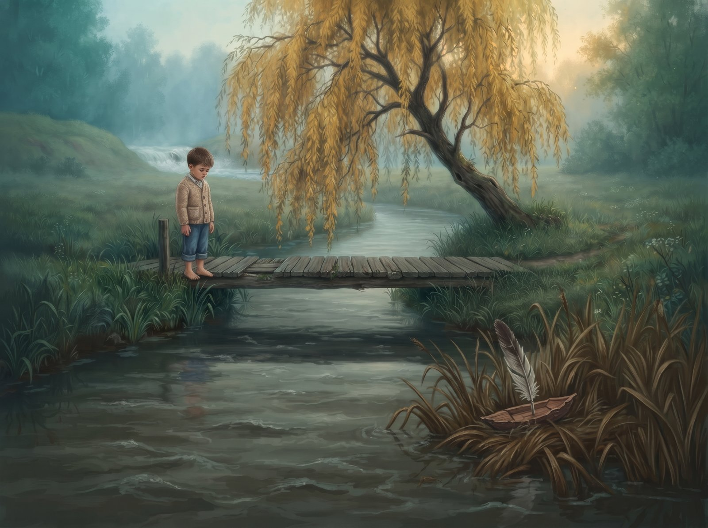
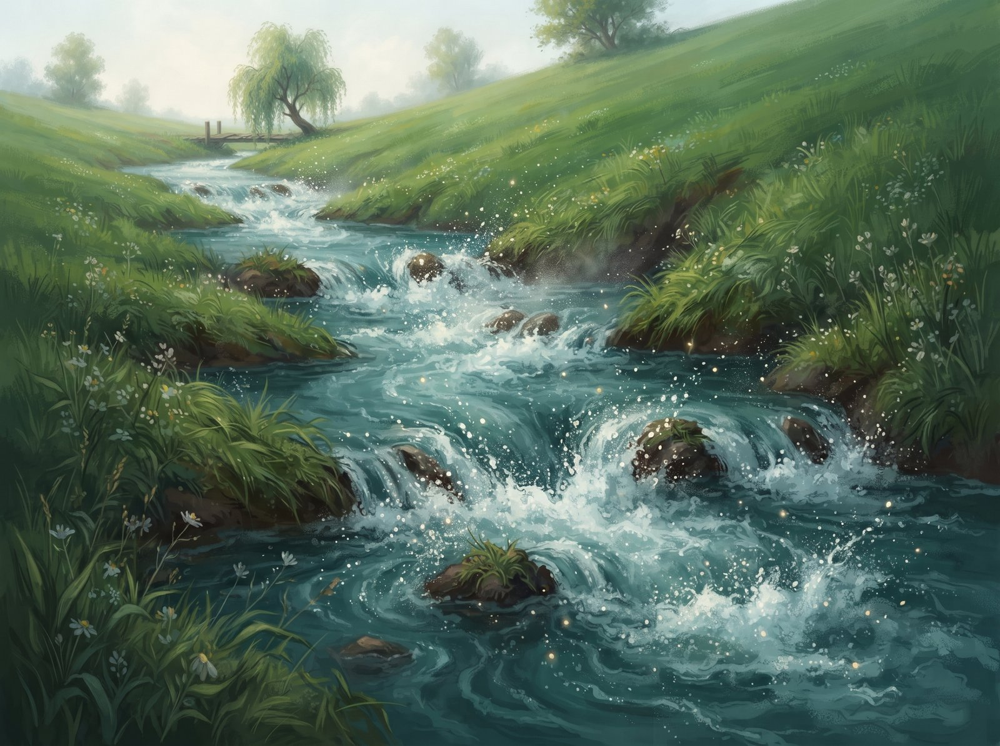
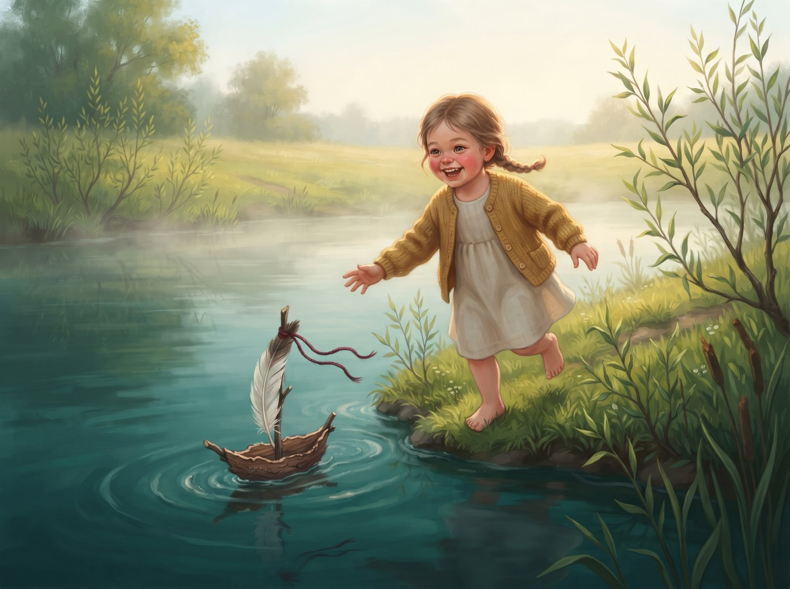
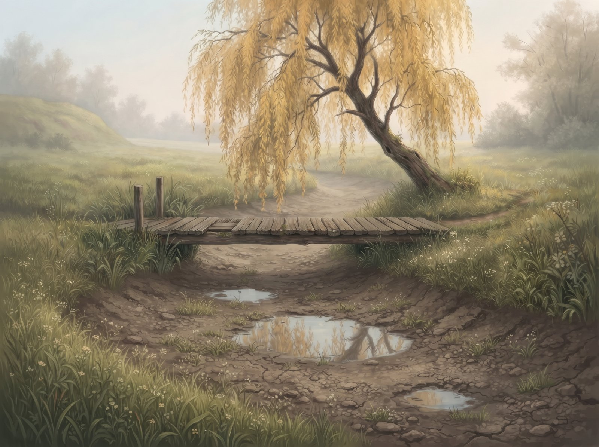

Upė Alanta tekėjo lėtai ir ramiai. Ji vingiavo per pievą didele kilpa, kad tik ilgiau pabūtų prie seno medinio lieptelio. Ten kaimo vaikai leisdavo į vandenį pušies žievės laivelius su plunksnų burėmis. Alanta nešdavo juos labai atsargiai, kad nė vienas neapsiverstų, ir palaukdavo prie posūkio, kol vaikai atbėgs krantu.

Už kalvos tekėjo kita upė, Žvelsa. Ji šokinėjo per akmenis, taškėsi purslais ir šniokštė taip, kad buvo girdėti toli toli.

Vieną dieną prie lieptelio sustojo du keliautojai. Jie nusiplovė rankas, bet į Alantą beveik nepažiūrėjo.

– Girdi Žvelsą? – tarė vienas. – Va ten tai upė! Galėtum žiūrėti visą dieną.

Keliautojai nuėjo, o Alanta pažiūrėjo į save. Lėta. Rami. Dugne snaudžia karosai. „Aš nuobodi“, – pagalvojo ji.

Nuo tada Alanta ėmė pykti ant savęs. Ji bandė šniokšti, daužėsi į akmenį, bet sukėlė tik kelis drumzlinus lašus. O kai berniukas paleido laivelį, ji net nepažiūrėjo. Stumtelėjo jį piktai, ir laivelis įstrigo nendrėse. Berniukas nuliūdęs grįžo namo.

Pavasarį Alanta patvino ir sugalvojo planą. Šalia jos kilpos ėjo senas griovys tiesiai per šlaitą. Alanta užgulė jį visa jėga, graužė žemę, vertė grumstus, kol pagaliau šovė nauju, tiesiu keliu.

Šniokšt! Purslai! Putos! Alanta lėkė greitai ir garsiai, visai kaip Žvelsa.

– Pagaliau! – džiūgavo ji.

Bet šlaitas greitai baigėsi. Vanduo vėl sulėtėjo. Alanta apsidairė: nei gluosnio, nei lieptelio, nei vaikų. Tik tušti karklai ir tyla.

Praėjo kelios savaitės. Vieną rytą prie naujojo kranto atėjo maža mergaitė su kreivu žievės laiveliu, papuoštu raudonu siūlu. Už kalvos vėl sušniokštė Žvelsa, ir Alantai suspaudė širdį. Bet ji pažiūrėjo į mergaitę, į jos mažą laivelį ir nusprendė: šiandien ji neskubės.

Alanta švelniai pagavo laivelį, pasuko jį mažame sūkuryje ir nešė lėtai, kad mergaitė spėtų bėgti pakrante. Mergaitė juokėsi, ir juokas skambėjo kaip varpelis.

Alanta vėl turėjo ką nešti. Ir suprato, kad jos lėtumas buvo ne nuobodumas, o rūpestis.

O aukščiau, kur kadaise vingiavo senoji kilpa, liko tik kelios balutės. Senasis lieptelis stovi tylus ir sausas. Gal kada nors aplink jį pražys gėlės.

