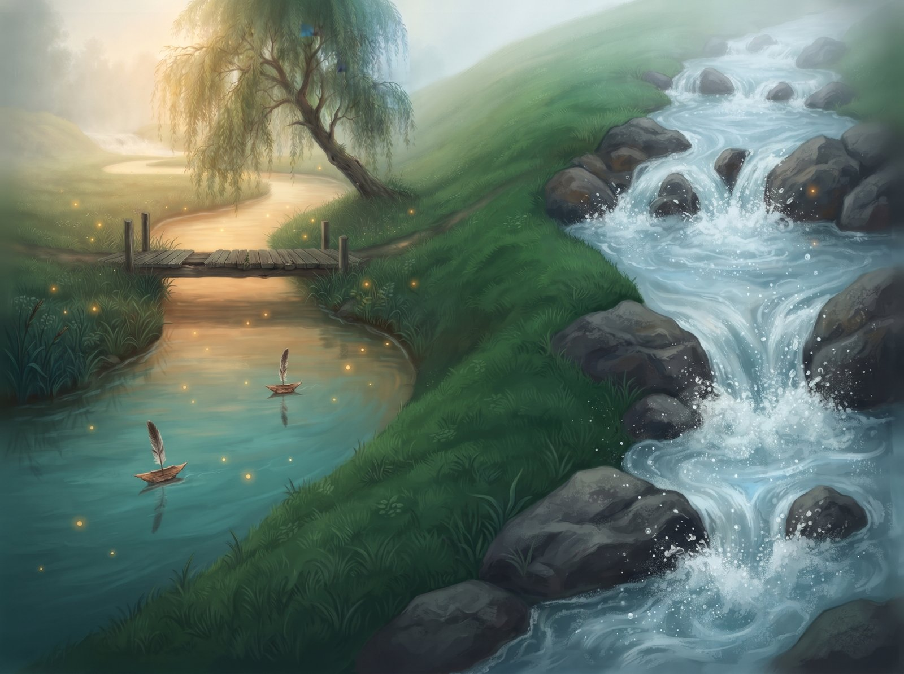
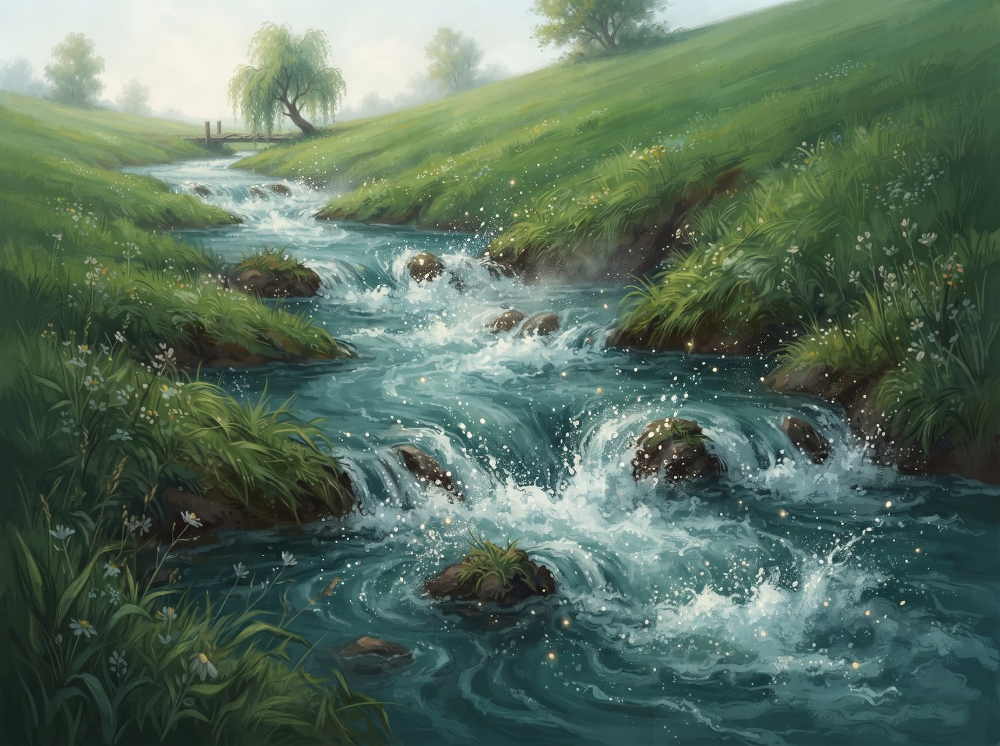
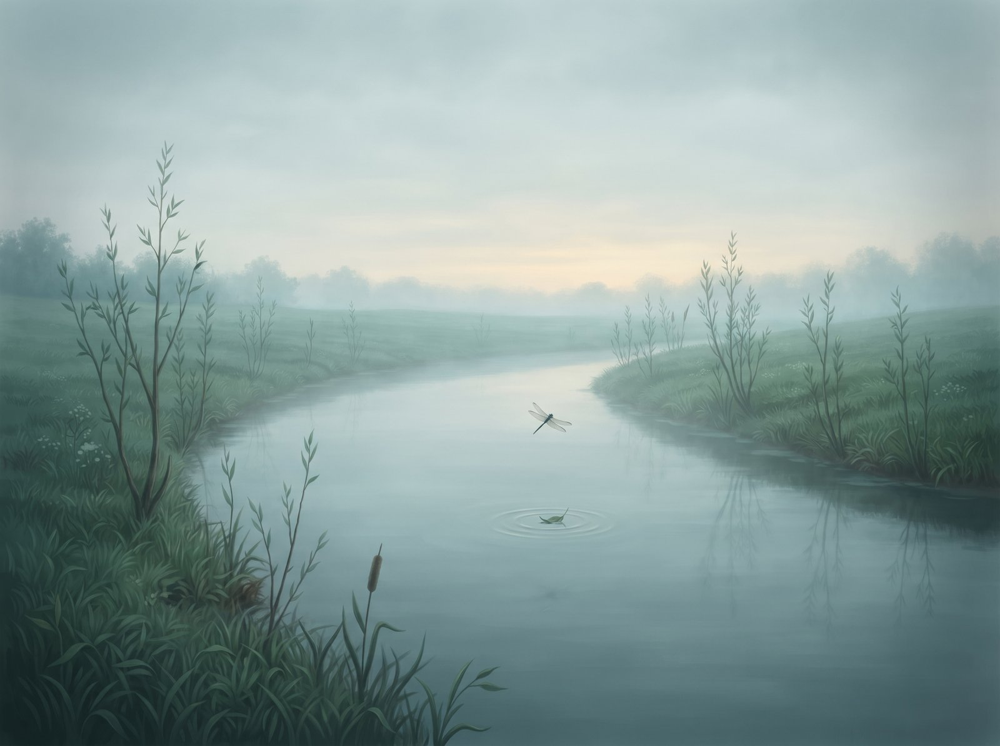
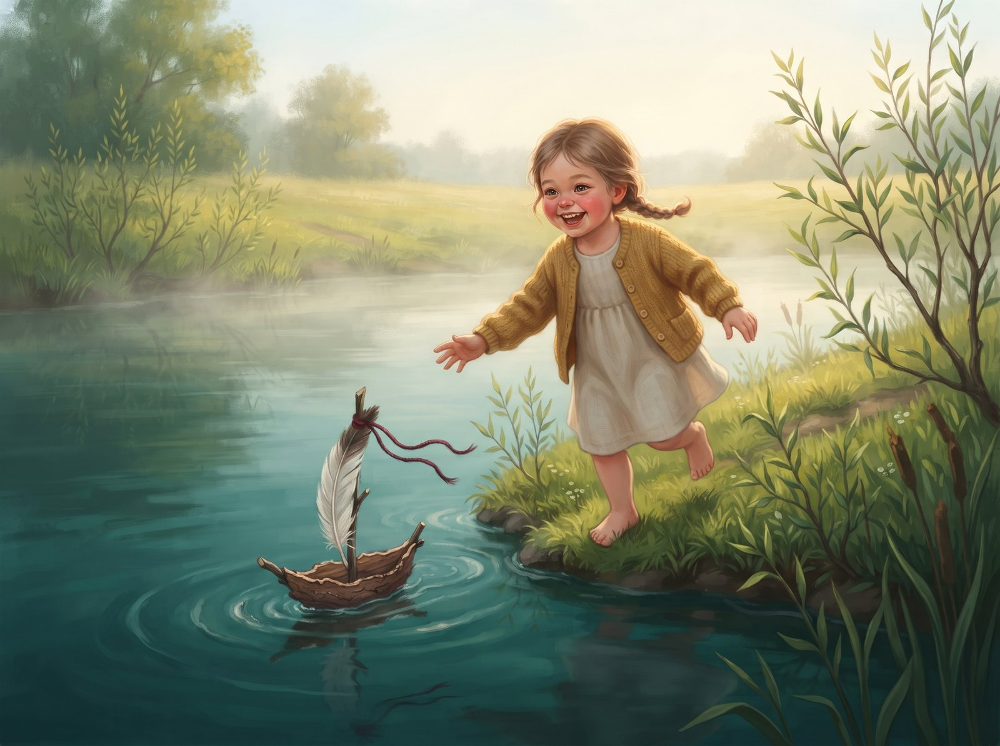

Pievoje, prie seno lieptelio, vingiavo upė Alanta. Ji tekėjo neskubėdama, nes labiausiai mėgo nešti vaikų laivelius iš pušies žievės. Alanta juos švelniai supo ir tyliai čiurleno:

– Lėtai, lėtai, laivelį nešu.

O už kalvos tekėjo kita upė, Žvelsa. Ji šokinėjo per akmenis ir šniokštė taip garsiai, kad girdėjo visas kaimas.

Vieną dieną vaikai paliko savo laivelius ir nubėgo už kalvos pažiūrėti Žvelsos. Alantai pasidarė liūdna. Ji irgi norėjo būti tokia garsi, kad visi bėgtų jos žiūrėti. Alanta pabandė pašniokšti, bet iš jos išėjo tik mažas burbuliukas. Karosas dugne net neprabudo.

Pavasarį, kai Alantoje buvo labai daug vandens, ji nutarė nebevingiuoti. Alanta pasileido tiesiai nuo kalno, kiek tik galėjo, ir šaukė:

– Greitai, greitai, nieko nenešu!

Purslai skraidė į visas puses.

Bet kalnas greitai baigėsi. Alanta sustojo ir apsidairė. Aplink buvo tylu: nei lieptelio, nei vaikų, nei laivelių. Tik vienas lapelis plaukė pasroviui. Alantai pasidarė labai liūdna.

Praėjo kelios dienos. Vieną rytą prie naujo kranto atbėgo maža mergaitė geltonu megztuku. Ji atsinešė kreivą laivelį su raudonu siūlu ant stiebo ir pliumpt! – įleido jį į vandenį.

Šį kartą Alanta neskubėjo. Ji pagavo laivelį ir nešė jį taip lėtai, kad mergaitė spėtų bėgti pakrante. Mergaitė juokėsi, o Alanta džiaugėsi, galėdama žaisti su nauja drauge, ir vėl tyliai čiurleno:

– Lėtai, lėtai, laivelį nešu.

## Pokalbiui

### Apie ką ši pasaka

Upė buvo laiminga, kol neišgirdo, kad kita upė įdomesnė. Tai pasaka apie lyginimąsi su kitais ir apie tai, kaip vienas atsitiktinis sakinys, net ne tau skirtas, gali pakeisti tai, kaip save matai. Alanta bando tapti Žvelsa ir trumpam tampa, bet praranda tai, kas jos gyvenimui teikė prasmę: lieptelį, vaikus, laivelius. Jos lėtumas buvo rūpestis kitais, tik ji to nematė, kol jo neprarado.

Antras sluoksnis yra apie sprendimus, kurių nebeatšauksi. Senoji kilpa išdžiūsta. Bet pabaiga nėra beviltiška: Alanta randa, kaip būti savimi naujoje vietoje.

Pabaigos skiriasi. 2–4 m. versijoje senosios kilpos nėra, Alanta tiesiog vėl teka lėtai. 5–8 m., 9–12 m. ir „Vyresniems“ versijose senoji vieta išdžiūsta.

### Kaip kalbėtis

Tema: aš geras toks, koks esu.

Mažiems vaikams lyginimasis tik prasideda: „jis greičiau bėga“, „jos piešinys gražesnis“. Svarbiausia, kad vaikas išgirstų, jog lėtas, tylus ir atsargus irgi gerai. Galit kartu pažaisti: pačiurlenti kaip Alanta ir pašniokšti kaip Žvelsa.

### Klausimai

- Kokia buvo Alanta, greita ar lėta? O Žvelsa?
- Kodėl mergaitė juokėsi?
- Ką tu moki daryti lėtai ir atsargiai?

Po pokalbio pagirkit vaiką už kokį nors „lėtą“ dalyką: kaip atsargiai jis paglosto katę, kaip kruopščiai stato bokštą iš kaladėlių.
