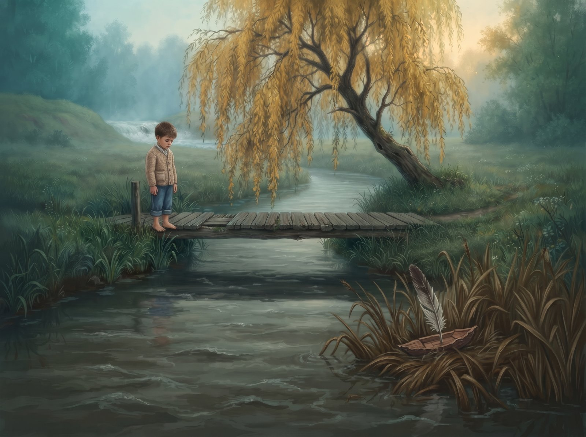
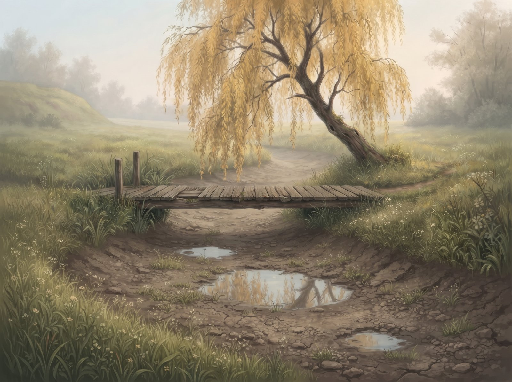

Alanta niekada nesiskubino. Ji mėgo kutenti į vandenį nusvirusias gluosnio šakas ir mėtyti ant apatinių lapų saulės zuikučius, mėgo plačia kilpa apsukti drėgną pievą vien tam, kad ilgiau pabūtų prie seno medinio lieptelio. Įkaitusios jo lentos kvepėjo sakais ir dulkėmis, o vasaromis ant jų tupėdavo kaimo vaikai ir leisdavo į vandenį pušies žievės laivelius su plunksnų burėmis. Tada Alanta sulaikydavo kvapą. Ji žinojo kiekvieną savo sūkurį ir kiekvieną akmenį, žinojo, kur laivelį pasukti, o kur leisti jam pailsėti, ir prie posūkio visada palaukdavo, kol basos pėdos spės atbėgti krantu. Niekas jos to nemokė. Ji tiesiog tokia buvo.

Už kalvos, akmenuotu tarpekliu, lėkė Žvelsa: šalta, sidabrinė, triukšminga. Kartais per vėją ji šūktelėdavo kaimynei „labas“, ir Alanta atsakydavo ramiu pliūkštelėjimu. Jos niekada nesilygino. Kam? Jos buvo skirtingos upės.

Kol vieną popietę prie lieptelio sustojo du keliautojai. Jie nusiplovė rankas, nusipurtė vandenį nuo pirštų ir pažiūrėjo pro Alantą taip, kaip žiūrima pro langą.

– Girdi Žvelsą? – tarė vienas. – Va ten tai jėga. Vanduo net verda. Galėtum žiūrėti valandų valandas.

Jie nuėjo ir po valandos tikriausiai nebeprisiminė nei to, ką sakė, nei upės, kurioje plovėsi rankas. O Alanta prisiminė.

Pirmą kartą ji pažiūrėjo į save svetimomis akimis. Maurai, lėtai linguojantys kaip pavargusios rankos. Karosai, snaudžiantys dumble. Vingis, kuris niekur neskuba. Viskas, kas vakar buvo jos, šiandien atrodė kaip trūkumų sąrašas.

Nuo tos dienos Žvelsos ūžesys, anksčiau buvęs tik kaimynės balsas, virto priekaištu. Kaskart, kai vėjas jį atnešdavo, Alantai sugeldavo šonus. Ji pyko ant savo posūkių, ant gluosnio šaknų, kurios, rodos, tyčia kabinosi į srovę ir stabdė. Kartą ji visa jėga bloškėsi į vienintelį pakrantės akmenį, tikėdamasi bent vieno balto purslo, ir pakėlė tik kelis drumzlinus lašus. Tai buvo dar blogiau nei nieko. O rudenį, kai berniukas paleido nuo lieptelio laivelį, ji nė nepažvelgė į jį. Stumtelėjo piktai, kaip stumiama tai, kas trukdo, ir laivelis įstrigo nendrėse. Berniukas ilgai stovėjo ant lieptelio. Paskui nuėjo.

Prieš pat ilgąją kilpą per pievą ėjo senas sausas griovys. Alanta jį žinojo visą gyvenimą ir niekada apie jį negalvojo. Dabar galvojo kasdien. Griovys kirto šlaitą tiesiai, be jokių vingių, ir žemiau vėl susitikdavo su jos vaga. Trumpesnis kelias. Statesnis. Toks, kokiu tekėtų Žvelsa.

Pavasarį, kai ištirpo sniegas ir vandens buvo daugiau nei bet kada, Alanta apsisprendė. Ji nepasuko į savo kilpą. Ji užgulė griovio šlaitą visu svoriu, graužė velėną, plėšė šaknis, vertė molio grumstus, ir griovys, ilgus metus buvęs tik įdubimas žolėje, pasidavė. Visa srovė su trenksmu šovė nauju keliu.

Ir tai buvo nuostabu. Krisdama stačiu šlaitu, Alanta šniokštė. Jos nugara putojo, vanduo daužėsi į ką tik atidengtus akmenis ir kėlė šaltų purslų debesis. Ji buvo greita. Ji buvo garsi. Ji pagaliau buvo tokia, kokią išgirdo keliautojų balse.

Šlaitas baigėsi greičiau, nei ji tikėjosi. Apačioje plytėjo lėkšta žemuma, ir čia vanduo išsiliejo, prarado greitį ir vėl tapo lėtas, tik dabar jau niekur. Alanta apsidairė. Aplink šiureno tušti karklynai. Nei gluosnio, nei lieptelio, nei basų pėdų. Ji vėl buvo lėta upė, tik nebeturėjo dėl ko būti lėta.

Praėjo kelios savaitės. Vieną rytą prie naujojo molėto kranto nedrąsiai priėjo mergaitė. Ji klimpo į minkštą molį, bet vis tiek pritūpė ir atsargiai įleido į vandenį kreivą žievės laivelį, papuoštą storu raudonu siūlu. Matėsi, kad laivelį ji darė pati ir ilgai. Už kalvos vėjas vėl atnešė Žvelsos ūžesį, ir Alantai suspaudė krūtinę sena, įprasta gėla. Bet ji pažiūrėjo į mergaitės veidą, susikaupusį ir šiek tiek išsigandusį, į tą mažą, taip kruopščiai išrinktą žievės gabalėlį, ir suprato, kad renkasi dar kartą. Šį kartą tyliai.

Ji švelniai pagavo laivelį. Leido jam apsisukti mažame sūkuryje, kad mergaitė nusijuoktų, ir nešė jį lėtai, pakrante, taikydamasi prie pėdų, bėgančių per žolę. Juokas skambėjo skardžiai, lyg varpelis. Ir Alanta pajuto tai, ko nebuvo jautusi nuo tos popietės prie lieptelio: kad ji kažkam reikalinga tokia, kokia yra.

Tik aukščiau slėnyje, ten, kur anksčiau vinguriavo senoji kilpa, dabar telkšojo kelios džiūstančios balutės. Senasis lieptelis po gluosniu stovėjo tylus ir sausas, pakibęs virš dugno, kuris pamažu želia žolėmis. Kai kurie keliai, kartą išgraužti, atgal nebeužželia. O kai kurie užželia visam laikui.

