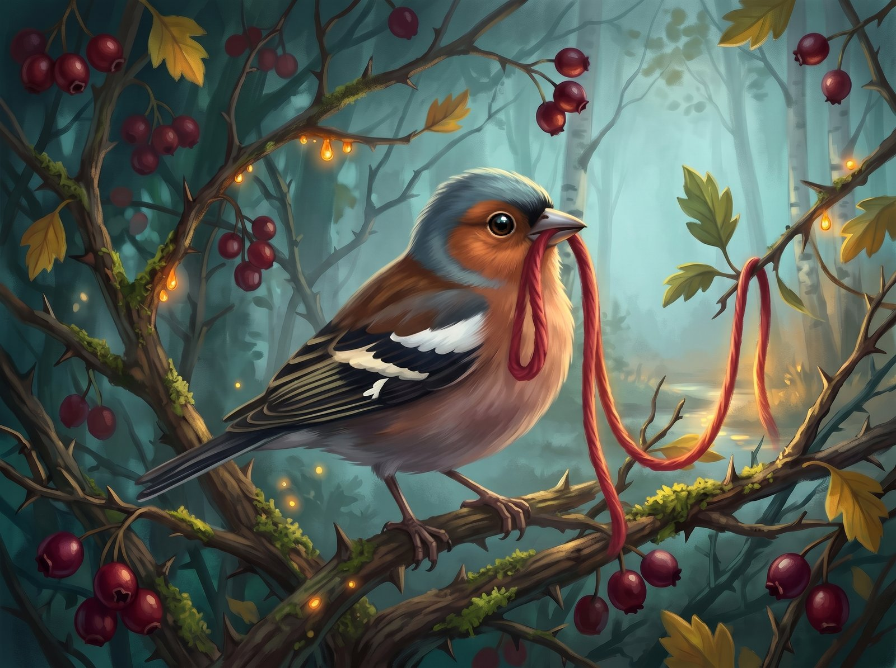
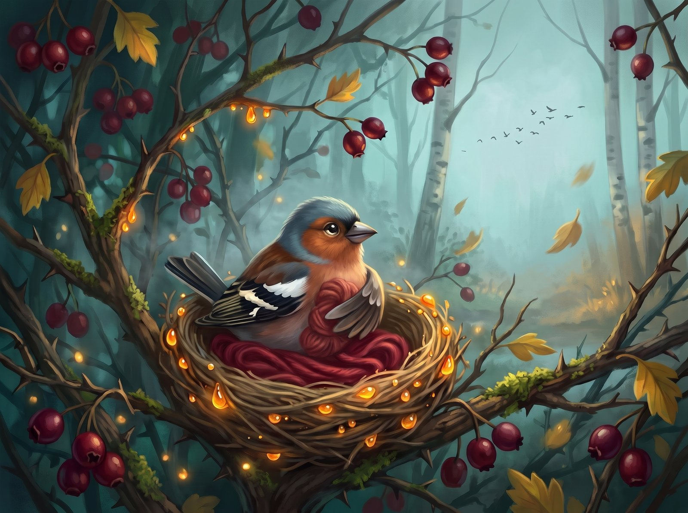
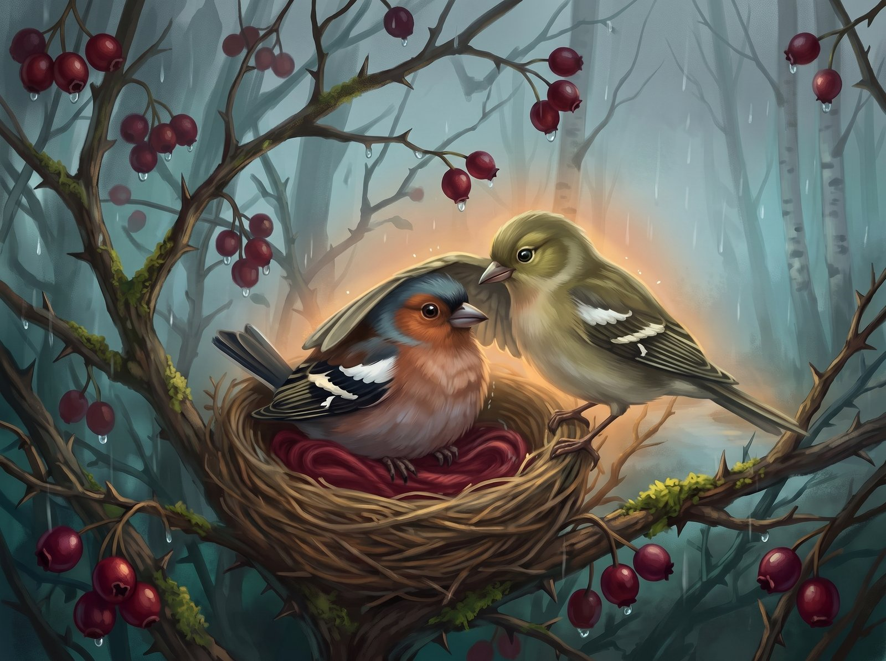
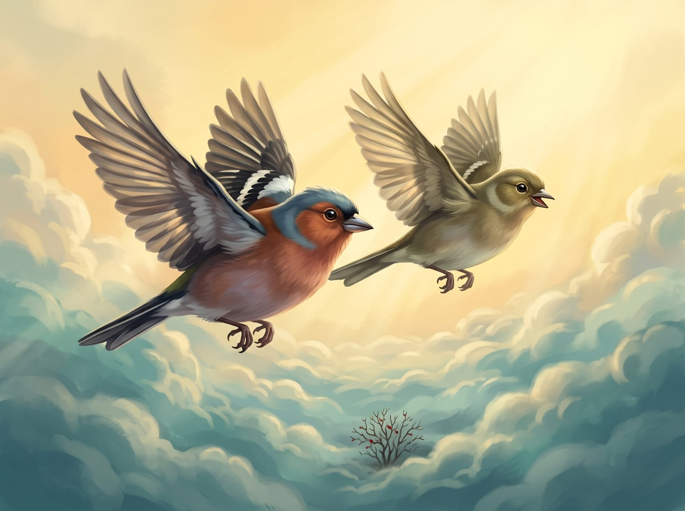

Čiūta the little chaffinch found a red thread. It was soft. It was warm.

"My thread!" chirped Čiūta, and he carried it home to his nest.

Along came his friend Guoda.

"Čiūta, let's fly to the stream!"

Čiūta shook his head.

"No. I have to look after my thread."

Flap, flap, and off went Guoda.

Then autumn came. The leaves fell down. A chilly wind blew. All the birds flew away to the warm lands.

"Čiūta, come with us!"

Čiūta hugged his thread with his wings.

"No. I have to look after my thread."

Then the rain came. The nest got wet. The thread got wet. Čiūta was cold.

And then Guoda came back.

"Čiūta, are you cold?"

"Yes," Čiūta peeped very quietly. "My thread isn't warm anymore."

Guoda tucked him in under her wing.

"Let's fly together. The sun is shining over there. It's warm over there."

Čiūta looked at his thread. Then he looked at Guoda. And he let the thread go.

Flap, flap went their wings! And the two little birds flew up, up, up, through the clouds, all the way to the warm sun.

And the red thread stayed in the bush. Maybe in spring another little bird will find it.
