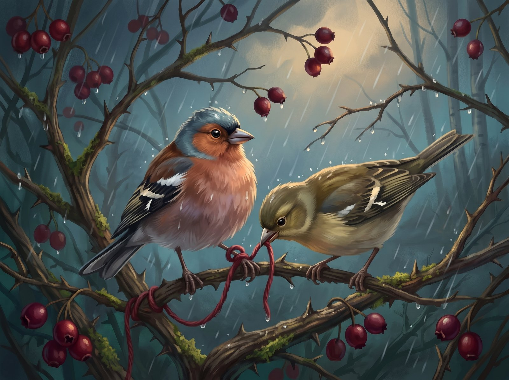
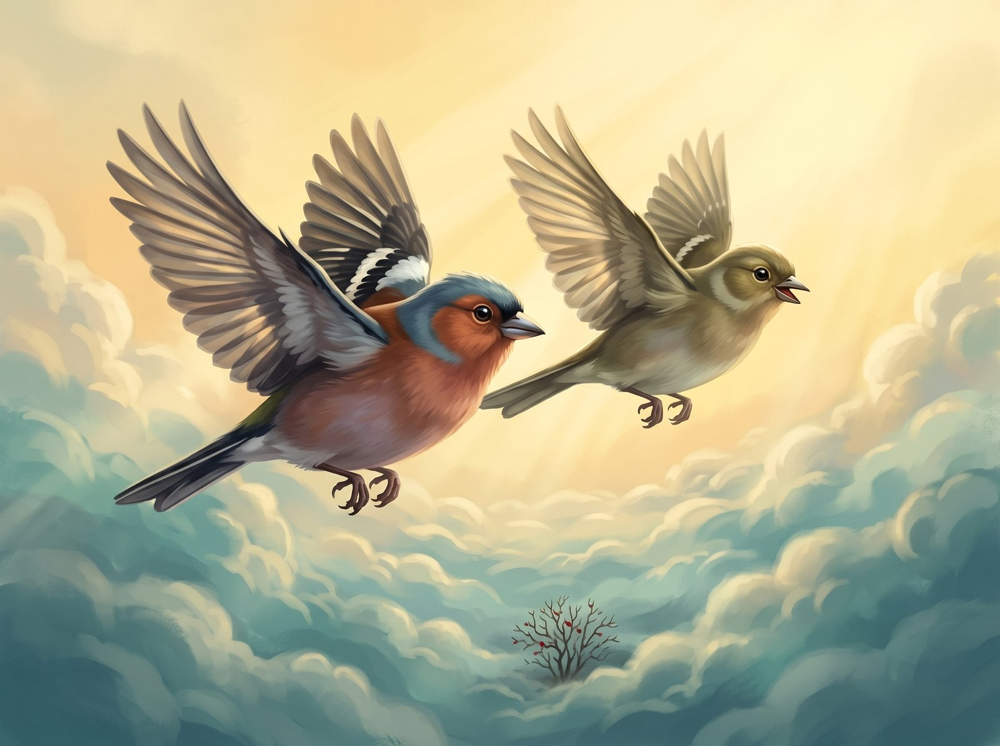

Čiūta the chaffinch loved pretty things. He collected little drops of amber tree resin and lined them up along the edge of his nest, so that in the mornings the sun would sparkle in them. Then one August day, in the hawthorn bush, he found something even prettier: a red woollen thread.

It was soft and warm, and it smelled of smoke and sheep. Čiūta wove it into the bottom of his nest and snuggled up against it.

"Now I'll never be cold again," he told himself.

In September the hawthorn berries turned dark red. The other chaffinches gathered at the tops of the birch trees and talked about the long journey to the warm lands.

"Čiūta, let's fly to the stream!" his friend Guoda called. "The water's still warm!"

Čiūta really wanted to go. He loved splashing about in the shallows. But he looked at his thread and thought: what if a jay comes along while I'm gone and steals it?

"I don't want to," said Čiūta. Even though he really, really did.

So Guoda flew off on her own. And Čiūta tied one end of the thread to a branch, so the wind couldn't blow it away.

October came, and then November. The leaves fell, and the nest went cold and stiff. Čiūta didn't fly anywhere anymore. He just sat there guarding his thread, even though it was wet now and didn't keep him warm at all. His friends flew south. Only the wind was left in the bush.

One evening a big storm blew in. The branches bent, and the rain came pouring down. Čiūta tried to fly up, but the thread had wrapped itself around his leg. The harder he pulled, the tighter it got.

"Help!" squeaked Čiūta.

And suddenly, through the rain, he heard a voice he knew.

"Čiūta! Hold on!"

It was Guoda. She hadn't flown south with the others. She had waited for her friend. Guoda landed next to him and started pecking at the wet thread. Peck, peck, peck. Snap! The thread broke.

Čiūta was free! The two little birds flew up and up, past the wet branches, past the black clouds, until they came out on top of the storm. Up there the sun was shining.

"Thank you," Čiūta said quietly. "I was so busy guarding my thread, I forgot what really keeps you warm."

Guoda laughed.

"Come on. Down south the streams stay warm all winter."

And back in the hawthorn bush, the wind rocks the red thread to and fro. Maybe in spring some little bird will find it and weave it into her new nest.
