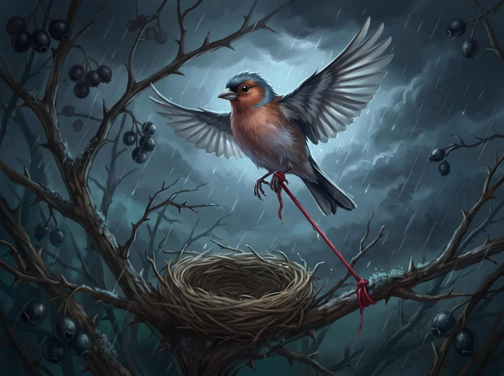
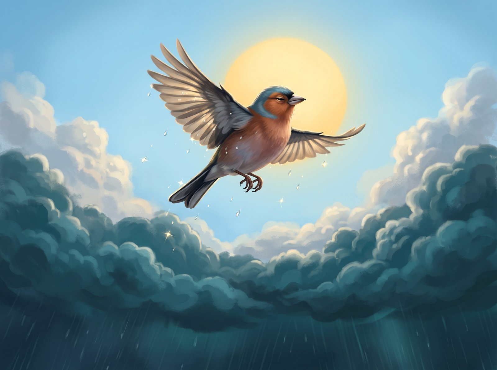

Ciuta (CHOO-ta) the chaffinch had an odd hobby. He collected drops of amber resin that had hardened on tree bark and lined them up along the edge of his nest, so that in the mornings the sunlight would break into pieces as it shone through them. But that August afternoon, when the wind brought in the first cold fog, Ciuta found something better. Caught among the thorny hawthorn branches, a red woollen thread was fluttering in the breeze.

The thread was warm, as if it was still holding on to the summer heat, and it smelled of smoke and sheep's wool. Ciuta wove it into the bottom of his nest and felt the restless flutter in his chest finally settle down. Snuggled up to that red thread, even the chilly evenings didn't seem scary anymore.

In September the hawthorn berries ripened and went dark, like dried blood. The other chaffinches were already flocking at the tops of the birches, chattering about faraway southern forests.

"Ciuta, let's fly to the stream!" his friend Guoda (GWOH-da) called one morning, cracking open a seed. "It's full of gnats, and the water's still warm!"

Ciuta's wings were already twitching, but he glanced down. The wind was ruffling the edge of the nest, and the red thread stirred. What if a jay came by while he was off splashing around, and made off with his treasure?

"You can see the flies better from up here," Ciuta lied, and he poked the end of the thread deeper between the dry grass stems.

Guoda just shrugged her wings and flew off alone. Ciuta watched her go. He loved splashing in the shallows, and the tickly feeling afterwards, when the drops dried on his tail feathers. But leaving the nest now felt way too risky. The next day, so the wind couldn't blow the thread away, he wound one end of it tightly around a hawthorn branch.

October came, then November. The bush lost its leaves and turned black, and the nest went hard and cold from the frost and fog. The wind had long since blown the resin drops off the edge of the nest, but Ciuta didn't go looking for them. He didn't even fly as far as the nearest pine anymore. He just sat there hunched up, fixing his red treasure with his beak, over and over. The damp had turned the thread dark and tangled, but Ciuta still felt that without it the cold would get right into his bones. The flocks had left long ago, and all that was left in the bush was the whistling wind.

That evening the sky came down really low. A gale started up. The branches thrashed about and kept smashing into the nest. Ciuta got scared. He shifted, tried to take off, but the loose end of the thread had wrapped itself around his left leg. He gave a tug. The wet wool didn't give an inch. It just pulled even tighter around his thin little leg.

Then the rain came down in icy sheets. A gust of wind lifted the nest and flipped it over. A heavy, soaking lump of moss and twigs fell right on top of Ciuta and pinned him against the branches. He struggled with everything he had, but every tug only pulled the loop tighter. The other end of the thread held fast to the branch. The cold and the dark squeezed the breath out of him. A sharp pain shot through his leg, and then everything went numb.

And then, with the very last of his strength, Ciuta flapped his wings. He heard a soft snap, like a tight string breaking. The weight was gone. He shot straight up, light as anything, past the wet branches, right into the black clouds. He kept climbing higher and higher, no longer feeling the wind or the sleet, until he came out above the storm. Up there the sky was clear and bright blue, and a big summer sun was warming his ruffled feathers. Ciuta spread his wings wide and flew off to where the air smelled of resin and stream water.

Down below, the storm slowly died away. In the hawthorn bush hung the overturned nest, heavy with water. From underneath it, the red woollen thread ran straight down, tied to the branch and pulled tight as a string, as if down there, in the dark, it was still holding on to something.
