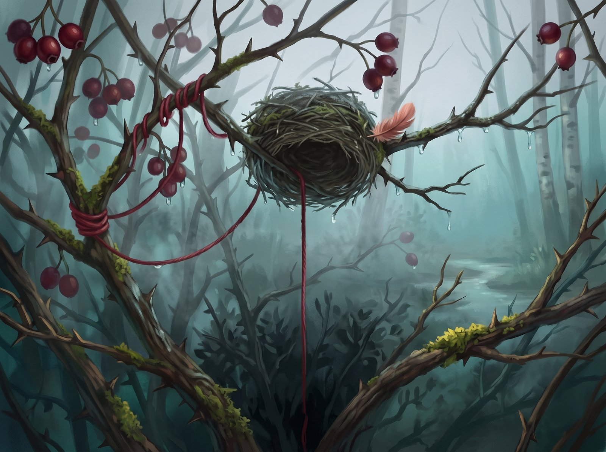

Čiūta the chaffinch loved things that hold on to light. He'd carry home drops of resin that had hardened on the pine bark and line them up along the rim of his nest, so that in the mornings the sun would break through them and scatter over his feathers like gold. That was all he owned, and not once did it cross his mind that he might ever need more.

Until, at the end of August, the wind brought in the first fog, cold as the bottom of a stream. That afternoon, among the hawthorn thorns, Čiūta spotted a red woollen thread. Who left it there, nobody knows. A shepherd, maybe, or a girl unravelling an old mitten. It smelled of smoke and sheep, and when he took it in his beak it was warm, as if summer had hidden inside it and had no plans to leave.

Čiūta wove it into the bottom of his nest. And something strange happened: the tremor in his chest, the one he'd carried for as long as he could remember, went quiet. For the first time in his life he wasn't afraid of evening coming.

In September the hawthorn berries ripened, dark as dried blood. The chaffinches flocked in the tops of the birches, and more and more often their chatter came back to one word: south.

"Čiūta, let's go to the stream!" Guoda called, shelling a seed. "The water's still warm. Might be the last time this year!"

Čiūta's wings moved. His body already knew what to do: off the branch, down, into the sunny shallows. But his eyes slid back to the nest. The end of the thread stirred in the wind, and for a moment Čiūta saw it the way someone else would: bright, visible from far off. A jay would see it. Anyone would.

"You can see the flies better from up here," he said. It was the first lie he ever told a friend, and nowhere near the last he'd tell himself.

Guoda shrugged her wings and flew off. Čiūta watched until she was just a speck. He thought about water drops, and how they tickle your tail as they dry. Then he turned away and wound one end of the thread around a branch. Twice, three times, until he was sure no wind would ever take it.

October, November. The bush dropped its leaves and turned black. The wind blew the resin drops away, but Čiūta didn't notice. He didn't fly even as far as the pine anymore, because the pine was too far from the thread. The damp had darkened it, matted it. It didn't keep him warm. Čiūta knew that. And still, every morning he fixed it, smoothed it with his beak, tucked it between the grass stems, because if he let go he'd have to admit he was cold with it too. The flocks were long gone. The wind stayed.

That night the sky came down right onto the bush. The gale threw the branches around, and they hammered at the nest like fists. Čiūta jumped up, but the loose end of the thread, the one he'd fixed so many times, wrapped itself around his leg. He pulled. The wet wool he'd taught to hold on held on.

A gust flipped the nest. A heavy, sodden clump of moss came down on top of him and pressed him into the thorns. Every beat of his wings only pulled the loop tighter, and the other end of the thread, wound around three times, didn't even budge. The cold and the dark took his breath. A pain shot through his leg, and then everything went numb.

And then Čiūta flapped one last time. He heard a soft snap, like a tight string breaking. The weight was gone. He shot up through the wet branches, through the black clouds, no longer feeling the wind or the sleet, until he came out where there was no storm. The sky lay open and clear, and a big summer sun, the same sun he used to catch in his drops of resin, was warming his feathers. There was nothing left to guard. Čiūta spread his wings and flew off to where the air smelled of resin and stream water.

Down below, the storm slowly settled. In the hawthorn bush hung the overturned nest, heavy with water. From underneath it the red woollen thread ran straight down, tied fast to the branch and pulled tight as a string, as if down there, in the dark, it was still holding on to something.

