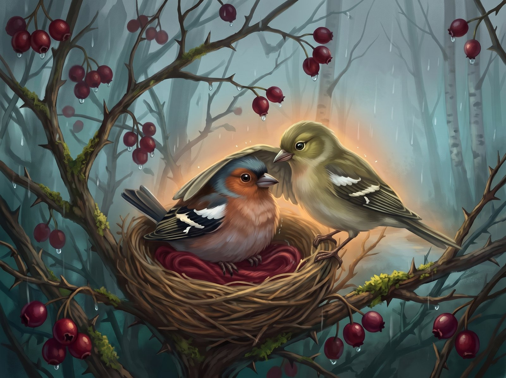
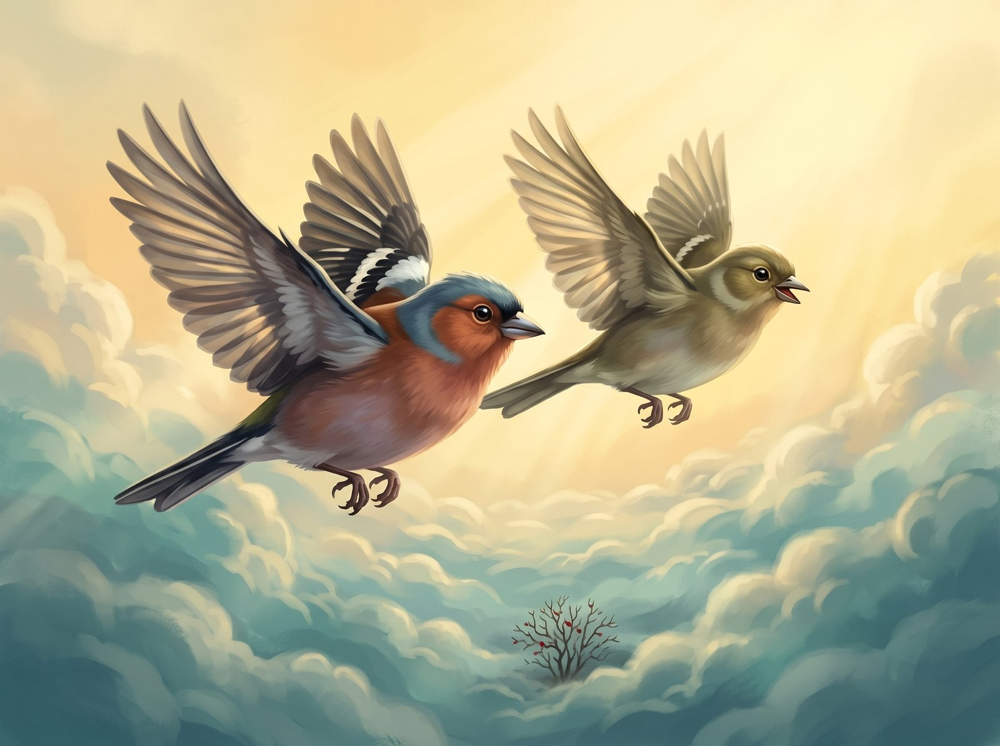

Gudobelės krūme gyveno kikilis Čiūta. Rytais Čiūta šokinėjo nuo šakos ant šakos, strikt, strikt, ir dainavo: čiū-čiū-čiūta!

Vieną dieną ant spygliuko Čiūta rado siūlą. Raudoną kaip uogelė, minkštą kaip plunksnelė. Čiūta apsivyniojo siūlu kojytę, o kas liko, tuo papuošė uodegą. Čiūtai buvo šilta ir gera.

Atskrido draugė Guoda.

– Čiūta, skrendam prie upelio!

Čiūta papurtė galvą.

– Negaliu. Saugau savo siūlą.

Atėjo ruduo. Lapai geltonavo ir krito. Paukščiai susirinko į didelį būrį.

– Čiūta, skrisk su mumis į šiltus kraštus!

Čiūta prispaudė siūlą prie savęs.

– Negaliu... saugau siūlą.

Paukščiai išskrido, ir Čiūtai pasidarė liūdna.

Paskui ėmė lyti. Sušlapo siūlas, sušlapo Čiūtos plunksnelės. Čiūtai buvo šalta, ir jis susigūžė į mažą kamuoliuką.

Per lietų atskrido Guoda. Ji neišskrido su būriu, ji laukė draugo. Guoda apkabino Čiūtą sparnu.

– Skrendam kartu. Ten šilta ir šviečia saulė.

Čiūta pažiūrėjo į siūlą. Paskui į Guodą.

– Galiu, – tyliai pasakė Čiūta. – Skrendam!

Plast, plast! Du paukščiukai pakilo aukštai aukštai, pro debesis, į saulę.

Toli apačioje liko gudobelių krūmas, o krūme – raudonas siūlas. Gal pavasarį jį ras mažas paukštelis, kuriam reikės šilumos.
