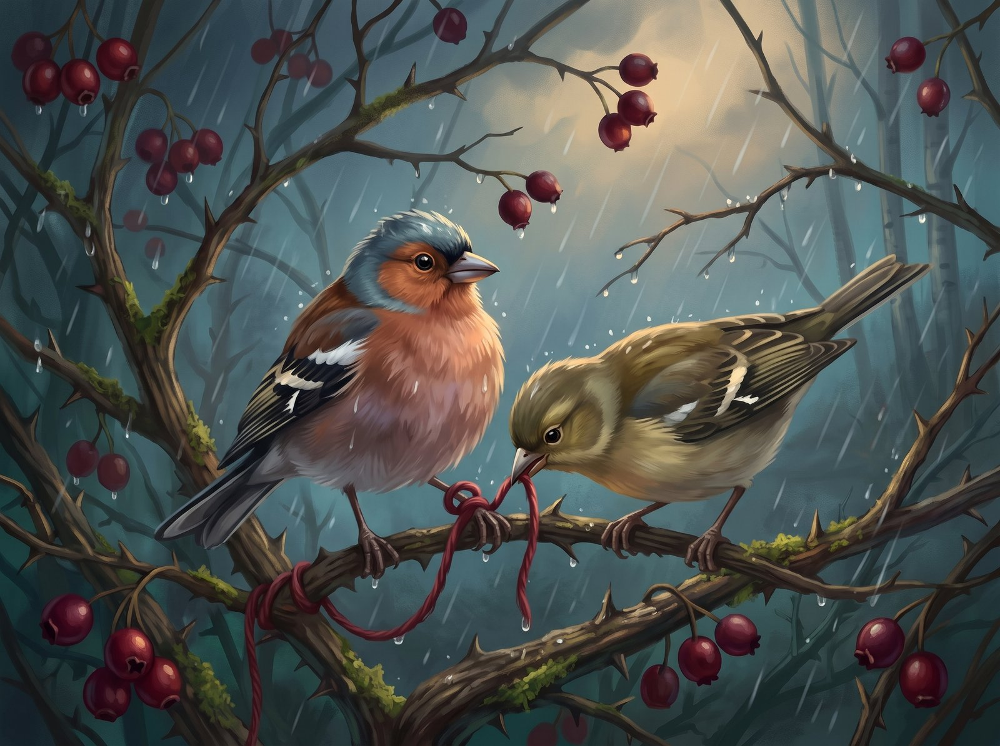
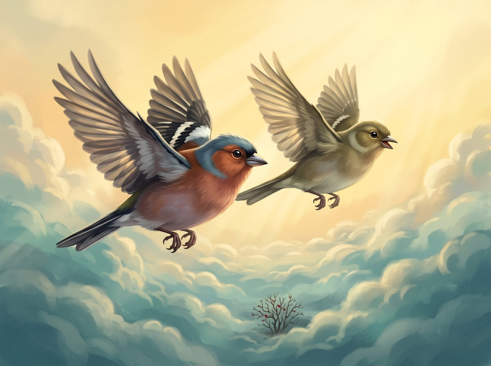

Kikilis Čiūta mėgo gražius daiktus. Jis rinkdavo gintarinius sakų lašelius ir dėliodavo juos ant lizdo krašto, kad rytais juose žibėtų saulė. Vieną rugpjūčio dieną gudobelės krūme jis rado kai ką dar gražesnio: raudoną vilnonį siūlą.

Siūlas buvo minkštas ir šiltas, kvepėjo dūmais ir avimi. Čiūta įpynė jį į lizdo dugną ir prisiglaudė.

– Dabar man niekada nebus šalta, – pasakė jis sau.

Rugsėjį gudobelės uogos nusidažė tamsiai raudonai. Kiti kikiliai rinkosi beržų viršūnėse ir kalbėjo apie ilgą kelionę į šiltus kraštus.

– Čiūta, skrendam prie upelio! – pašaukė draugė Guoda. – Vanduo dar šiltas!

Čiūta labai norėjo. Jis mėgo taškytis seklumoje. Bet pažiūrėjo į siūlą ir pagalvojo: o jeigu, kol manęs nebus, atskris kėkštas ir jį pavogs?

– Nenoriu, – pasakė Čiūta. Nors iš tikrųjų labai norėjo.

Guoda nuskrido viena. O Čiūta, kad vėjas siūlo neišneštų, vieną jo galą pririšo prie šakos.

Atėjo spalis, paskui lapkritis. Lapai nukrito, lizdas sušalo ir sukietėjo. Čiūta niekur nebeskraidė. Jis tupėjo ir saugojo siūlą, nors siūlas jau buvo šlapias ir nebešildė. Draugai išskrido. Krūme liko tik vėjas.

Vieną vakarą pakilo didelė audra. Šakos linko, lietus pliaupė. Čiūta norėjo pakilti, bet siūlas apsivijo jo kojelę. Kuo labiau jis traukė, tuo stipriau siūlas veržė.

– Pagalbos! – sucypė Čiūta.

Ir staiga per lietų išgirdo pažįstamą balsą.

– Čiūta! Laikykis!

Tai buvo Guoda. Ji neišskrido su kitais, ji laukė savo draugo. Guoda nutūpė šalia ir ėmė kapoti šlapią siūlą. Kap, kap, kap. Pokšt! Siūlas trūko.

Čiūta laisvas! Abu paukščiukai pakilo aukštyn, pro šlapias šakas, pro juodus debesis, kol išniro virš audros. Ten švietė saulė.

– Ačiū, – tyliai pasakė Čiūta. – Aš taip saugojau siūlą, kad pamiršau, kas iš tikrųjų šildo.

Guoda nusijuokė.

– Skrendam. Pietuose upeliai šilti visą žiemą.

O gudobelės krūme vėjas linguoja raudoną siūlą. Gal pavasarį jį ras kokia paukštelė ir įsipins į savo naują lizdą.
