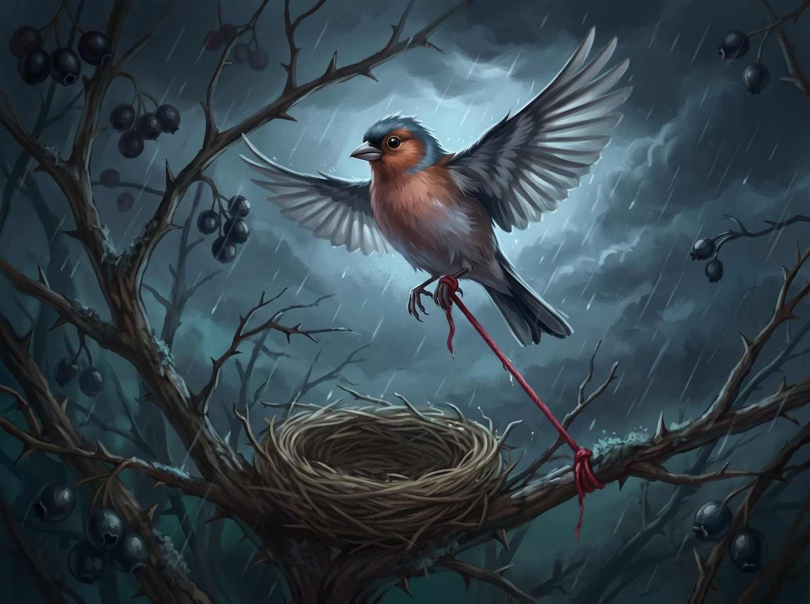
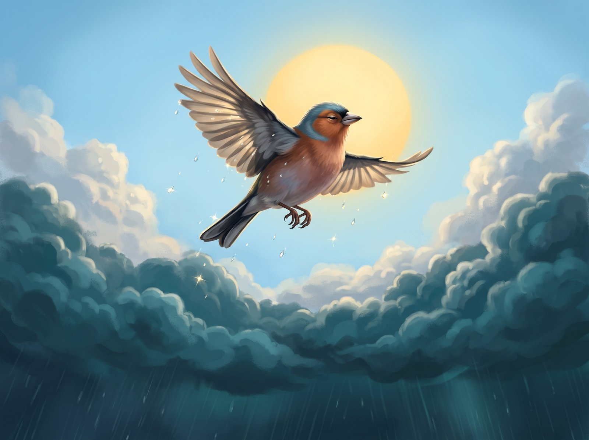

Kikilis Čiūta turėjo keistą pomėgį. Jis rinkdavo ant žievės sustingusius gintarinius sakų lašelius ir dėliodavo juos ant lizdo krašto, kad rytais per juos lūžtų saulės šviesa. Tačiau tą rugpjūčio popietę, kai vėjas pirmą kartą atpūtė šalto rūko, Čiūta rado kai ką geresnio. Tarp dygliuotų gudobelės šakų plevėsavo raudonas vilnonis siūlas.

Siūlas buvo šiltas, tarsi savyje vis dar laikytų vasaros kaitrą, ir kvepėjo dūmais bei avies vilna. Čiūta įpynė jį į lizdo dugną ir pajuto, kaip krūtinėje nurimsta neramus virpulys. Prisiglaudus prie raudonos gijos, net vėstantys vakarai nebeatrodė baisūs.

Rugsėjį gudobelės uogos prisirpo ir patamsėjo lyg sukrešėjęs kraujas. Kiti kikiliai jau būriavosi beržų viršūnėse ir čiauškėjo apie tolimus pietų miškus.

– Čiūta, skrendam prie upelio! – vieną rytą pašaukė draugė Guoda, vikriai lukštendama sėklą. – Ten pilna uodų, o vanduo dar šiltas!

Čiūta jau sujudino sparnus, bet žvilgtelėjo žemyn. Vėjas kedeno lizdo kraštą, ir raudonas siūlas krustelėjo. O jeigu, kol jis maudysis, atskris kėkštas ir nutemps jo lobį?

– Iš čia geriau matyti muses, – pamelavo Čiūta ir snapu giliau įspraudė siūlo galą tarp sausų smilgų.

Guoda tik gūžtelėjo sparnais ir nuplasnojo viena. Čiūta palydėjo ją akimis. Jis labai mėgo taškytis seklumoje, o paskui jausti, kaip lašai džiūdami kutena uodegą. Bet palikti lizdą dabar atrodė per daug pavojinga. Kitą dieną, kad vėjas siūlo neišpūstų, jis vieną jo galą tvirtai apvyniojo aplink gudobelės šaką.

Atėjo spalis, paskui lapkritis. Krūmas nuplikęs pajuodo, o lizdas nuo šalnų ir rūko pasidarė kietas ir šaltas. Sakų lašelius nuo lizdo krašto seniai nupūtė vėjas, bet Čiūta jų nebeieškojo. Jis nebeskrido net iki artimiausios pušies. Tik tupėjo susigūžęs ir vis taisė snapu savo raudonąjį turtą. Siūlas nuo drėgmės patamsėjo ir susivėlė, tačiau Čiūtai vis dar atrodė, kad be jo šaltis persmelks iki kaulų. Būriai seniai buvo išskridę, ir krūme liko tik vėjo švilpimas.

Tą vakarą dangus nusileido visai žemai. Pakilo vėtra. Šakos blaškėsi ir daužė lizdą. Čiūta išsigando, pasimuistė, bandė pakilti, bet laisvasis siūlo galas apsivijo jo kairę kojelę. Paukštelis trūktelėjo. Šlapia vilna nepasidavė, tik dar stipriau susiveržė aplink ploną blauzdelę.

Lietus pliūptelėjo ledinėmis čiurkšlėmis. Vėjo gūsis kilstelėjo lizdą ir apvertė. Sunkus, permirkęs samanų ir šakelių gniužulas užgriuvo tiesiai ant Čiūtos ir prispaudė jį prie šakų. Paukštelis spurdėjo iš visų jėgų, bet kiekvienas trūktelėjimas tik labiau veržė kilpą. Kitas siūlo galas tvirtai laikėsi prie šakos. Šaltis ir tamsa užgniaužė kvapą. Kojelę nudiegė aštrus skausmas, paskui viskas aptirpo.

Ir tada Čiūta iš paskutiniųjų suplasnojo. Jam pasigirdo tylus pokštelėjimas, tarsi trūktų įtempta styga. Sunkumas dingo. Paukštelis lengvai šovė į viršų, pro šlapias šakas, tiesiai į juodus debesis. Jis kilo vis aukštyn, nebejausdamas nei vėjo, nei šlapdribos, kol išniro virš audros. Ten plytėjo vaiskus žydras dangus, o didelė vasaros saulė šildė pašiauštas plunksnas. Čiūta plačiai išskleidė sparnus ir nuskrido ten, kur kvepėjo sakais ir upelio vandeniu.

O apačioje vėtra pamažu rimo. Gudobelės krūme kabojo apvirtęs, nuo vandens sunkus lizdas. Iš po jo žemyn driekėsi raudonas vilnonis siūlas, prikabintas prie šakos ir įsitempęs lyg styga, tarsi apačioje, tamsoje, vis dar kažką laikytų.
